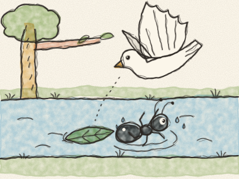
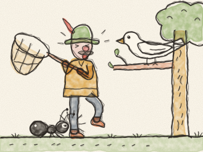

# La Colombe et la Fourmi

Par une chaude journée d’été, une petite Fourmi noire avait très soif. Elle descendit jusqu’à la rivière pour boire. *Tip-tap, tip-tap.* Elle se pencha au-dessus de l’eau, un peu, encore un peu… et — *plouf !* — elle tomba dedans.

« Au secours ! Au secours ! » cria la Fourmi. L’eau tournait, tournait, et l’emportait. Elle agitait ses toutes petites pattes, mais la rivière était beaucoup trop grande.

Tout en haut d’un arbre se tenait une Colombe blanche. Elle vit la petite Fourmi dans l’eau. « Oh là là ! » roucoula la Colombe. « Il faut que je l’aide ! » Elle cueillit une feuille avec son bec, descendit en volant et la laissa tomber sur l’eau, juste à côté de la Fourmi. *Plop !*

La Fourmi grimpa sur la feuille. La feuille flotta, doucement, doucement, jusqu’au bord de la rivière. La Fourmi sauta sur l’herbe sèche. « Merci, Colombe ! » cria-t-elle. « Tu m’as sauvée ! »

Quelques jours plus tard, un chasseur arriva à pas de loup entre les arbres, avec un grand filet. *Chut…* Il avait vu la Colombe sur sa branche, et il voulait l’attraper. Il leva son filet, tout doucement…

Mais la petite Fourmi le vit. « Ah non, pas question ! » dit-elle. Elle courut jusqu’à son pied et — *pic !* — elle le piqua à la cheville, aussi fort qu’elle put.

« AÏE ! » cria le chasseur en sautant à cloche-pied. Le filet tomba par terre. La Colombe entendit le bruit, ouvrit ses ailes — *flap, flap, flap !* — et s’envola, sauve et libre.

Ce soir-là, la Colombe revint au bord de la rivière. Elle se posa sur une branche basse, la petite Fourmi s’assit sur une feuille juste en dessous, et elles regardèrent ensemble le soleil se coucher.

> Un bienfait n’est jamais perdu. Et le plus petit des amis peut aider le plus grand.
