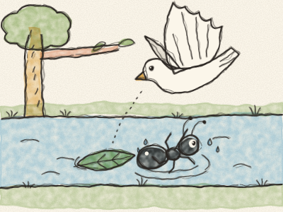
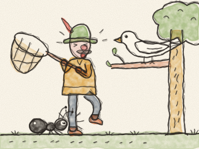

# A Pomba e a Formiga

Num dia quente de verão, uma Formiguinha preta estava cheia de sede. Desceu até ao rio para beber. *Tip-tap, tip-tap.* Debruçou-se sobre a água, um bocadinho, mais um bocadinho… e — *chape!* — caiu lá dentro.

— Socorro! Socorro! — gritou a Formiga. A água andava à roda, à roda, e levava-a para longe. Ela mexia as perninhas, mas o rio era grande demais.

Lá no alto de uma árvore estava uma Pomba branca. Viu a Formiguinha na água. — Ai, coitadinha! — arrulhou a Pomba. — Tenho de a ajudar! — Arrancou uma folha com o bico, desceu a voar e deixou-a cair na água, mesmo ao lado da Formiga. *Plop!*

A Formiga subiu para a folha. A folha flutuou, devagarinho, devagarinho, até à margem do rio. A Formiga saltou para a relva seca. — Obrigada, Pomba! — gritou ela. — Salvaste-me!

Alguns dias depois, um caçador apareceu entre as árvores, pé ante pé, com uma grande rede. *Chiu…* Tinha visto a Pomba no seu ramo e queria apanhá-la. Levantou a rede, muito devagar…

Mas a Formiguinha viu-o. — Ai, isso é que não! — disse ela. Correu até ao pé dele e — *pic!* — ferrou-lhe no tornozelo, com toda a força que tinha.

— AI! — gritou o caçador, aos saltos num pé só. A rede caiu ao chão. A Pomba ouviu o barulho, abriu as asas — *flap, flap, flap!* — e voou para longe, salva e livre.

Nessa tarde, a Pomba voltou ao rio. Pousou num ramo baixinho, a Formiguinha sentou-se numa folha mesmo por baixo, e as duas ficaram a ver o sol a pôr-se.

> Uma boa ação nunca se perde. E até o amigo mais pequenino pode ajudar o maior.
