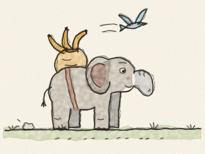
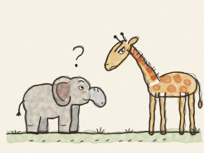
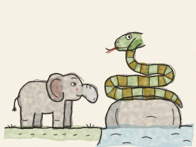
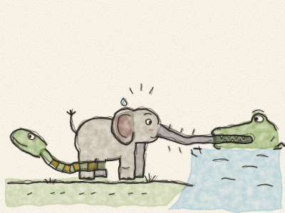
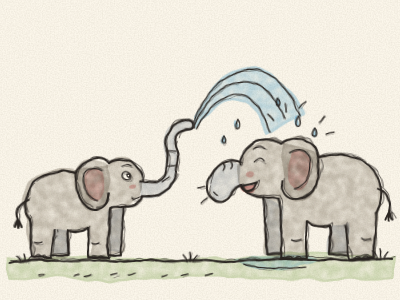

# The Elephant’s Child

A long, long time ago, elephants had no trunks. They only had a short, bulgy nose, about the size of a boot. They could wiggle it from side to side, but they couldn’t pick anything up with it.

And there was one little elephant, the Elephant’s Child, who was full of questions. Full! He asked questions all day long, and all night too.

He asked the tall Ostrich, “Why do your feathers grow just so?” He asked the tall Giraffe, “What makes your spots so spotty?” He asked the big Hippopotamus, “Why are your eyes so red?”

And every time, they all said, “Hush! Little elephants should not ask so many questions!” But the Elephant’s Child just went on asking.

One fine morning, he asked a brand-new question, one he had never asked before. “What does the Crocodile have for dinner?”

“HUSH!” said everybody at once, very loudly.

So the Elephant’s Child went to see the Kolokolo Bird, who was sitting in the middle of a thorn bush. “Please, Kolokolo Bird,” he said, “what does the Crocodile have for dinner?”

The Kolokolo Bird sang, “Go to the banks of the great grey-green, greasy Limpopo River, all set about with fever-trees, and find out!”

So the Elephant’s Child packed a hundred bananas, a hundred sticks of sugar cane and seventeen melons, said “Goodbye, everyone!” and set off. *Plod, plod, plod.* He walked and walked, eating melons and dropping the rinds, because he couldn’t pick them up.

At last he came to the great grey-green, greasy Limpopo River, all set about with fever-trees. On a rock lay the Bi-Coloured-Python-Rock-Snake, curled round and round.

“Excuse me,” said the Elephant’s Child politely, “have you seen the Crocodile?”

“Look down there,” hissed the Python. *Sssss.*

The Elephant’s Child looked down, and saw a log in the water. But the log winked one eye.

“Come here, little one,” said the log, very softly. “I am the Crocodile. Come closer, and I’ll whisper the answer.”

The Elephant’s Child leaned down… and *SNAP!* The Crocodile caught him by his little nose!

“I think,” said the Crocodile between his teeth, “that today I will start with a little elephant!”

“Led go! You are hurtig be!” cried the Elephant’s Child, through his squashed nose.

The Crocodile pulled. The Elephant’s Child pulled. And his nose began to stretch. The Python slid down, wrapped himself round the Elephant’s Child’s back legs, and pulled too. *Heave! Heave! HEAVE!*

The Elephant’s Child’s nose stretched, and stretched, and stretched… until, *PLOP!*, the Crocodile let go and fell back into the river with a great splash.

The Elephant’s Child sat down and looked at his nose. It wasn’t short any more. It was long, very long, almost down to his toes: a trunk!

At first he was sad. But then a fly landed on his back, and *swish!*, he brushed it away with his trunk. He felt hungry, and he picked a bunch of grass with his trunk. He felt hot, and he scooped up some cool water and *sploosh!* poured it on his head.

“Thank you, Python!” he said. “This is wonderful!”

He went home and sprayed his whole family with water, *Splash! Splash!*, until they all laughed. And then, one by one, all the elephants went off to the Limpopo River to get long trunks too.

> Questions are good: keep asking, and keep finding out! Just be careful who you ask.
