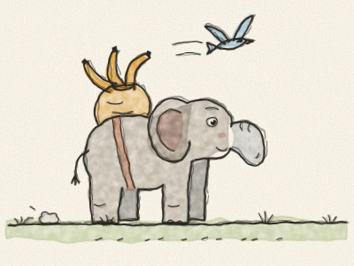
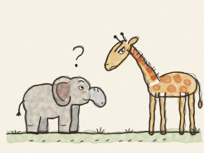
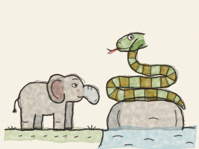
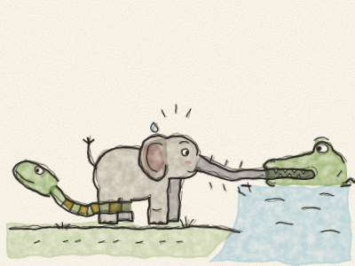
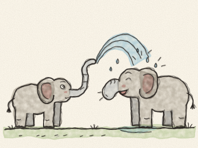

# L’Enfant d’Éléphant

Il y a très, très longtemps, les éléphants n’avaient pas de trompe. Ils avaient juste un petit nez bombé, de la taille d’une botte. Ils pouvaient le remuer de droite à gauche, mais ils ne pouvaient rien attraper avec.

Et il y avait un petit éléphant, l’Enfant d’Éléphant, qui était plein de questions. Plein ! Il posait des questions toute la journée, et toute la nuit aussi.

Il demandait à la grande Autruche : « Pourquoi tes plumes poussent-elles comme ça ? » Il demandait à la grande Girafe : « Qu’est-ce qui rend tes taches si tachetées ? » Il demandait au gros Hippopotame : « Pourquoi as-tu les yeux si rouges ? »

Et chaque fois, tous répondaient : « Chut ! Les petits éléphants ne doivent pas poser tant de questions ! » Mais l’Enfant d’Éléphant continuait de demander.

Un beau matin, il posa une question toute neuve, une question qu’il n’avait jamais posée. « Qu’est-ce que le Crocodile mange au dîner ? »

« CHUT ! » dirent-ils tous en même temps, très fort.

Alors l’Enfant d’Éléphant alla voir l’oiseau Kolokolo, perché au milieu d’un buisson d’épines. « S’il te plaît, oiseau Kolokolo, qu’est-ce que le Crocodile mange au dîner ? »

L’oiseau Kolokolo chanta : « Va sur les rives du grand fleuve Limpopo, gris-vert et tout gras, bordé d’arbres à fièvre, et tu le sauras ! »

Alors l’Enfant d’Éléphant prit cent bananes, cent bâtons de canne à sucre et dix-sept melons, dit « Au revoir, tout le monde ! » et partit. *Pom, pom, pom.* Il marcha, marcha, en mangeant des melons et en laissant tomber les écorces, parce qu’il ne pouvait pas les ramasser.

Enfin, il arriva au grand fleuve Limpopo, gris-vert et tout gras, bordé d’arbres à fièvre. Sur un rocher était couché le Python-Bicolore-des-Rochers, enroulé sur lui-même.

« Excusez-moi », dit poliment l’Enfant d’Éléphant, « avez-vous vu le Crocodile ? »

« Regarde là, en bas », siffla le Python. *Sssss.*

L’Enfant d’Éléphant regarda en bas et vit un tronc d’arbre dans l’eau. Mais le tronc cligna d’un œil.

« Viens ici, petit », dit le tronc, tout doucement. « Je suis le Crocodile. Approche-toi, et je te chuchoterai la réponse. »

L’Enfant d’Éléphant se pencha… et *CLAC !* Le Crocodile l’attrapa par son petit nez !

« Je crois », dit le Crocodile entre ses dents, « qu’aujourd’hui je vais commencer par un petit éléphant ! »

« Lâche-boi ! Tu be fais bal ! » cria l’Enfant d’Éléphant, avec son nez tout écrasé.

Le Crocodile tira. L’Enfant d’Éléphant tira. Et son nez commença à s’allonger. Le Python glissa jusqu’en bas, s’enroula autour des pattes arrière de l’Enfant d’Éléphant, et tira lui aussi. *Ho hisse ! Ho hisse ! HO HISSE !*

Le nez de l’Enfant d’Éléphant s’allongea, s’allongea, s’allongea… jusqu’à ce que, *PLOP !*, le Crocodile lâche prise et retombe dans le fleuve dans un grand plouf.

L’Enfant d’Éléphant s’assit et regarda son nez. Il n’était plus court du tout. Il était long, très long, presque jusqu’à ses pieds : une trompe !

D’abord, il fut triste. Mais une mouche se posa sur son dos et, *fouit !*, il la chassa avec sa trompe. Il eut faim, et il cueillit une touffe d’herbe avec sa trompe. Il eut chaud, et il aspira un peu d’eau fraîche et, *splouch !*, se la versa sur la tête.

« Merci, Python ! » dit-il. « C’est merveilleux ! »

Il rentra chez lui et arrosa toute sa famille, *Splash ! Splash !*, jusqu’à ce que tout le monde rie. Et puis, un par un, tous les éléphants partirent au fleuve Limpopo pour avoir eux aussi une longue trompe.

> Les questions, c’est bien : continue de demander et de chercher ! Fais juste attention à qui tu demandes.
