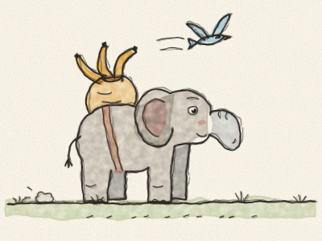
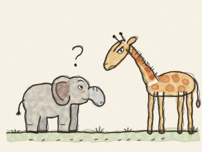
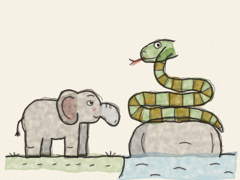
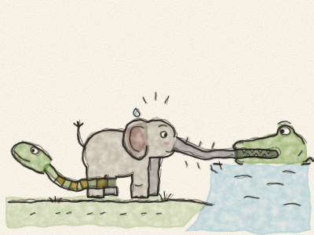
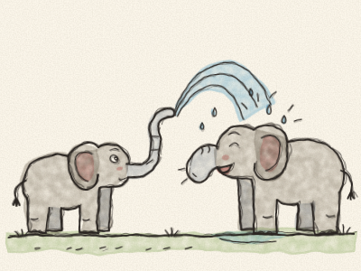

# O Filho do Elefante

Há muito, muito tempo, os elefantes não tinham tromba. Tinham só um narizinho curto e redondo, do tamanho de uma bota. Conseguiam abaná-lo de um lado para o outro, mas não conseguiam apanhar nada com ele.

E havia um elefantezinho, o Filho do Elefante, que estava cheio de perguntas. Cheio! Fazia perguntas o dia inteiro, e a noite inteira também.

Perguntava à alta Avestruz: — Porque é que as tuas penas crescem assim? Perguntava à alta Girafa: — O que é que faz as tuas manchas tão manchadas? Perguntava ao grande Hipopótamo: — Porque é que tens os olhos tão vermelhos?

E de todas as vezes, todos respondiam: — Chiu! Os elefantes pequenos não devem fazer tantas perguntas! Mas o Filho do Elefante continuava a perguntar.

Numa bela manhã, fez uma pergunta novinha em folha, uma pergunta que nunca tinha feito. — O que é que o Crocodilo come ao jantar?

— CHIU! — disseram todos ao mesmo tempo, muito alto.

Então o Filho do Elefante foi ter com o pássaro Kolokolo, que estava pousado no meio de um arbusto de espinhos. — Por favor, pássaro Kolokolo, o que é que o Crocodilo come ao jantar?

O pássaro Kolokolo cantou: — Vai até às margens do grande rio Limpopo, cinzento-esverdeado e oleoso, rodeado de árvores-da-febre, e descobre!

Então o Filho do Elefante levou cem bananas, cem paus de cana-de-açúcar e dezassete melões, disse «Adeus a todos!» e partiu. *Pum, pum, pum.* Andou e andou, a comer melões e a deixar cair as cascas, porque não as conseguia apanhar.

Por fim, chegou ao grande rio Limpopo, cinzento-esverdeado e oleoso, rodeado de árvores-da-febre. Numa rocha estava deitada a Cobra-Pitão-Bicolor-das-Rochas, enrolada às voltas.

— Desculpe — disse o Filho do Elefante, com boas maneiras —, viu o Crocodilo?

— Olha ali em baixo — silvou a Pitão. *Sssss.*

O Filho do Elefante olhou para baixo e viu um tronco na água. Mas o tronco piscou um olho.

— Anda cá, pequenino — disse o tronco, muito baixinho. — Eu sou o Crocodilo. Chega-te mais perto, que eu digo-te a resposta ao ouvido.

O Filho do Elefante debruçou-se… e *ZÁS!* O Crocodilo apanhou-o pelo narizinho!

— Acho — disse o Crocodilo entre os dentes — que hoje vou começar por um elefantezinho!

— Larga-be! Estás a bagoar-be! — gritou o Filho do Elefante, com o nariz todo esmagado.

O Crocodilo puxou. O Filho do Elefante puxou. E o nariz dele começou a esticar. A Pitão deslizou até lá abaixo, enrolou-se às patas de trás do Filho do Elefante e puxou também. *Upa! Upa! UPA!*

O nariz do Filho do Elefante esticou, esticou, esticou… até que, *PLOC!*, o Crocodilo largou e caiu de costas no rio, com um grande chapão.

O Filho do Elefante sentou-se e olhou para o nariz. Já não era curto. Era comprido, muito comprido, quase até aos pés: uma tromba!

Primeiro ficou triste. Mas depois uma mosca pousou-lhe nas costas e, *zás!*, enxotou-a com a tromba. Teve fome, e apanhou um molho de erva com a tromba. Teve calor, e aspirou um pouco de água fresca e, *chape!*, despejou-a na cabeça.

— Obrigado, Pitão! — disse ele. — Isto é maravilhoso!

Foi para casa e esguichou água sobre a família toda, *Chape! Chape!*, até todos se rirem. E depois, um a um, todos os elefantes foram até ao rio Limpopo para ganhar também uma tromba comprida.

> Fazer perguntas é bom: continua a perguntar e a descobrir! Só tens de ter cuidado com quem perguntas.
