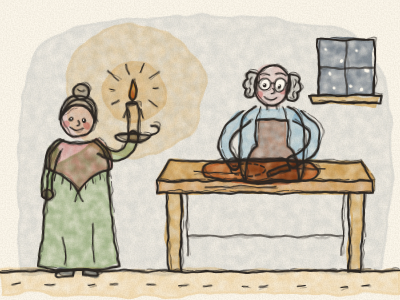
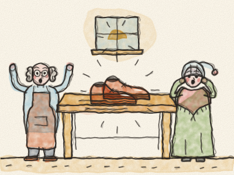
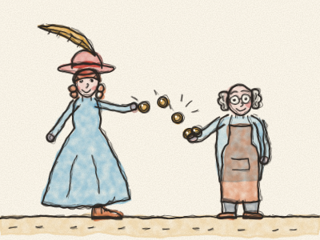
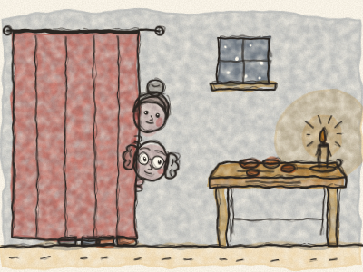
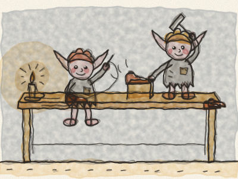
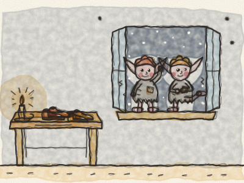
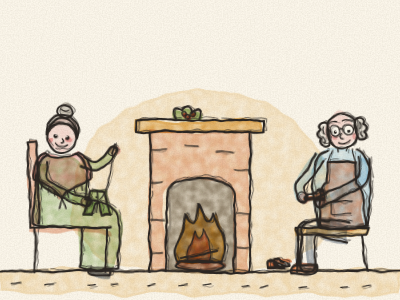
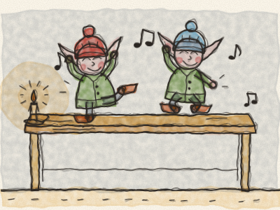
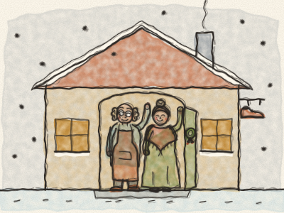

# The Elves and the Shoemaker

Once upon a time, in a little town with crooked roofs, there lived a shoemaker and his wife. The shoemaker was a good and honest man, and he worked hard all day long. *Tap, tap, tap* went his little hammer. But times were hard, and he grew poorer and poorer.

One winter evening, he looked in his cupboard. There was only one piece of leather left. Just enough for one pair of shoes. “This is the very last one,” he sighed. “After this, I have no money to buy any more.”

So, by the light of a candle, he carefully cut out the leather for a pair of shoes. He laid the pieces neatly on his workbench, ready to sew in the morning. Then he blew out the candle and went to bed. *Goodnight, little shop.*

The next morning, the shoemaker came down to his workshop, yawning and rubbing his eyes. And then he stopped. And he stared.

There on the workbench stood a pair of shoes. Finished! Not one stitch was crooked. Not one nail was out of place. They were the most beautiful shoes he had ever seen. They shone like new chestnuts.

“Wife! Wife!” he called. “Come and see!” His wife came running down the stairs in her nightcap. She picked up the shoes and turned them over and over. “Who made these?” she whispered. “I don’t know,” said the shoemaker. “It wasn’t me!”

That very morning, the shop bell rang. *Ding-a-ling!* In came a fine lady in a hat with a long feather. She saw the shoes in the window, and she tried them on. They fitted her perfectly.

“Oh, how lovely!” she said, and she twirled around. “I have never had such comfortable shoes!” She was so pleased that she paid much more than the usual price. *Clink, clink, clink* went the shiny coins on the counter.

With that money, the shoemaker bought enough leather for two pairs of shoes. That evening he cut them out, laid the pieces on his workbench, and went to bed, wondering. *(What do you think he found the next morning?)*

The next morning, there they were: two pairs of beautiful shoes, finished, every stitch perfect! He sold them for a good price and bought leather for four pairs. And in the morning, there were four new pairs waiting on the workbench.

And so it went on, day after day. Whatever leather he cut out in the evening was turned into beautiful shoes by the morning. Boots for the farmer. Slippers for the grandmother. Little red shoes for a little girl. *Ding-a-ling!* went the shop bell, all day long.

Soon the shoemaker and his wife were no longer poor. They had wood for the fire, bread on the table, and a pot of soup bubbling on the stove. But they still did not know who was helping them.

One evening, a little before Christmas, when the snow was falling softly outside, the wife said: “Husband, I would so like to know who is helping us. Shall we stay up tonight and see?”

“Yes,” said the shoemaker. “Let’s!” So they cut out the leather as usual and laid it on the workbench. They left a candle burning. Then they hid behind the curtain in the corner of the room, and they waited, as quiet as two mice.

They waited and waited. The clock went *tick, tock, tick, tock.* The shoemaker’s eyes began to close. His wife gave him a little nudge. “Shh! Stay awake!” And then, just as the clock struck midnight, *dong, dong, dong*, they heard a tiny sound at the window.

The window creaked open, and in climbed two tiny elves. They were no bigger than a teapot. They had pointy ears, rosy cheeks and bright, twinkly eyes. But their clothes were nothing but rags, and their little feet were bare.

They hopped up onto the workbench, took the leather, and set to work. Oh, how fast they were! Their little fingers flew. They stitched and sewed. *Stitch, stitch, stitch!* They hammered and tapped. *Tippity-tap, tippity-tap!* And while they worked, they hummed a merry little tune.

The shoemaker and his wife could hardly believe their eyes. They held their breath and watched from behind the curtain.

Before the sun came up, every pair of shoes was finished and standing in a neat row. The elves jumped down from the bench, waved to the shoes, and slipped out of the window into the cold, snowy night. *Brrr!* They were shivering.

The next morning, the wife said: “Husband, those little elves have been so kind to us. They have made us rich, and they ask for nothing. But did you see? They have no warm clothes, and no shoes on their little feet. They must be so cold in the snow.”

“You are right,” said the shoemaker. “Let us do something kind for them, too. Let us make them a present for Christmas.”

So the wife took out her sewing basket. She made two tiny shirts, and two tiny pairs of trousers, and two tiny green coats with shiny buttons. She knitted two tiny pairs of warm stockings, and two tiny woolly hats, one red and one blue.

And the shoemaker made two tiny pairs of shoes, the smallest shoes he had ever made, soft and strong, with silver buckles. *Tap, tap, tap* went his little hammer, very gently.

When everything was ready, on Christmas Eve, they did not put any leather on the workbench. Instead, they laid out all the little presents, neatly folded. Then they hid behind the curtain again and waited.

At midnight, the window creaked open and in climbed the two elves. They hopped up onto the workbench, looking for the leather. But there was no leather. Instead, they found the little clothes. They stopped. They stared. And then they laughed for joy!

Quick as a wink, they put on the shirts and the trousers, the coats and the stockings, the hats and the shoes. They looked at each other and spun around. And they began to sing:

*“Now we are dressed so fine and neat,*
*from our heads down to our feet!”*

And they danced and jumped all over the workbench, over the chairs and round and round the room.

Then, still singing, the two elves danced out of the window and away into the starry night. The shoemaker and his wife never saw them again. But they did not mind. They knew that the elves were warm and happy at last.

And from then on, the shoemaker made his shoes all by himself, with care and with love, just as the elves had shown him. Everyone in town came to buy them, and he and his wife were never poor again.

And every Christmas Eve, the shoemaker and his wife left a little plate of biscuits by the window. Just in case. And every Christmas morning, the plate was empty.

> When someone is kind to you, be kind to them too.
