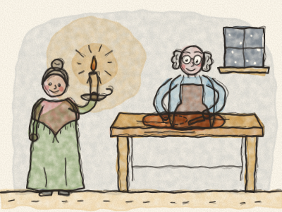
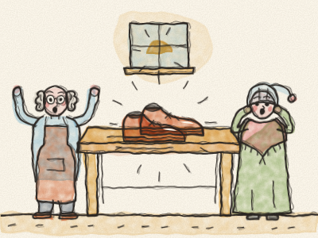
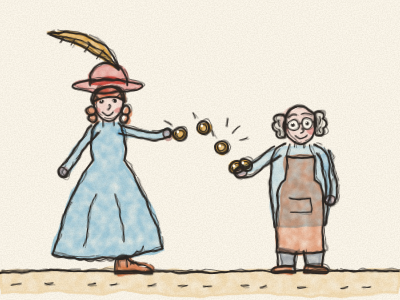
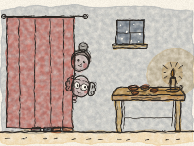
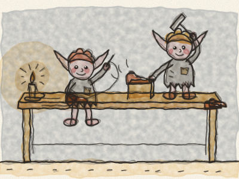
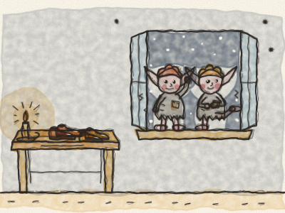
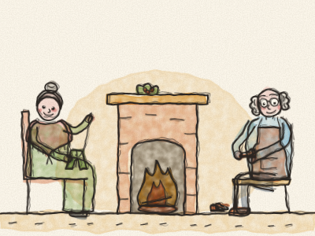
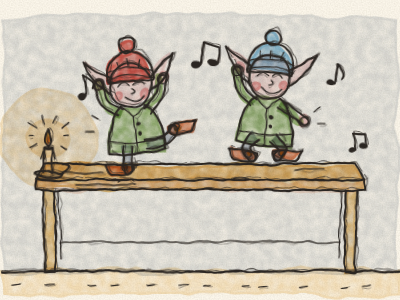
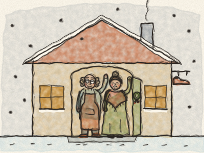

# Le Cordonnier et les Lutins

Il était une fois, dans une petite ville aux toits tout tordus, un cordonnier et sa femme. Le cordonnier était un homme bon et honnête, et il travaillait dur toute la journée. *Tap, tap, tap*, faisait son petit marteau. Mais les temps étaient difficiles, et il devenait de plus en plus pauvre.

Un soir d’hiver, il regarda dans son placard. Il ne restait qu’un seul morceau de cuir. Juste assez pour une paire de chaussures. « C’est le tout dernier, soupira-t-il. Après celui-ci, je n’ai plus d’argent pour en acheter. »

Alors, à la lueur d’une bougie, il découpa soigneusement le cuir pour une paire de chaussures. Il posa les morceaux bien en ordre sur son établi, prêts à être cousus le lendemain matin. Puis il souffla la bougie et alla se coucher. *Bonne nuit, petite boutique.*

Le lendemain matin, le cordonnier descendit dans son atelier en bâillant et en se frottant les yeux. Et puis il s’arrêta. Et il resta bouche bée.

Là, sur l’établi, se tenait une paire de chaussures. Terminée ! Pas un seul point de travers. Pas un seul clou mal placé. C’étaient les plus belles chaussures qu’il ait jamais vues. Elles brillaient comme des marrons tout neufs.

« Femme ! Femme ! appela-t-il. Viens voir ! » Sa femme descendit l’escalier en courant, avec son bonnet de nuit. Elle prit les chaussures et les tourna dans tous les sens. « Qui les a faites ? chuchota-t-elle. — Je ne sais pas, dit le cordonnier. Ce n’est pas moi ! »

Ce matin-là, la clochette de la boutique sonna. *Drelin, drelin !* Entra une belle dame avec un chapeau orné d’une longue plume. Elle vit les chaussures dans la vitrine et les essaya. Elles lui allaient parfaitement.

« Oh, qu’elles sont jolies ! » dit-elle en tournoyant. « Je n’ai jamais eu de chaussures aussi confortables ! » Elle était si contente qu’elle paya bien plus que le prix habituel. *Cling, cling, cling*, firent les pièces brillantes sur le comptoir.

Avec cet argent, le cordonnier acheta assez de cuir pour deux paires de chaussures. Le soir, il les découpa, posa les morceaux sur son établi et alla se coucher en se posant mille questions. *(À ton avis, qu’a-t-il trouvé le lendemain matin ?)*

Le lendemain matin, elles étaient là : deux paires de magnifiques chaussures, terminées, chaque point parfait ! Il les vendit un bon prix et acheta du cuir pour quatre paires. Et le matin, quatre paires neuves l’attendaient sur l’établi.

Et cela continua, jour après jour. Tout le cuir qu’il découpait le soir devenait de belles chaussures au matin. Des bottes pour le fermier. Des pantoufles pour la grand-mère. Des petits souliers rouges pour une petite fille. *Drelin, drelin !* faisait la clochette, toute la journée.

Bientôt, le cordonnier et sa femme ne furent plus pauvres. Ils avaient du bois pour le feu, du pain sur la table et une marmite de soupe qui mijotait sur le poêle. Mais ils ne savaient toujours pas qui les aidait.

Un soir, peu avant Noël, alors que la neige tombait doucement dehors, la femme dit : « Mon mari, j’aimerais tant savoir qui nous aide. Et si nous restions éveillés cette nuit pour voir ? »

« Oui, dit le cordonnier. Faisons-le ! » Alors ils découpèrent le cuir comme d’habitude et le posèrent sur l’établi. Ils laissèrent une bougie allumée. Puis ils se cachèrent derrière le rideau, dans le coin de la pièce, et ils attendirent, sages comme deux petites souris.

Ils attendirent, attendirent. L’horloge faisait *tic, tac, tic, tac.* Les yeux du cordonnier commencèrent à se fermer. Sa femme lui donna un petit coup de coude. « Chut ! Reste éveillé ! » Et puis, juste quand l’horloge sonna minuit, *dong, dong, dong*, ils entendirent un tout petit bruit à la fenêtre.

La fenêtre s’ouvrit en grinçant, et deux tout petits lutins entrèrent. Ils n’étaient pas plus grands qu’une théière. Ils avaient des oreilles pointues, des joues roses et des yeux brillants et pétillants. Mais leurs habits n’étaient que des haillons, et leurs petits pieds étaient nus.

Ils sautèrent sur l’établi, prirent le cuir et se mirent au travail. Oh, comme ils étaient rapides ! Leurs petits doigts volaient. Ils cousaient et piquaient. *Pique, pique, pique !* Ils martelaient et tapotaient. *Tipiti-tap, tipiti-tap !* Et tout en travaillant, ils fredonnaient une petite chanson joyeuse.

Le cordonnier et sa femme n’en croyaient pas leurs yeux. Ils retenaient leur souffle et regardaient de derrière le rideau.

Avant le lever du soleil, chaque paire de chaussures était terminée et bien alignée. Les lutins sautèrent de l’établi, firent au revoir aux chaussures et se faufilèrent par la fenêtre dans la nuit froide et enneigée. *Brrr !* Ils grelottaient.

Le lendemain matin, la femme dit : « Mon mari, ces petits lutins ont été si gentils avec nous. Ils nous ont rendus riches, et ils ne demandent rien. Mais as-tu vu ? Ils n’ont pas d’habits chauds, ni de chaussures à leurs petits pieds. Ils doivent avoir si froid dans la neige. »

« Tu as raison, dit le cordonnier. Faisons quelque chose de gentil pour eux, nous aussi. Préparons-leur un cadeau pour Noël. »

Alors la femme sortit son panier à couture. Elle fit deux toutes petites chemises, deux tout petits pantalons et deux tout petits manteaux verts avec des boutons brillants. Elle tricota deux toutes petites paires de chaussettes bien chaudes, et deux tout petits bonnets de laine, un rouge et un bleu.

Et le cordonnier fabriqua deux toutes petites paires de chaussures, les plus petites qu’il ait jamais faites, souples et solides, avec des boucles en argent. *Tap, tap, tap*, faisait son petit marteau, tout doucement.

Quand tout fut prêt, le soir de Noël, ils ne posèrent pas de cuir sur l’établi. À la place, ils y disposèrent tous les petits cadeaux, bien pliés. Puis ils se cachèrent de nouveau derrière le rideau et attendirent.

À minuit, la fenêtre s’ouvrit en grinçant et les deux lutins entrèrent. Ils sautèrent sur l’établi pour chercher le cuir. Mais il n’y avait pas de cuir. À la place, ils trouvèrent les petits habits. Ils s’arrêtèrent. Ils restèrent bouche bée. Et puis ils éclatèrent de rire, tout joyeux !

En un clin d’œil, ils enfilèrent les chemises et les pantalons, les manteaux et les chaussettes, les bonnets et les chaussures. Ils se regardèrent et tournèrent sur eux-mêmes. Et ils se mirent à chanter :

*« Nous voilà beaux et bien vêtus,*
*des pieds à la tête, plus jamais nus ! »*

Et ils dansèrent et sautèrent partout sur l’établi, par-dessus les chaises, et tout autour de la pièce.

Puis, toujours en chantant, les deux lutins sortirent en dansant par la fenêtre et disparurent dans la nuit étoilée. Le cordonnier et sa femme ne les revirent jamais. Mais ce n’était pas grave. Ils savaient que les lutins avaient enfin chaud et qu’ils étaient heureux.

Depuis ce jour, le cordonnier fit ses chaussures tout seul, avec soin et avec amour, comme les lutins le lui avaient montré. Tout le monde en ville venait les acheter, et sa femme et lui ne furent plus jamais pauvres.

Et chaque soir de Noël, le cordonnier et sa femme laissaient une petite assiette de biscuits près de la fenêtre. Au cas où. Et chaque matin de Noël, l’assiette était vide.

> Quand quelqu’un est gentil avec toi, sois gentil avec lui aussi.
