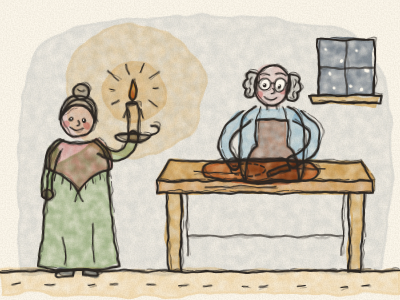
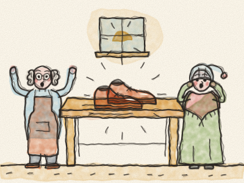
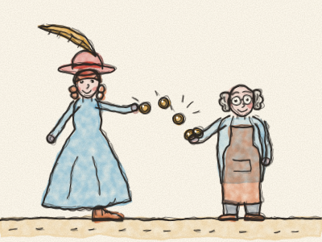
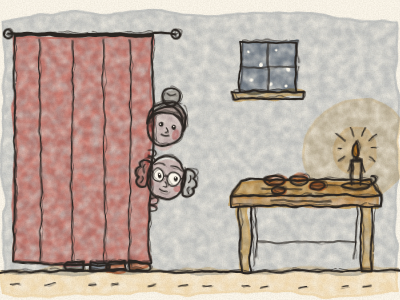
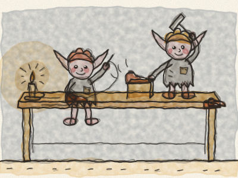
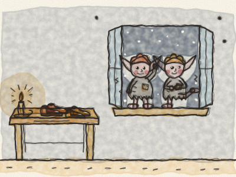
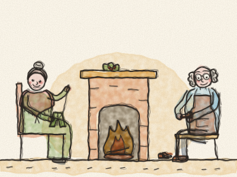
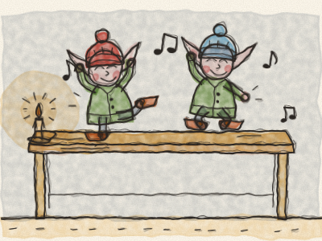
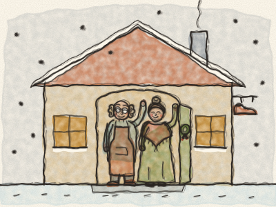

# O Sapateiro e os Duendes

Era uma vez, numa pequena cidade de telhados tortos, um sapateiro e a sua mulher. O sapateiro era um homem bom e honesto, e trabalhava muito o dia inteiro. *Tap, tap, tap*, fazia o seu martelinho. Mas os tempos eram difíceis, e ele ficava cada vez mais pobre.

Numa noite de inverno, foi espreitar ao armário. Só restava um pedaço de cabedal. Apenas o suficiente para um par de sapatos. — É mesmo o último — suspirou ele. — Depois deste, já não tenho dinheiro para comprar mais.

Então, à luz de uma vela, cortou com muito cuidado o cabedal para um par de sapatos. Pousou as peças muito arrumadinhas na bancada, prontas para coser de manhã. Depois apagou a vela e foi deitar-se. *Boa noite, lojinha.*

Na manhã seguinte, o sapateiro desceu à oficina a bocejar e a esfregar os olhos. E de repente parou. E ficou a olhar, de boca aberta.

Ali, em cima da bancada, estava um par de sapatos. Prontinho! Nem um ponto torto. Nem um prego fora do sítio. Eram os sapatos mais bonitos que ele alguma vez tinha visto. Brilhavam como castanhas acabadas de cair.

— Mulher! Mulher! — chamou ele. — Anda ver! — A mulher desceu as escadas a correr, de touca de dormir. Pegou nos sapatos e virou-os de um lado e do outro. — Quem os fez? — sussurrou ela. — Não sei — disse o sapateiro. — Não fui eu!

Nessa mesma manhã, a campainha da loja tocou. *Tlim, tlim!* Entrou uma senhora elegante, com um chapéu de pena comprida. Viu os sapatos na montra e experimentou-os. Serviam-lhe na perfeição.

— Ai, que lindos! — disse ela, a rodopiar. — Nunca tive uns sapatos tão confortáveis! — Ficou tão contente que pagou muito mais do que o preço habitual. *Tlim, tlim, tlim*, fizeram as moedas brilhantes no balcão.

Com esse dinheiro, o sapateiro comprou cabedal que chegava para dois pares de sapatos. À noite, cortou-os, pousou as peças na bancada e foi deitar-se, muito intrigado. *(O que achas que ele encontrou na manhã seguinte?)*

Na manhã seguinte, lá estavam eles: dois pares de sapatos lindíssimos, prontos, com todos os pontos perfeitos! Vendeu-os por um bom preço e comprou cabedal para quatro pares. E de manhã, estavam quatro pares novos à espera em cima da bancada.

E assim continuou, dia após dia. Todo o cabedal que ele cortava à noite aparecia transformado em sapatos lindos de manhã. Botas para o lavrador. Chinelos para a avó. Sapatinhos vermelhos para uma menina. *Tlim, tlim!* fazia a campainha da loja, o dia inteiro.

Em pouco tempo, o sapateiro e a mulher deixaram de ser pobres. Tinham lenha para a lareira, pão na mesa e uma panela de sopa a fervilhar no fogão. Mas continuavam sem saber quem os estava a ajudar.

Uma noite, pouco antes do Natal, enquanto a neve caía devagarinho lá fora, a mulher disse: — Marido, gostava tanto de saber quem nos anda a ajudar. E se ficássemos acordados esta noite para ver?

— Sim — disse o sapateiro. — Vamos a isso! — Então cortaram o cabedal como de costume e pousaram-no na bancada. Deixaram uma vela acesa. Depois esconderam-se atrás da cortina, a um canto da sala, e ficaram à espera, caladinhos como dois ratinhos.

Esperaram e esperaram. O relógio fazia *tic, tac, tic, tac.* Os olhos do sapateiro começaram a fechar-se. A mulher deu-lhe uma cotoveladazinha. — Chiu! Não adormeças! — E então, mesmo quando o relógio deu a meia-noite, *dong, dong, dong*, ouviram um barulhinho na janela.

A janela abriu-se a ranger, e entraram dois duendes pequeninos. Não eram maiores do que um bule. Tinham orelhas bicudas, bochechas rosadas e olhos brilhantes e marotos. Mas a roupa deles não passava de farrapos, e os pezinhos estavam descalços.

Saltaram para cima da bancada, pegaram no cabedal e puseram mãos à obra. Ai, como eram rápidos! Os dedinhos voavam. Coseram e pespontaram. *Pique, pique, pique!* Martelaram e bateram. *Tiquiti-tap, tiquiti-tap!* E, enquanto trabalhavam, cantarolavam uma cantiga alegre.

O sapateiro e a mulher nem queriam acreditar no que viam. Sustiveram a respiração e ficaram a espreitar por trás da cortina.

Antes de o sol nascer, todos os pares de sapatos estavam prontos e arrumadinhos em fila. Os duendes saltaram da bancada, disseram adeus aos sapatos e escapuliram-se pela janela para a noite fria e cheia de neve. *Brrr!* Estavam a tremer.

Na manhã seguinte, a mulher disse: — Marido, aqueles duendes têm sido tão bons para nós. Fizeram-nos ricos e não pedem nada em troca. Mas viste? Não têm roupa quente, nem sapatos nos pezinhos. Devem ter tanto frio na neve.

— Tens razão — disse o sapateiro. — Vamos também fazer uma coisa boa por eles. Vamos preparar-lhes uma prenda de Natal.

Então a mulher foi buscar o cesto da costura. Fez duas camisinhas, duas calças pequeninas e dois casaquinhos verdes com botões brilhantes. Fez em tricô dois pares de meias bem quentinhas e dois gorros de lã pequeninos, um vermelho e um azul.

E o sapateiro fez dois pares de sapatinhos, os mais pequenos que alguma vez tinha feito, macios e fortes, com fivelas de prata. *Tap, tap, tap*, fazia o seu martelinho, muito devagarinho.

Quando estava tudo pronto, na noite de Natal, não puseram cabedal na bancada. Em vez disso, puseram lá todas as prendinhas, muito bem dobradas. Depois esconderam-se outra vez atrás da cortina e ficaram à espera.

À meia-noite, a janela abriu-se a ranger e entraram os dois duendes. Saltaram para a bancada, à procura do cabedal. Mas não havia cabedal. Em vez disso, encontraram a roupinha. Pararam. Ficaram a olhar, de boca aberta. E depois desataram a rir de alegria!

Num abrir e fechar de olhos, vestiram as camisas e as calças, os casacos e as meias, os gorros e os sapatos. Olharam um para o outro e deram uma volta. E começaram a cantar:

*«Que bonitos e bem vestidos,*
*da cabeça aos pés aquecidos!»*

E dançaram e saltaram por toda a bancada, por cima das cadeiras e à volta da sala inteira.

Depois, sempre a cantar, os dois duendes saíram a dançar pela janela e desapareceram na noite estrelada. O sapateiro e a mulher nunca mais os viram. Mas não se importaram. Sabiam que os duendes estavam finalmente quentinhos e felizes.

A partir desse dia, o sapateiro passou a fazer os sapatos sozinho, com cuidado e com amor, tal como os duendes lhe tinham mostrado. Toda a gente da cidade vinha comprá-los, e ele e a mulher nunca mais foram pobres.

E em todas as noites de Natal, o sapateiro e a mulher deixavam um pratinho de bolachas junto à janela. Só para o caso de voltarem. E em todas as manhãs de Natal, o prato estava vazio.

> Quando alguém é bom para ti, sê bom para essa pessoa também.
