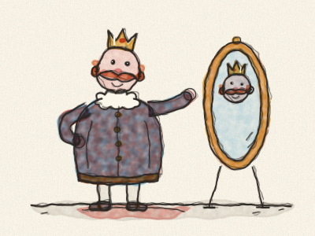
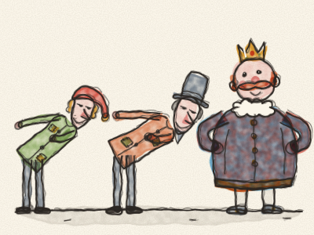
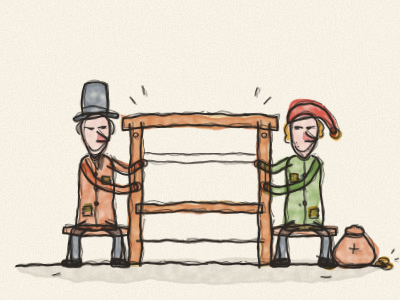
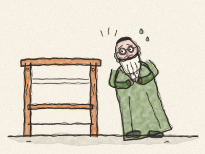
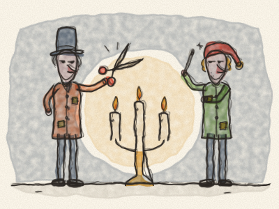
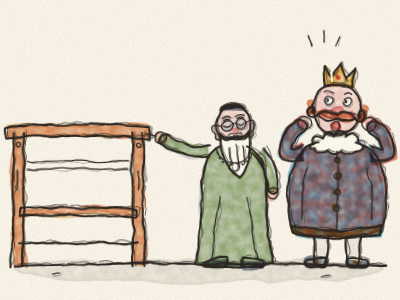
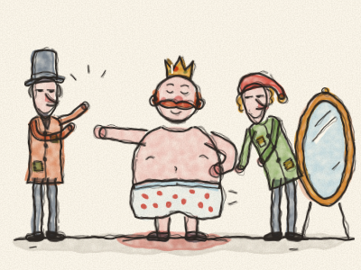
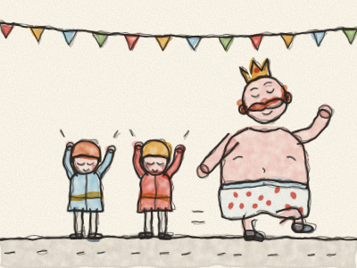
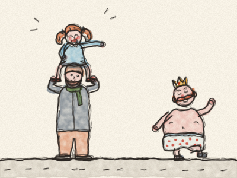
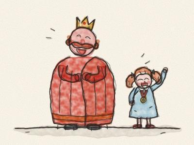

# The Emperor’s New Clothes

Once upon a time, there was an Emperor who loved clothes more than anything in the whole world. He did not care about his soldiers, or his gardens, or going to the theatre. He only cared about new clothes. He had a coat for every hour of the day: a purple coat for breakfast, a yellow coat for lunch, a blue coat with silver buttons for teatime. And whenever anybody asked, “Where is the Emperor?”, the answer was always the same: “He is in his dressing room, trying on clothes!”

One day, two strangers arrived in the city. They said they were weavers. But they were not really weavers at all. They were two tricksters.

“Your Majesty,” they said, bowing very low, “we can weave the most wonderful cloth in the world. Its colours are more beautiful than a rainbow. And it is magic! Anybody who is silly, or who is not good at their job, cannot see it at all. To them, it is invisible.”

“Magic cloth!” thought the Emperor. “If I wore clothes made of it, I would know at once who is silly in my kingdom and who is clever!” So he gave the two tricksters a big bag of gold, and he said, “Start weaving at once!”

The tricksters set up a big wooden loom in a room in the palace. And they asked for the finest silk and the brightest gold thread.

But they put all the silk and all the gold thread into their own bags. Then they sat at the empty loom and pretended to weave. *Clickety-clack, clickety-clack.* They worked all day and late into the night, moving their hands busily over… nothing at all.

After a while, the Emperor wanted to know how the cloth was coming along. But he felt a little bit nervous. “What if I cannot see it?” he thought. “I will send my old Minister first. He is very wise. He will be able to see it.”

So the old Minister went to the room where the tricksters were working.

The old Minister opened his eyes very wide. He looked, and looked. *(What do you think he saw?)* He saw nothing. Only an empty loom!

“Oh dear!” he thought. “Am I silly? Am I not good at my job? Nobody must ever find out!”

“Isn’t it beautiful?” said the tricksters. “Look at the lovely pattern! Look at the bright colours!”

“Oh… yes!” said the old Minister. “It is… wonderful! I shall tell the Emperor how much I like it.” And he listened very carefully while the tricksters described the colours, so that he could repeat every word.

Then the tricksters asked for more gold and more silk. And it all went into their bags.

Soon the Emperor sent someone else: the Royal Treasurer. And the very same thing happened. She looked, and looked, and saw nothing at all. But she was too worried to say so. “Charming!” she said. “Simply charming!”

By now, everybody in the city was talking about the magic cloth. And everybody wanted to know who would turn out to be silly.

At last, the tricksters said the cloth was ready to be made into clothes. They cut the air with big scissors. *Snip, snip.* They sewed with needles that had no thread. *Stitch, stitch.* They worked all night, with a hundred candles burning.

The next morning, the Emperor came to see his new clothes himself, with the old Minister and the Royal Treasurer.

“Aren’t they magnificent, Your Majesty?” said the old Minister, pointing at the empty loom.

The Emperor looked. And looked. He saw… nothing!

“Goodness!” he thought. “Am I silly? Am I not good at being Emperor? That would be the most terrible thing of all!” So he smiled and said, very loudly, “Magnificent! Simply magnificent!”

And all the people around him, who could not see anything either, said, “Magnificent! Magnificent!”

“Your Majesty should wear these new clothes for the Great Parade tomorrow,” said the old Minister.

On the morning of the parade, the tricksters came to dress the Emperor. He took off all his old clothes, until he was wearing nothing but his spotty underpants.

“Here are the trousers,” said the tricksters, holding up nothing. “Here is the coat. And here is the long cloak. They are as light as a spider’s web! Your Majesty will hardly feel them.”

The Emperor turned this way and that way in front of the mirror. *(Turn this way and that, like the Emperor!)*

“How well they fit!” said everyone. “What a beautiful pattern!”

Two little pages bent down and pretended to pick up the long cloak from the floor, so that it would not get dusty.

And so the Great Parade began. *Boom, boom!* went the drums. *Ta-ra-ta-ra!* went the trumpets. The Emperor marched proudly down the street, with his nose in the air, and the two pages carried the cloak that wasn’t there.

All the people of the city had come out to watch. And every single one of them could see that the Emperor was wearing only his underpants. But nobody wanted to seem silly.

“Oh, what splendid clothes!” they cried. “What a long, beautiful cloak! What lovely colours!” And they clapped and cheered.

In the crowd, there was a little girl sitting on her father’s shoulders. She looked at the Emperor. She looked again. And then she said, in a loud, clear voice:

“But the Emperor isn’t wearing any clothes! He’s only wearing his underpants!”

Everything went quiet. Then somebody whispered, “The little girl is right.” And the whisper went from person to person, all along the street. “She’s right… he’s only wearing his underpants… spotty ones!”

And then everybody began to laugh. *Ha ha ha!* The old Minister laughed. The Royal Treasurer laughed. Even the two little pages laughed so much that they had to sit down.

The Emperor’s face went pink, then red, then as red as a tomato. Then he looked down at his spotty underpants… and he began to laugh too. “What a silly Emperor I have been!” he said.

And the two tricksters? They had run away in the night with all the gold and all the silk, and nobody ever saw them again.

The Emperor wrapped himself in a big warm blanket and went to find the little girl. “You were the only one brave enough to tell the truth,” he said. He pinned a small golden medal on her coat, and made her his Royal Truth-Teller. And from that day on, whenever he tried on new clothes, he always asked her first: “Tell me honestly — can you see them?”

> It takes courage to say what you really see. And a true friend tells you the truth, even when it makes everyone laugh.
