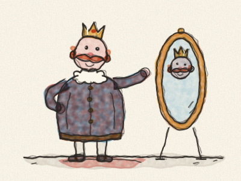
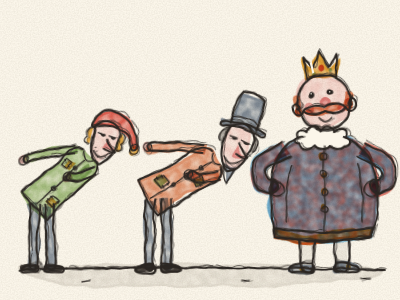
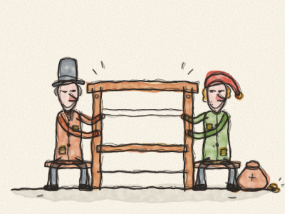
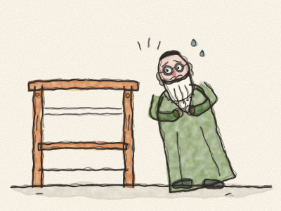
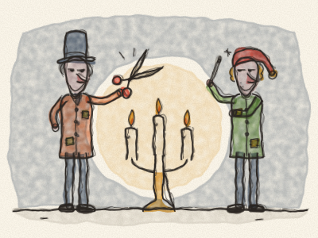
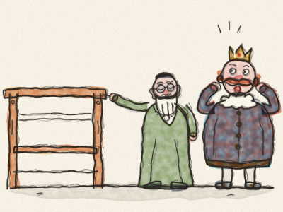
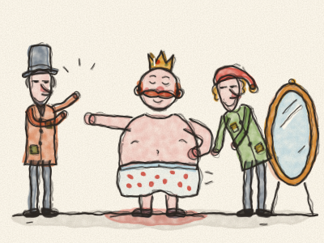
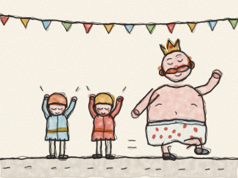
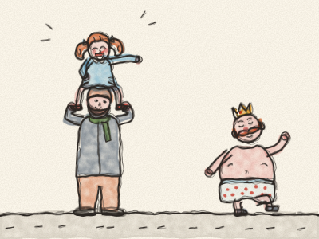
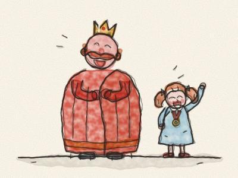

# Les Habits neufs de l’Empereur

Il était une fois un Empereur qui aimait les habits plus que tout au monde. Il ne s’intéressait ni à ses soldats, ni à ses jardins, ni au théâtre. Il ne pensait qu’à ses habits neufs. Il avait un manteau pour chaque heure de la journée : un manteau violet pour le petit déjeuner, un manteau jaune pour le déjeuner, un manteau bleu aux boutons d’argent pour le goûter. Et chaque fois que quelqu’un demandait : « Où est l’Empereur ? », la réponse était toujours la même : « Il est dans sa garde-robe, en train d’essayer des habits ! »

Un jour, deux étrangers arrivèrent en ville. Ils disaient qu’ils étaient tisserands. Mais ce n’étaient pas du tout des tisserands. C’étaient deux filous.

« Votre Majesté », dirent-ils en s’inclinant très bas, « nous savons tisser le plus merveilleux tissu du monde. Ses couleurs sont plus belles qu’un arc-en-ciel. Et il est magique ! Ceux qui sont sots, ou qui ne font pas bien leur travail, ne peuvent pas le voir du tout. Pour eux, il est invisible. »

« Un tissu magique ! » pensa l’Empereur. « Si je portais des habits faits de ce tissu, je saurais tout de suite qui est sot dans mon royaume et qui est malin ! » Alors il donna aux deux filous un gros sac d’or, et il dit : « Mettez-vous au travail tout de suite ! »

Les filous installèrent un grand métier à tisser en bois dans une salle du palais. Et ils demandèrent la soie la plus fine et le fil d’or le plus brillant.

Mais ils mirent toute la soie et tout le fil d’or dans leurs propres sacs. Puis ils s’assirent devant le métier vide et firent semblant de tisser. *Clic-clac, clic-clac.* Ils travaillèrent toute la journée et tard dans la nuit, en agitant les mains au-dessus de… rien du tout.

Au bout d’un moment, l’Empereur voulut savoir où en était le tissu. Mais il était un peu inquiet. « Et si je ne pouvais pas le voir ? » pensa-t-il. « Je vais d’abord envoyer mon vieux Ministre. Il est très sage. Lui, il pourra le voir. »

Alors le vieux Ministre se rendit dans la salle où travaillaient les filous.

Le vieux Ministre ouvrit les yeux tout grands. Il regarda, et regarda encore. *(À votre avis, qu’a-t-il vu ?)* Il ne vit rien. Rien qu’un métier à tisser vide !

« Oh là là ! » pensa-t-il. « Est-ce que je suis sot ? Est-ce que je ne fais pas bien mon travail ? Personne ne doit jamais le savoir ! »

« N’est-ce pas magnifique ? » dirent les filous. « Regardez ce joli motif ! Regardez ces couleurs éclatantes ! »

« Oh… oui ! » dit le vieux Ministre. « C’est… merveilleux ! Je dirai à l’Empereur combien cela me plaît. » Et il écouta très attentivement les filous décrire les couleurs, pour pouvoir répéter chaque mot.

Puis les filous demandèrent encore de l’or et encore de la soie. Et tout finit dans leurs sacs.

Bientôt, l’Empereur envoya quelqu’un d’autre : la Trésorière royale. Et il se passa exactement la même chose. Elle regarda, et regarda encore, et ne vit rien du tout. Mais elle était trop inquiète pour le dire. « Charmant ! » dit-elle. « Tout simplement charmant ! »

À présent, toute la ville parlait du tissu magique. Et tout le monde voulait savoir qui allait se révéler sot.

Enfin, les filous annoncèrent que le tissu était prêt à devenir des habits. Ils coupèrent l’air avec de grands ciseaux. *Clip, clip.* Ils cousirent avec des aiguilles sans fil. *Pique, pique.* Ils travaillèrent toute la nuit, à la lumière de cent bougies.

Le lendemain matin, l’Empereur vint lui-même voir ses habits neufs, avec le vieux Ministre et la Trésorière royale.

« Ne sont-ils pas magnifiques, Votre Majesté ? » dit le vieux Ministre en montrant le métier vide.

L’Empereur regarda. Et regarda encore. Il ne vit… rien du tout !

« Ciel ! » pensa-t-il. « Est-ce que je suis sot ? Est-ce que je ne suis pas un bon Empereur ? Ce serait la chose la plus terrible au monde ! » Alors il sourit et dit, très fort : « Magnifique ! Tout simplement magnifique ! »

Et tous les gens autour de lui, qui ne voyaient rien non plus, répétèrent : « Magnifique ! Magnifique ! »

« Votre Majesté devrait porter ces habits neufs pour le Grand Défilé de demain », dit le vieux Ministre.

Le matin du défilé, les filous vinrent habiller l’Empereur. Il enleva tous ses vieux habits, jusqu’à ne plus porter que son caleçon à pois.

« Voici le pantalon », dirent les filous en tenant… rien du tout. « Voici le manteau. Et voici la longue cape. Ils sont légers comme une toile d’araignée ! Votre Majesté les sentira à peine. »

L’Empereur se tourna d’un côté, puis de l’autre, devant le miroir. *(Tournez-vous d’un côté, puis de l’autre, comme l’Empereur !)*

« Comme ils lui vont bien ! » disaient-ils tous. « Quel joli motif ! »

Deux petits pages se penchèrent et firent semblant de ramasser la longue cape par terre, pour qu’elle ne se salisse pas.

Et le Grand Défilé commença. *Boum, boum !* firent les tambours. *Tagada-tsoin-tsoin !* firent les trompettes. L’Empereur marchait fièrement dans la rue, le nez en l’air, et les deux pages portaient la cape qui n’existait pas.

Tous les habitants de la ville étaient sortis pour regarder. Et chacun d’eux voyait bien que l’Empereur ne portait que son caleçon. Mais personne ne voulait passer pour un sot.

« Oh, quels habits splendides ! » s’écriaient-ils. « Quelle longue et belle cape ! Quelles jolies couleurs ! » Et ils applaudissaient et l’acclamaient.

Dans la foule, il y avait une petite fille assise sur les épaules de son papa. Elle regarda l’Empereur. Elle regarda encore. Et puis elle dit, d’une voix forte et claire :

« Mais l’Empereur n’a pas d’habits ! Il est juste en caleçon ! »

Tout le monde se tut. Puis quelqu’un chuchota : « La petite fille a raison. » Et le chuchotement passa de l’un à l’autre, tout le long de la rue. « Elle a raison… il est juste en caleçon… un caleçon à pois ! »

Et alors, tout le monde se mit à rire. *Ha ha ha !* Le vieux Ministre rit. La Trésorière royale rit. Même les deux petits pages rirent tellement qu’ils durent s’asseoir.

Le visage de l’Empereur devint rose, puis rouge, puis rouge comme une tomate. Puis il regarda son caleçon à pois… et il se mit à rire, lui aussi. « Quel Empereur sot j’ai été ! » dit-il.

Et les deux filous ? Ils s’étaient enfuis pendant la nuit avec tout l’or et toute la soie, et personne ne les revit jamais.

L’Empereur s’enveloppa dans une grande couverture bien chaude et alla trouver la petite fille. « Tu as été la seule assez courageuse pour dire la vérité », lui dit-il. Il accrocha une petite médaille dorée sur son manteau et la nomma Gardienne royale de la Vérité. Et à partir de ce jour, chaque fois qu’il essayait des habits neufs, il lui demandait toujours d’abord : « Dis-moi franchement : est-ce que tu les vois ? »

> Il faut du courage pour dire ce que l’on voit vraiment. Et un vrai ami dit la vérité, même quand cela fait rire tout le monde.
