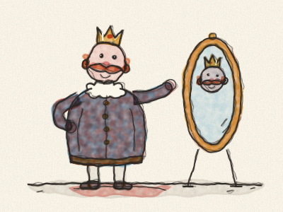
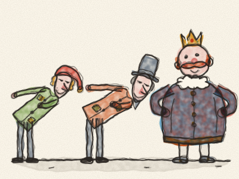
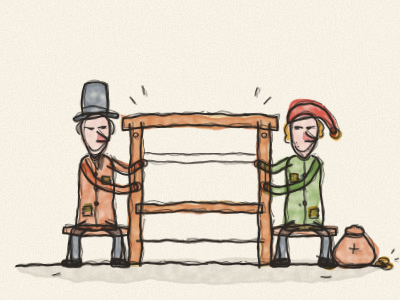
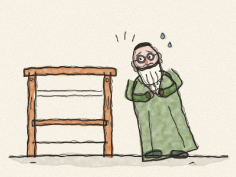
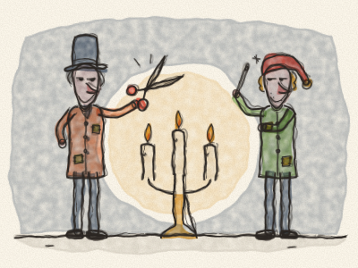
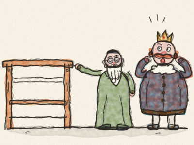
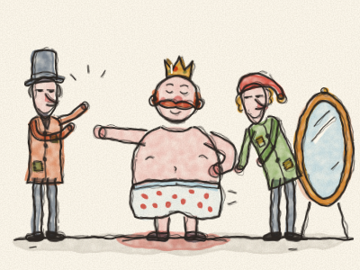
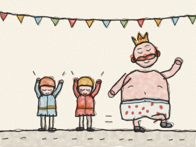
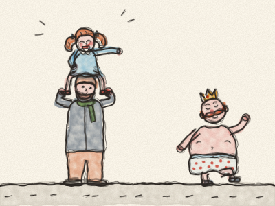
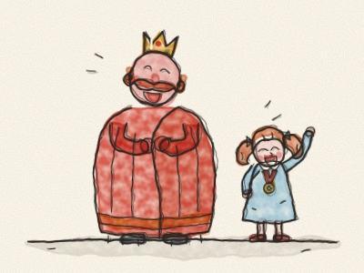

# O Rei Vai Nu

Era uma vez um Imperador que gostava de roupa mais do que de qualquer outra coisa no mundo. Não queria saber dos soldados, nem dos jardins, nem de ir ao teatro. Só queria saber de roupa nova. Tinha um casaco para cada hora do dia: um casaco roxo para o pequeno-almoço, um casaco amarelo para o almoço, um casaco azul com botões de prata para o lanche. E sempre que alguém perguntava: «Onde está o Imperador?», a resposta era sempre a mesma: «Está no quarto de vestir, a experimentar roupa!»

Um dia, chegaram à cidade dois forasteiros. Diziam que eram tecelões. Mas não eram tecelões nenhuns. Eram dois vigaristas.

— Majestade — disseram eles, fazendo uma vénia muito funda —, sabemos tecer o tecido mais maravilhoso do mundo. As cores são mais bonitas do que um arco-íris. E é mágico! Quem for tolo, ou não fizer bem o seu trabalho, não o consegue ver. Para essas pessoas, é invisível.

«Um tecido mágico!», pensou o Imperador. «Se eu usasse roupa feita com ele, ficava logo a saber quem é tolo no meu reino e quem é esperto!» Então deu aos dois vigaristas um grande saco de ouro e disse: — Comecem já a tecer!

Os vigaristas montaram um grande tear de madeira numa sala do palácio. E pediram a seda mais fina e o fio de ouro mais brilhante.

Mas guardaram a seda toda e o fio de ouro todo nos seus próprios sacos. Depois sentaram-se ao tear vazio e fingiram que teciam. *Tique-taque, tique-taque.* Trabalharam o dia inteiro e até tarde, pela noite dentro, a mexer as mãos muito atarefados por cima de… nada.

Passado algum tempo, o Imperador quis saber como ia o tecido. Mas estava um bocadinho nervoso. «E se eu não o conseguir ver?», pensou. «Vou mandar primeiro o meu velho Ministro. Ele é muito sábio. Ele vai conseguir vê-lo.»

Então o velho Ministro foi à sala onde os vigaristas trabalhavam.

O velho Ministro abriu muito os olhos. Olhou, e olhou. *(O que acham que ele viu?)* Não viu nada. Só um tear vazio!

«Ai, ai!», pensou ele. «Serei tolo? Será que não faço bem o meu trabalho? Ninguém pode saber!»

— Não é lindo? — disseram os vigaristas. — Veja este padrão tão bonito! Veja estas cores tão vivas!

— Ah… sim! — disse o velho Ministro. — É… maravilhoso! Vou dizer ao Imperador o quanto gostei. — E ouviu com muita atenção os vigaristas a descrever as cores, para poder repetir cada palavra.

Depois os vigaristas pediram mais ouro e mais seda. E foi tudo parar aos sacos deles.

Pouco depois, o Imperador mandou outra pessoa: a Tesoureira Real. E aconteceu exatamente o mesmo. Ela olhou, e olhou, e não viu nada. Mas estava preocupada demais para o dizer. — Encantador! — disse ela. — Simplesmente encantador!

Por esta altura, toda a cidade falava do tecido mágico. E toda a gente queria saber quem ia afinal ser tolo.

Por fim, os vigaristas disseram que o tecido estava pronto para ser transformado em roupa. Cortaram o ar com grandes tesouras. *Tic, tic.* Coseram com agulhas sem linha. *Pique, pique.* Trabalharam a noite inteira, com cem velas acesas.

Na manhã seguinte, o próprio Imperador veio ver a sua roupa nova, com o velho Ministro e a Tesoureira Real.

— Não é magnífica, Majestade? — disse o velho Ministro, a apontar para o tear vazio.

O Imperador olhou. E olhou. Não viu… nada!

«Valha-me Deus!», pensou ele. «Serei tolo? Será que não sou um bom Imperador? Isso era a coisa mais terrível de todas!» Então sorriu e disse, muito alto: — Magnífica! Simplesmente magnífica!

E todas as pessoas à volta dele, que também não viam nada, disseram: — Magnífica! Magnífica!

— Vossa Majestade devia usar esta roupa nova no Grande Desfile de amanhã — disse o velho Ministro.

Na manhã do desfile, os vigaristas vieram vestir o Imperador. Ele tirou a roupa velha toda, até ficar só com as suas cuecas às bolinhas.

— Aqui estão as calças — disseram os vigaristas, a segurar… nada. — Aqui está o casaco. E aqui está o manto comprido. São leves como uma teia de aranha! Vossa Majestade quase nem os vai sentir.

O Imperador virou-se para um lado e para o outro, em frente ao espelho. *(Virem-se para um lado e para o outro, como o Imperador!)*

— Que bem que lhe fica! — diziam todos. — Que padrão tão bonito!

Dois pajenzinhos baixaram-se e fingiram apanhar do chão o manto comprido, para não se sujar.

E o Grande Desfile começou. *Bum, bum!* faziam os tambores. *Tarará-tarará!* faziam as trombetas. O Imperador marchava todo vaidoso pela rua, de nariz no ar, e os dois pajens seguravam o manto que não existia.

Toda a gente da cidade tinha saído à rua para ver. E cada uma das pessoas via muito bem que o Imperador só trazia vestidas as cuecas. Mas ninguém queria parecer tolo.

— Oh, que roupa esplêndida! — gritavam. — Que manto tão comprido e tão bonito! Que cores tão lindas! — E batiam palmas e davam vivas.

No meio da multidão, havia uma menina sentada aos ombros do pai. Olhou para o Imperador. Olhou outra vez. E depois disse, com uma voz alta e clara:

— Mas o Rei vai nu! Só tem as cuecas vestidas!

Fez-se silêncio. Depois alguém sussurrou: — A menina tem razão. — E o sussurro passou de pessoa em pessoa, ao longo da rua toda. — Ela tem razão… só tem as cuecas… e são às bolinhas!

E então toda a gente começou a rir. *Ah, ah, ah!* O velho Ministro riu-se. A Tesoureira Real riu-se. Até os dois pajenzinhos se riram tanto que tiveram de se sentar.

A cara do Imperador ficou cor-de-rosa, depois vermelha, depois vermelha como um tomate. Depois olhou para as suas cuecas às bolinhas… e também se começou a rir. — Que Imperador tão tolo eu fui! — disse ele.

E os dois vigaristas? Tinham fugido durante a noite com o ouro todo e a seda toda, e nunca mais ninguém os viu.

O Imperador embrulhou-se num grande cobertor quentinho e foi procurar a menina. — Foste a única com coragem para dizer a verdade — disse-lhe ele. Prendeu-lhe ao casaco uma pequena medalha dourada e nomeou-a Guardiã Real da Verdade. E a partir desse dia, sempre que experimentava roupa nova, perguntava-lhe sempre primeiro: — Diz-me com franqueza: consegues vê-la?

> É preciso coragem para dizer o que realmente se vê. E um verdadeiro amigo diz a verdade, mesmo quando isso põe toda a gente a rir.
