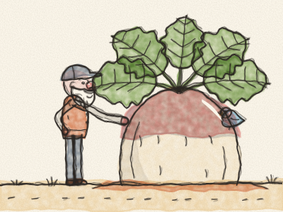
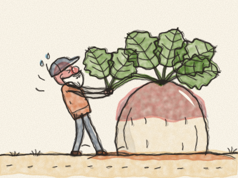

# The Enormous Turnip

Once upon a time, an old Grandpa lived in a little wooden house with a little vegetable garden. One spring morning, he took a tiny turnip seed, made a hole in the earth with his finger, and dropped the seed in. *Pat, pat, pat.* He covered it up.

“Grow, little turnip,” said Grandpa. “Grow sweet, and grow strong.”

Every day, Grandpa watered his turnip. *Splish, splash.* The sun shone on it, the rain fell on it, and the little turnip grew. It grew, and it grew, and it GREW. Soon it was as big as a football. Then as big as a wheelbarrow. Then as big as Grandpa himself! Its leaves were so large that the birds used them as umbrellas.

“What a turnip!” said Grandpa. “It’s time to pull it up for supper.”

He took hold of the big green leaves. He planted his feet. And he pulled. *Heave-ho! Heave-ho!* *(Pull with Grandpa!)*

He pulled and he pulled. His face went pink, then red. But the turnip would not come up. Not even a little bit.

So Grandpa called, “Grandma! Come and help me!”

Grandma came out of the house, wiping her hands on her apron. She held on to Grandpa, Grandpa held on to the turnip, and they pulled. *Heave-ho! Heave-ho!*

They pulled and they pulled. But the turnip would not come up.

So Grandma called, “Granddaughter! Come and help us!”

The little Granddaughter came running from her swing. She held on to Grandma, Grandma held on to Grandpa, Grandpa held on to the turnip, and they pulled. *Heave-ho! Heave-ho!*

They pulled and they pulled. But the turnip would not come up.

So the Granddaughter called, “Doggy! Come and help us!”

The Dog came bounding across the garden. *Woof, woof!* He held on to the Granddaughter’s skirt. The Granddaughter held on to Grandma, Grandma held on to Grandpa, Grandpa held on to the turnip, and they pulled. *Heave-ho! Heave-ho!*

They pulled and they pulled. But the turnip would not come up.

So the Dog called, “Kitty! Come and help us!”

The Cat stretched, yawned, and strolled over. *Miaow.* She held on to the Dog’s tail. The Dog held on to the Granddaughter, the Granddaughter held on to Grandma, Grandma held on to Grandpa, Grandpa held on to the turnip, and they pulled. *Heave-ho! Heave-ho!*

They pulled and they pulled. But the turnip would not come up. *(Who could possibly help now?)*

Then, from the long grass, came a teeny-tiny voice. “Squeak! Can I help too?”

It was a little brown Mouse. Everybody laughed. “You? But you’re so small!”

“Small,” said the Mouse, “but strong!”

So the Cat called, “All right, little Mouse. Come and help us!”

The Mouse held on to the Cat’s tail. The Cat held on to the Dog, the Dog held on to the Granddaughter, the Granddaughter held on to Grandma, Grandma held on to Grandpa, Grandpa held on to the turnip, and they pulled. *Heave-ho! Heave-ho! HEAVE-HO!*

And — *POP!* — up came the enormous turnip!

Everybody fell over backwards in a big happy heap: Grandpa on Grandma, Grandma on the Granddaughter, the Granddaughter on the Dog, the Dog on the Cat, and the Cat… very gently on the Mouse’s tail.

They laughed and laughed. Then Grandma made the biggest pot of turnip soup you have ever seen, and they all sat down together to eat it. And the very first bowl went to the littlest helper of all: the Mouse.

> When everybody helps, even the biggest job gets done. And every helper counts, even the smallest.
