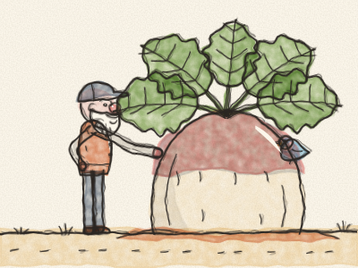
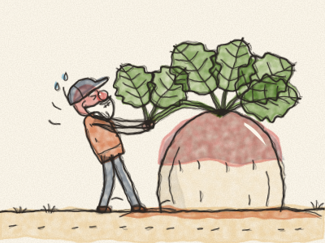

# Le Navet géant

Il était une fois un vieux Grand-père qui vivait dans une petite maison en bois, avec un petit potager. Un matin de printemps, il prit une minuscule graine de navet, fit un trou dans la terre avec son doigt et y laissa tomber la graine. *Pat, pat, pat.* Puis il la recouvrit de terre.

« Pousse, petit navet », dit le Grand-père. « Pousse bien sucré, et pousse bien fort. »

Chaque jour, le Grand-père arrosait son navet. *Plic, ploc.* Le soleil brillait sur lui, la pluie tombait sur lui, et le petit navet poussait. Il poussait, il poussait, il POUSSAIT. Bientôt, il fut gros comme un ballon. Puis gros comme une brouette. Puis aussi grand que le Grand-père lui-même ! Ses feuilles étaient si larges que les oiseaux s’en servaient comme parapluies.

« Quel navet ! » dit le Grand-père. « C’est le moment de l’arracher pour le dîner. »

Il attrapa les grandes feuilles vertes. Il planta bien ses pieds dans la terre. Et il tira. *Oh hisse ! Oh hisse !* *(Tirez avec le Grand-père !)*

Il tira, il tira. Son visage devint rose, puis tout rouge. Mais le navet ne voulait pas sortir. Pas même un tout petit peu.

Alors le Grand-père appela : « Grand-mère ! Viens m’aider ! »

La Grand-mère sortit de la maison en s’essuyant les mains sur son tablier. Elle tint le Grand-père, le Grand-père tint le navet, et ils tirèrent. *Oh hisse ! Oh hisse !*

Ils tirèrent, ils tirèrent. Mais le navet ne voulait pas sortir.

Alors la Grand-mère appela : « Petite-fille ! Viens nous aider ! »

La Petite-fille arriva en courant de sa balançoire. Elle tint la Grand-mère, la Grand-mère tint le Grand-père, le Grand-père tint le navet, et ils tirèrent. *Oh hisse ! Oh hisse !*

Ils tirèrent, ils tirèrent. Mais le navet ne voulait pas sortir.

Alors la Petite-fille appela : « Le Chien ! Viens nous aider ! »

Le Chien traversa le jardin en bondissant. *Ouaf, ouaf !* Il tint la jupe de la Petite-fille. La Petite-fille tint la Grand-mère, la Grand-mère tint le Grand-père, le Grand-père tint le navet, et ils tirèrent. *Oh hisse ! Oh hisse !*

Ils tirèrent, ils tirèrent. Mais le navet ne voulait pas sortir.

Alors le Chien appela : « La Chatte ! Viens nous aider ! »

La Chatte s’étira, bâilla, et arriva tranquillement. *Miaou.* Elle tint la queue du Chien. Le Chien tint la Petite-fille, la Petite-fille tint la Grand-mère, la Grand-mère tint le Grand-père, le Grand-père tint le navet, et ils tirèrent. *Oh hisse ! Oh hisse !*

Ils tirèrent, ils tirèrent. Mais le navet ne voulait pas sortir. *(Qui pourrait bien les aider maintenant ?)*

Alors, des hautes herbes, sortit une toute petite voix : « Couic ! Je peux aider, moi aussi ? »

C’était une petite Souris brune. Tout le monde éclata de rire. « Toi ? Mais tu es si petite ! »

« Petite », dit la Souris, « mais costaude ! »

Alors la Chatte appela : « D’accord, petite Souris. Viens nous aider ! »

La Souris tint la queue de la Chatte. La Chatte tint le Chien, le Chien tint la Petite-fille, la Petite-fille tint la Grand-mère, la Grand-mère tint le Grand-père, le Grand-père tint le navet, et ils tirèrent. *Oh hisse ! Oh hisse ! OH HISSE !*

Et — *POP !* — le navet géant sortit de terre !

Tout le monde tomba à la renverse, en un grand tas joyeux : le Grand-père sur la Grand-mère, la Grand-mère sur la Petite-fille, la Petite-fille sur le Chien, le Chien sur la Chatte, et la Chatte… tout doucement sur la queue de la Souris.

Ils rirent, ils rirent. Puis la Grand-mère prépara la plus grande marmite de soupe au navet que vous ayez jamais vue, et ils s’assirent tous ensemble pour la manger. Et le tout premier bol fut pour la plus petite aide de toutes : la Souris.

> Quand tout le monde s’y met, même le plus gros travail se fait. Et chaque aide compte, même la plus petite.
