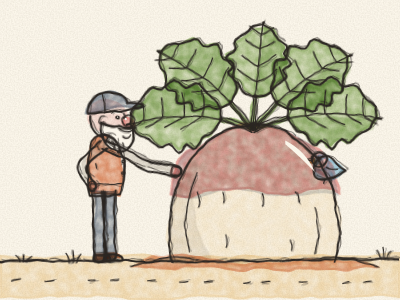
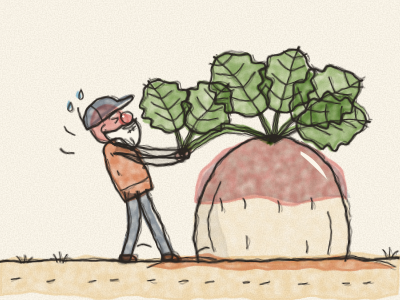

# O Nabo Gigante

Era uma vez um Avô velhinho que vivia numa casinha de madeira, com uma pequena horta. Numa manhã de primavera, pegou numa semente de nabo minúscula, fez um buraco na terra com o dedo e deixou cair a semente lá dentro. *Pat, pat, pat.* Depois tapou-a com terra.

— Cresce, nabozinho — disse o Avô. — Cresce docinho e cresce forte.

Todos os dias, o Avô regava o seu nabo. *Chape, chape.* O sol brilhava sobre ele, a chuva caía sobre ele, e o nabozinho crescia. Crescia, crescia e CRESCIA. Em pouco tempo ficou do tamanho de uma bola de futebol. Depois do tamanho de um carrinho de mão. Depois ficou tão grande como o próprio Avô! As folhas eram tão largas que os pássaros as usavam como guarda-chuvas.

— Que nabo! — disse o Avô. — Está na hora de o arrancar para o jantar.

Agarrou nas grandes folhas verdes. Firmou bem os pés na terra. E puxou. *Força! Força!* *(Puxem com o Avô!)*

Puxou, puxou. A cara ficou cor-de-rosa, depois vermelha. Mas o nabo não saía. Nem um bocadinho.

Então o Avô chamou: — Avó! Anda ajudar-me!

A Avó saiu de casa a limpar as mãos ao avental. Agarrou-se ao Avô, o Avô agarrou-se ao nabo, e puxaram. *Força! Força!*

Puxaram, puxaram. Mas o nabo não saía.

Então a Avó chamou: — Netinha! Anda ajudar-nos!

A Netinha veio a correr do baloiço. Agarrou-se à Avó, a Avó agarrou-se ao Avô, o Avô agarrou-se ao nabo, e puxaram. *Força! Força!*

Puxaram, puxaram. Mas o nabo não saía.

Então a Netinha chamou: — Cãozinho! Anda ajudar-nos!

O Cão atravessou o quintal aos saltos. *Ão, ão!* Agarrou-se à saia da Netinha. A Netinha agarrou-se à Avó, a Avó agarrou-se ao Avô, o Avô agarrou-se ao nabo, e puxaram. *Força! Força!*

Puxaram, puxaram. Mas o nabo não saía.

Então o Cão chamou: — Gatinha! Anda ajudar-nos!

A Gata espreguiçou-se, bocejou e veio devagarinho. *Miau.* Agarrou-se à cauda do Cão. O Cão agarrou-se à Netinha, a Netinha agarrou-se à Avó, a Avó agarrou-se ao Avô, o Avô agarrou-se ao nabo, e puxaram. *Força! Força!*

Puxaram, puxaram. Mas o nabo não saía. *(Quem é que ainda pode ajudar?)*

Então, do meio da erva alta, ouviu-se uma vozinha pequenina: — Chi, chi! Também posso ajudar?

Era um Ratinho castanho. Toda a gente se riu. — Tu? Mas tu és tão pequenino!

— Pequenino — disse o Ratinho —, mas forte!

Então a Gata chamou: — Está bem, Ratinho. Anda ajudar-nos!

O Ratinho agarrou-se à cauda da Gata. A Gata agarrou-se ao Cão, o Cão agarrou-se à Netinha, a Netinha agarrou-se à Avó, a Avó agarrou-se ao Avô, o Avô agarrou-se ao nabo, e puxaram. *Força! Força! FORÇA!*

E — *PUM!* — o nabo gigante saiu da terra!

Caíram todos para trás, num grande monte feliz: o Avô em cima da Avó, a Avó em cima da Netinha, a Netinha em cima do Cão, o Cão em cima da Gata, e a Gata… muito devagarinho em cima da cauda do Ratinho.

Riram-se, riram-se. Depois a Avó fez a maior panela de sopa de nabo que alguma vez se viu, e sentaram-se todos juntos a comê-la. E a primeiríssima tigela foi para o ajudante mais pequenino de todos: o Ratinho.

> Quando todos ajudam, até o trabalho maior se faz. E cada ajudante conta, mesmo o mais pequenino.
