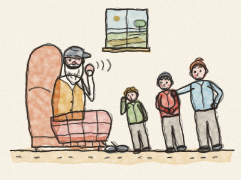
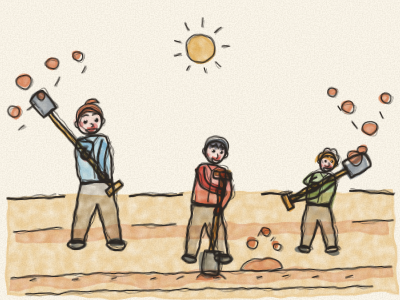

# The Farmer and His Sons

Once upon a time, an old Farmer lived with his three sons beside a big field. The Farmer had worked in that field every day of his life. But his sons liked to lie in the sun and yawn. *Aaaah-hum.*

One evening, the old Farmer felt very tired. He called his sons to his armchair. “Come close, my boys,” he whispered. “I have a secret. Somewhere in our field, a treasure is hidden.”

“A treasure?” said the three sons. “Where, Father? Where?”

“I don’t know exactly,” said the Farmer, with a little smile. “But if you dig, you will find it. Dig everywhere. Don’t miss a single corner.”

The very next morning, the three sons ran to the field with their spades. They dug in the north. *Dig, dig.* They dug in the south. *Dig, dig, dig.* They turned over every little bit of earth, all day long, all week long. But they found no gold. Not one coin.

“There’s no treasure!” they grumbled, rubbing their backs.

Then summer came. And because the earth had been turned so well, the wheat grew tall and thick and golden, more than ever before. That autumn, the brothers had the best harvest in the whole valley.

Then they understood. “Father was right,” said the eldest. “The treasure was our work.”

> Work hard and keep going: that is a treasure no one can take away.
