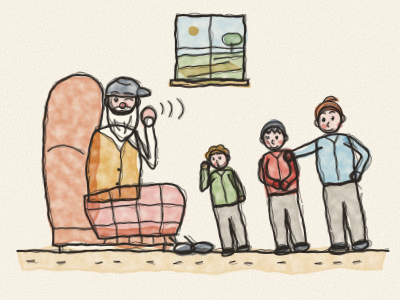
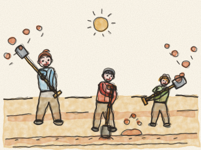

# Le Laboureur et ses Enfants

Il était une fois un vieux Laboureur qui vivait avec ses trois fils à côté d’un grand champ. Le Laboureur avait travaillé dans ce champ tous les jours de sa vie. Mais ses fils, eux, aimaient bien se coucher au soleil et bâiller. *Aaaah-hum.*

Un soir, le vieux Laboureur se sentit très fatigué. Il appela ses fils près de son fauteuil. « Approchez, mes garçons », chuchota-t-il. « J’ai un secret. Quelque part dans notre champ, un trésor est caché. »

« Un trésor ? » dirent les trois fils. « Où ça, Papa ? Où ça ? »

« Je ne sais pas exactement », dit le Laboureur avec un petit sourire. « Mais si vous creusez, vous le trouverez. Creusez partout. N’oubliez pas un seul coin. »

Dès le lendemain matin, les trois fils coururent au champ avec leurs bêches. Ils creusèrent au nord. *Creuse, creuse.* Ils creusèrent au sud. *Creuse, creuse, creuse.* Ils retournèrent chaque petit morceau de terre, toute la journée, toute la semaine. Mais ils ne trouvèrent pas d’or. Pas une seule pièce.

« Il n’y a pas de trésor ! » grognèrent-ils en se frottant le dos.

Puis l’été arriva. Et comme la terre avait été si bien retournée, le blé poussa haut, épais et doré, plus que jamais. Cet automne-là, les frères firent la plus belle récolte de toute la vallée.

Alors ils comprirent. « Papa avait raison », dit l’aîné. « Le trésor, c’était notre travail. »

> Travaillez, prenez de la peine : c’est le fonds qui manque le moins.
