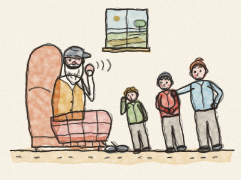
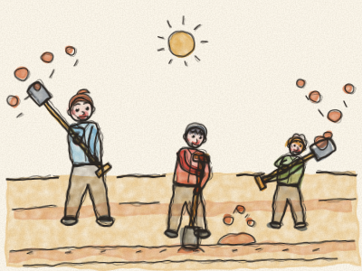

# O Lavrador e os Filhos

Era uma vez um velho Lavrador que vivia com os seus três filhos ao pé de um grande campo. O Lavrador tinha trabalhado naquele campo todos os dias da sua vida. Mas os filhos gostavam era de se deitar ao sol e bocejar. *Aaaah-hum.*

Uma noite, o velho Lavrador sentiu-se muito cansado. Chamou os filhos para junto da poltrona. — Cheguem-se cá, meus rapazes — sussurrou. — Tenho um segredo. Algures no nosso campo, está escondido um tesouro.

— Um tesouro? — disseram os três filhos. — Onde, pai? Onde?

— Não sei bem — disse o Lavrador, com um sorrisinho. — Mas, se cavarem, hão de encontrá-lo. Cavem por todo o lado. Não se esqueçam de nenhum cantinho.

Logo na manhã seguinte, os três filhos correram para o campo com as pás. Cavaram a norte. *Cava, cava.* Cavaram a sul. *Cava, cava, cava.* Revolveram cada pedacinho de terra, o dia inteiro, a semana inteira. Mas não encontraram ouro nenhum. Nem uma moeda.

— Não há tesouro nenhum! — resmungaram, a esfregar as costas.

Depois chegou o verão. E, como a terra tinha sido tão bem revolvida, o trigo cresceu alto, espesso e dourado, mais do que nunca. Nesse outono, os irmãos tiveram a melhor colheita de todo o vale.

Então perceberam. — O pai tinha razão — disse o mais velho. — O tesouro era o nosso trabalho.

> Trabalhar com vontade é um tesouro que ninguém nos pode tirar.
