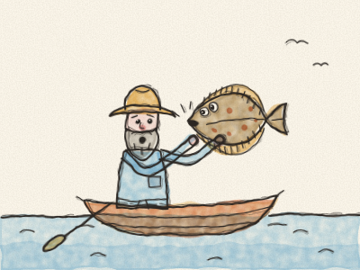
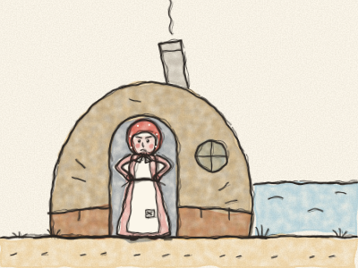
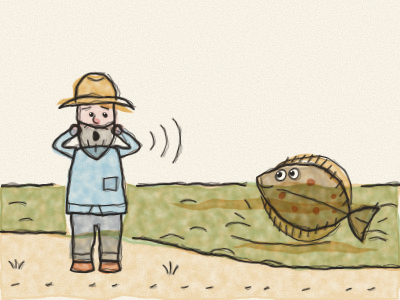
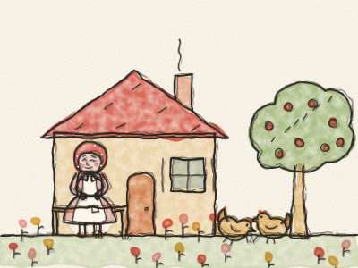
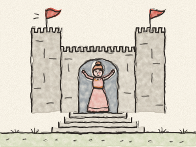
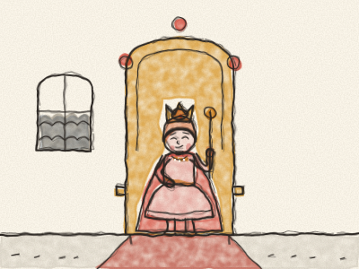
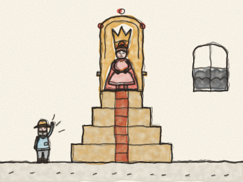
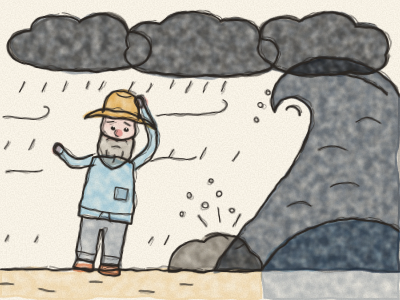
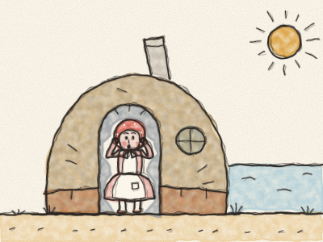
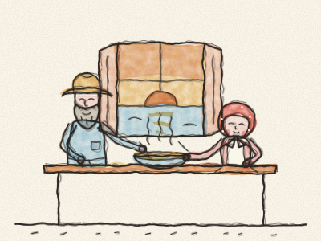

# The Fisherman and His Wife

Once upon a time, a fisherman and his wife, Ilsebill, lived by the sea in a tiny old hut. It was so small and so crooked that it looked like an upside-down pot. Every day the fisherman rowed out in his little boat and sat with his fishing line, watching the water.

One day, his line went *tug, tug, TUG!* He pulled and pulled, and up came a big flat fish, a flounder.

And the flounder spoke! “Please, fisherman, let me go. I am not really a fish. I am an enchanted prince. I wouldn’t taste nice at all.”

“Goodness me,” said the fisherman. “A fish that can talk? I would never eat you. Off you go!” And he put the flounder gently back into the water. *Splash!* The fish swam down to the bottom, and the fisherman rowed home.

“Did you catch anything today?” asked Ilsebill.

“Only a flounder,” said the fisherman. “But he said he was an enchanted prince, so I let him go.”

“You let him go?” cried Ilsebill. “And you didn’t wish for anything?”

“Wish for anything?” said the fisherman. “What would I wish for?”

“Look at this hut!” said Ilsebill. “It’s tiny. It’s crooked. It’s dark. Go straight back and tell that fish we would like a pretty little cottage.”

The fisherman did not really want to go. “He already gave us his thanks,” he said. But Ilsebill folded her arms and tapped her foot, *tap, tap, tap*. So off he went.

When he came to the sea, the water was no longer clear and blue. It was green and yellow. The fisherman stood at the edge of the waves and called out:

“Little fish, little fish, in the sea,
Please come up and talk to me!
My wife, my wife has another wish,
Please come and help us, little fish!”

*Splish!* Up came the flounder. “Well, what does she want?”

“She says I should have wished for something,” said the fisherman. “She doesn’t want to live in our old hut any more. She would like a pretty little cottage.”

“Go home,” said the flounder. “She has it already.”

The fisherman went home. The old hut was gone! In its place stood a pretty little cottage with a red roof, a little kitchen, a bedroom, and a garden full of flowers and apples, with hens going *cluck, cluck* in the yard. And there was Ilsebill, sitting on a bench by the door.

“Isn’t this lovely?” said the fisherman. “Now we will be happy.”

“We’ll see,” said Ilsebill.

For a week or two, everything was fine. Then one morning Ilsebill said, “Husband, this cottage is far too small. The garden is tiny. I want to live in a big stone castle. Go and ask the fish.”

“Oh, wife,” said the fisherman. “The cottage is perfectly nice. I don’t want to bother the fish again.”

“Go!” said Ilsebill.

So the fisherman went, with heavy feet. The sea was now purple and dark blue, and it was not calm any more. He called:

“Little fish, little fish, in the sea,
Please come up and talk to me!
My wife, my wife has another wish,
Please come and help us, little fish!”

“Well, what does she want now?” said the flounder.

“She wants to live in a big stone castle,” said the fisherman sadly.

“Go home. She is standing at the door.”

And there it was: a huge stone castle with tall towers and flags. Inside were marble floors, golden chairs, and servants who opened every door, *creak*, and closed every door, *clunk*. Behind the castle there was a park with deer and a stable full of horses.

“Now,” said the fisherman, “we will be happy for ever.”

“We’ll see,” said Ilsebill.

The next morning, she woke up early and looked out of the window at all the land. “Husband,” she said, “get up! I want to be Queen of all this land.”

“Queen?” said the fisherman. “Oh, wife, I don’t want to be King.”

“Then I’ll be Queen by myself. Go and tell the fish!”

The sea was grey now, and the waves were thick and churning, *swoosh, swoosh*. The fisherman called the little rhyme, and the flounder came up. “Well, what does she want now?”

“She wants to be Queen.”

“Go home. She is Queen already.”

At the castle, there were soldiers with drums and trumpets, *ta-ra-ra, boom, boom!* And Ilsebill sat on a tall golden throne, with a golden crown on her head and a sceptre in her hand.

“Well, wife,” said the fisherman, “now you are Queen. Now there is nothing more to wish for.”

But Ilsebill was already thinking. “Being Queen is boring,” she said. “I want to be Empress, the ruler of all the kings and queens in the world!”

“Oh, wife! The fish can’t do that!”

“Of course he can. Go!”

The sea was black now, and a cold wind was blowing. The fisherman was frightened, but he called out the rhyme. “What now?” asked the flounder.

“She wants to be Empress.”

“Go home. She is Empress already.”

Now Ilsebill sat on a throne as high as a house, with a crown as big as a bucket. Princes and dukes bowed to her, all in a long row. The fisherman had to stand on tiptoe and shout to talk to her.

“Wife!” he shouted. “Are you happy now?”

“We’ll see,” said Ilsebill.

That night she could not sleep. She tossed and turned, thinking of what else she could have. In the morning, she saw the sun come up over the hills, shining and golden. And she said, “Husband! I want to make the sun rise and the moon rise, all by myself!”

The fisherman was so shocked that he fell out of bed, *bump!* “Oh, wife, please! Be happy with what you have!”

“Go and tell the fish!” said Ilsebill.

Outside, there was a great storm. The wind howled, *whoooo!* The trees bent, the clouds were black, and the waves were as tall as church towers, crashing on the rocks. The fisherman had to shout as loudly as he could:

“Little fish, little fish, in the sea,
Please come up and talk to me!
My wife, my wife has another wish,
Please come and help us, little fish!”

“Well, what does she want now?” asked the flounder.

“Oh dear,” said the fisherman. “She wants to make the sun and the moon rise, all by herself.”

The flounder was quiet for a moment. Then he said, “Go home. She is back in your little old hut.”

And it was true. The castle was gone. The throne was gone. The crown was gone. There was the tiny crooked hut, just as before, and there was Ilsebill, sitting on the doorstep in her old apron.

The storm stopped. The sea grew calm and blue again, and the sun shone. *(Pause. How do you think Ilsebill felt?)*

At first, Ilsebill sniffed a little. Then she looked at the blue sea, at the sunshine, and at her husband, who was holding her hand.

“You know,” she said slowly, “I had a cottage, a castle and a crown, and I still wasn’t happy. Perhaps happiness isn’t about having more.”

“We have a roof over our heads,” said the fisherman, “and the sea, and each other.”

That evening, the fisherman made a big pot of soup, and they ate it together at their little table, by the open window, while the sun went down over the sea. It was the best soup Ilsebill had ever tasted.

The next day, she planted flowers by the door of the hut. The fisherman painted it blue. And it did not look like an old pot any more. It looked like home.

And sometimes, when the fisherman was out in his boat, a big flat fish would pop its head out of the water, and wink at him. *Splish!*

> Happiness doesn’t come from always wanting more. It comes from loving what you already have.
