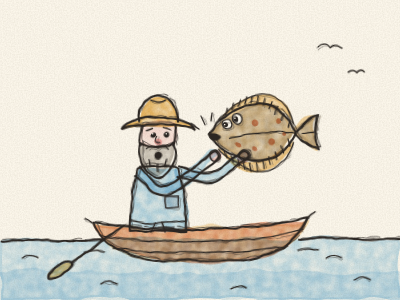
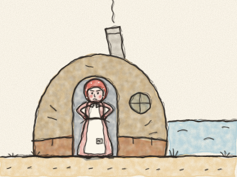
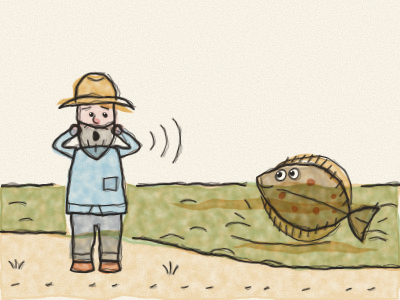
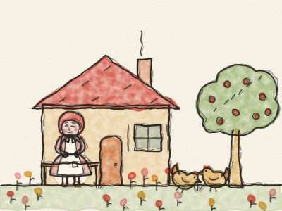
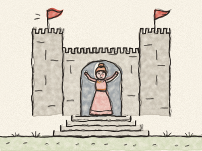
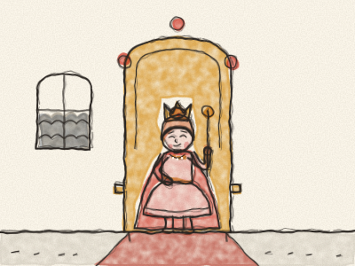
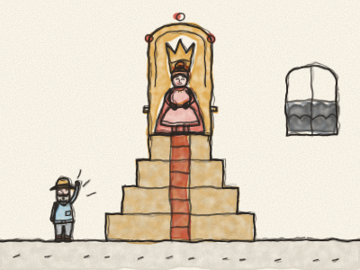
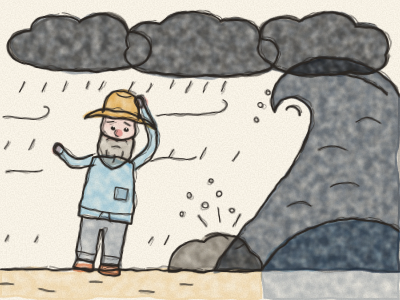
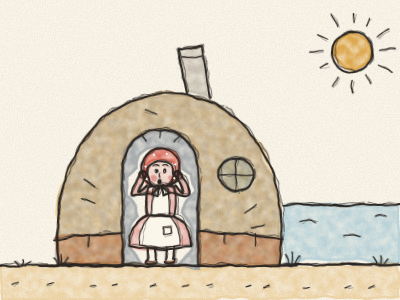
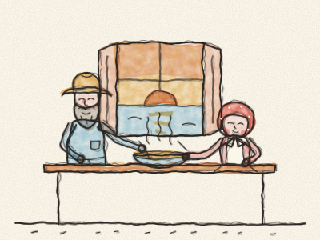

# Le Pêcheur et sa Femme

Il était une fois un pêcheur et sa femme, Ilsebill, qui vivaient au bord de la mer dans une toute petite cabane. Elle était si petite et si tordue qu’on aurait dit un vieux pot à l’envers. Chaque jour, le pêcheur partait dans sa petite barque, et il restait assis avec sa ligne, à regarder l’eau.

Un jour, sa ligne fit *tic, tic, TIC !* Il tira, tira, et il remonta un grand poisson plat, un turbot.

Et le turbot parla ! « S’il te plaît, pêcheur, laisse-moi partir. Je ne suis pas vraiment un poisson. Je suis un prince enchanté. Je ne serais pas bon à manger du tout. »

« Ça alors, » dit le pêcheur. « Un poisson qui parle ? Jamais je ne te mangerais. Va-t’en ! » Et il remit doucement le turbot dans l’eau. *Plouf !* Le poisson nagea jusqu’au fond, et le pêcheur rentra chez lui.

« Tu as pêché quelque chose aujourd’hui ? » demanda Ilsebill.

« Seulement un turbot, » dit le pêcheur. « Mais il m’a dit qu’il était un prince enchanté, alors je l’ai laissé partir. »

« Tu l’as laissé partir ? » s’écria Ilsebill. « Et tu n’as fait aucun vœu ? »

« Un vœu ? » dit le pêcheur. « Et qu’est-ce que j’aurais souhaité ? »

« Regarde cette cabane ! » dit Ilsebill. « Elle est minuscule. Elle est tordue. Elle est sombre. Retourne tout de suite dire à ce poisson que nous voudrions une jolie petite maison. »

Le pêcheur n’avait pas très envie d’y aller. « Il nous a déjà remerciés, » dit-il. Mais Ilsebill croisa les bras et tapa du pied, *tap, tap, tap*. Alors il y alla.

Quand il arriva à la mer, l’eau n’était plus claire et bleue. Elle était verte et jaune. Le pêcheur se mit au bord des vagues et appela :

« Petit poisson, poisson de l’océan,
Viens me parler, viens, je t’attends !
Ma femme, ma femme a un souhait,
Aide-nous encore, s’il te plaît ! »

*Plic !* Le turbot apparut. « Eh bien, que veut-elle ? »

« Elle dit que j’aurais dû faire un vœu, » dit le pêcheur. « Elle ne veut plus vivre dans notre vieille cabane. Elle voudrait une jolie petite maison. »

« Rentre chez toi, » dit le turbot. « Elle l’a déjà. »

Le pêcheur rentra. La vieille cabane avait disparu ! À sa place, il y avait une jolie petite maison avec un toit rouge, une petite cuisine, une chambre, et un jardin plein de fleurs et de pommes, avec des poules qui faisaient *cot, cot* dans la cour. Et Ilsebill était là, assise sur un banc devant la porte.

« N’est-ce pas merveilleux ? » dit le pêcheur. « Maintenant, nous allons être heureux. »

« On verra, » dit Ilsebill.

Pendant une semaine ou deux, tout alla bien. Puis un matin, Ilsebill dit : « Mon mari, cette maison est bien trop petite. Le jardin est minuscule. Je veux habiter dans un grand château de pierre. Va le demander au poisson. »

« Oh, ma femme, » dit le pêcheur. « La maison est très bien. Je ne veux pas encore déranger le poisson. »

« Vas-y ! » dit Ilsebill.

Alors le pêcheur y alla, en traînant les pieds. La mer était maintenant violette et bleu foncé, et elle n’était plus calme du tout. Il appela :

« Petit poisson, poisson de l’océan,
Viens me parler, viens, je t’attends !
Ma femme, ma femme a un souhait,
Aide-nous encore, s’il te plaît ! »

« Eh bien, que veut-elle maintenant ? » dit le turbot.

« Elle veut habiter dans un grand château de pierre, » dit le pêcheur tristement.

« Rentre chez toi. Elle est devant la porte. »

Et il était là : un immense château de pierre, avec de hautes tours et des drapeaux. À l’intérieur, il y avait des sols de marbre, des chaises en or, et des serviteurs qui ouvraient toutes les portes, *crrr*, et fermaient toutes les portes, *clac*. Derrière le château, il y avait un parc avec des cerfs et une écurie pleine de chevaux.

« Maintenant, » dit le pêcheur, « nous serons heureux pour toujours. »

« On verra, » dit Ilsebill.

Le lendemain matin, elle se réveilla de bonne heure et regarda tout le pays par la fenêtre. « Mon mari, » dit-elle, « lève-toi ! Je veux être Reine de tout ce pays. »

« Reine ? » dit le pêcheur. « Oh, ma femme, moi, je ne veux pas être Roi. »

« Alors je serai Reine toute seule. Va le dire au poisson ! »

La mer était grise maintenant, et les vagues étaient épaisses et agitées, *chhh, chhh*. Le pêcheur récita la petite chanson, et le turbot apparut. « Eh bien, que veut-elle maintenant ? »

« Elle veut être Reine. »

« Rentre chez toi. Elle est déjà Reine. »

Au château, il y avait des soldats avec des tambours et des trompettes, *tarata, boum, boum !* Et Ilsebill était assise sur un haut trône d’or, avec une couronne d’or sur la tête et un sceptre à la main.

« Eh bien, ma femme, » dit le pêcheur, « te voilà Reine. Maintenant, il n’y a plus rien à souhaiter. »

Mais Ilsebill réfléchissait déjà. « C’est ennuyeux d’être Reine, » dit-elle. « Je veux être Impératrice, la souveraine de tous les rois et de toutes les reines du monde ! »

« Oh, ma femme ! Le poisson ne peut pas faire ça ! »

« Bien sûr que si. Vas-y ! »

La mer était noire maintenant, et un vent froid soufflait. Le pêcheur avait peur, mais il récita la chanson. « Quoi encore ? » demanda le turbot.

« Elle veut être Impératrice. »

« Rentre chez toi. Elle est déjà Impératrice. »

Maintenant, Ilsebill était assise sur un trône haut comme une maison, avec une couronne grande comme un seau. Les princes et les ducs s’inclinaient devant elle, tous en rang. Le pêcheur devait se mettre sur la pointe des pieds et crier pour lui parler.

« Ma femme ! » cria-t-il. « Es-tu heureuse, maintenant ? »

« On verra, » dit Ilsebill.

Cette nuit-là, elle ne put pas dormir. Elle se tournait et se retournait, en pensant à tout ce qu’elle pourrait encore avoir. Au matin, elle vit le soleil se lever sur les collines, brillant et doré. Et elle dit : « Mon mari ! Je veux faire lever le soleil et la lune, toute seule ! »

Le pêcheur fut si surpris qu’il tomba du lit, *boum !* « Oh, ma femme, je t’en prie ! Contente-toi de ce que tu as ! »

« Va le dire au poisson ! » dit Ilsebill.

Dehors, il y avait une terrible tempête. Le vent hurlait, *hououou !* Les arbres se courbaient, les nuages étaient noirs, et les vagues, hautes comme des clochers, s’écrasaient sur les rochers. Le pêcheur dut crier de toutes ses forces :

« Petit poisson, poisson de l’océan,
Viens me parler, viens, je t’attends !
Ma femme, ma femme a un souhait,
Aide-nous encore, s’il te plaît ! »

« Eh bien, que veut-elle maintenant ? » demanda le turbot.

« Oh là là, » dit le pêcheur. « Elle veut faire lever le soleil et la lune, toute seule. »

Le turbot resta un moment silencieux. Puis il dit : « Rentre chez toi. Elle est de retour dans votre vieille petite cabane. »

Et c’était vrai. Le château avait disparu. Le trône avait disparu. La couronne avait disparu. Il y avait la toute petite cabane tordue, comme avant, et Ilsebill était assise sur le seuil, dans son vieux tablier.

La tempête s’arrêta. La mer redevint calme et bleue, et le soleil brilla. *(Faire une pause. À ton avis, comment se sentait Ilsebill ?)*

D’abord, Ilsebill renifla un peu. Puis elle regarda la mer bleue, le soleil, et son mari, qui lui tenait la main.

« Tu sais, » dit-elle lentement, « j’ai eu une maison, un château et une couronne, et je n’étais toujours pas heureuse. Peut-être que le bonheur, ce n’est pas d’avoir toujours plus. »

« Nous avons un toit au-dessus de nos têtes, » dit le pêcheur, « et la mer, et nous deux. »

Ce soir-là, le pêcheur prépara une grande marmite de soupe, et ils la mangèrent ensemble à leur petite table, près de la fenêtre ouverte, pendant que le soleil se couchait sur la mer. C’était la meilleure soupe qu’Ilsebill ait jamais goûtée.

Le lendemain, elle planta des fleurs devant la porte de la cabane. Le pêcheur la peignit en bleu. Et elle ne ressemblait plus du tout à un vieux pot. Elle ressemblait à une maison.

Et parfois, quand le pêcheur était dans sa barque, un grand poisson plat sortait la tête de l’eau et lui faisait un clin d’œil. *Plic !*

> Le bonheur ne vient pas de toujours vouloir plus. Il vient d’aimer ce que l’on a déjà.
