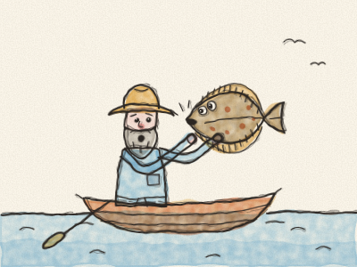
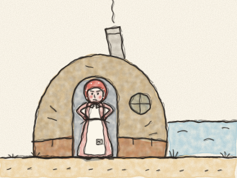
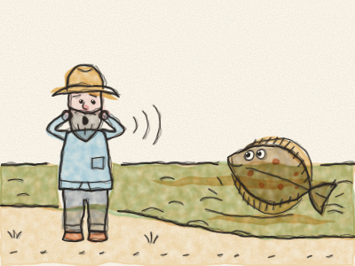
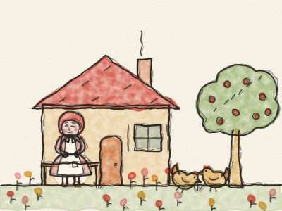
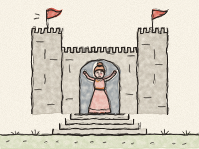
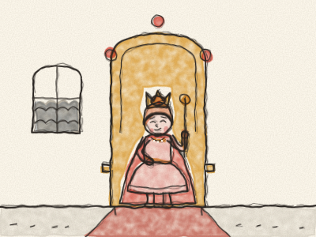
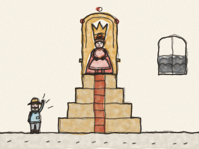
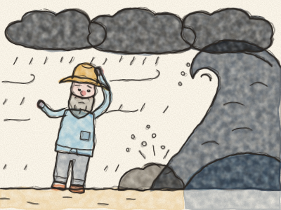
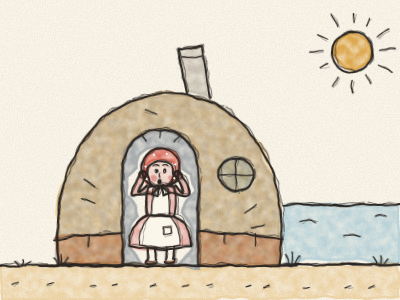
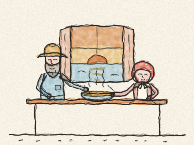

# O Pescador e a Sua Mulher

Era uma vez um pescador e a sua mulher, a Ilsebill, que viviam à beira-mar numa cabana pequenina e velha. Era tão pequena e tão torta que parecia uma panela virada ao contrário. Todos os dias, o pescador saía no seu barquinho e ficava sentado com a cana de pesca, a olhar para a água.

Um dia, a linha fez *tic, tic, TIC!* Ele puxou, puxou, e saiu da água um grande peixe achatado, um linguado.

E o linguado falou! — Por favor, pescador, deixa-me ir. Eu não sou um peixe a sério. Sou um príncipe encantado. Não ia saber nada bem.

— Valha-me Deus — disse o pescador. — Um peixe que fala? Eu nunca te comeria. Vai-te embora! — E pôs o linguado devagarinho de volta na água. *Chape!* O peixe nadou até ao fundo, e o pescador voltou para casa.

— Pescaste alguma coisa hoje? — perguntou a Ilsebill.

— Só um linguado — disse o pescador. — Mas ele disse que era um príncipe encantado, por isso deixei-o ir.

— Deixaste-o ir? — gritou a Ilsebill. — E não pediste nenhum desejo?

— Um desejo? — disse o pescador. — E o que é que eu havia de desejar?

— Olha para esta cabana! — disse a Ilsebill. — É minúscula. É torta. É escura. Volta já lá e diz a esse peixe que gostávamos de ter uma casinha bonita.

O pescador não tinha muita vontade de ir. — Ele já nos agradeceu — disse ele. Mas a Ilsebill cruzou os braços e bateu com o pé, *tap, tap, tap*. E lá foi ele.

Quando chegou ao mar, a água já não estava clara e azul. Estava verde e amarela. O pescador pôs-se à beira das ondas e chamou:

«Peixinho, peixinho do fundo do mar,
Sobe cá acima, vem-me escutar!
A minha mulher quer mais uma vez,
Ajuda-nos, peixinho, por quem és!»

*Plim!* O linguado apareceu. — Então, o que é que ela quer?

— Diz que eu devia ter pedido um desejo — disse o pescador. — Já não quer viver na nossa cabana velha. Gostava de ter uma casinha bonita.

— Vai para casa — disse o linguado. — Ela já a tem.

O pescador voltou para casa. A cabana velha tinha desaparecido! No lugar dela estava uma casinha bonita com um telhado vermelho, uma cozinha pequenina, um quarto e um jardim cheio de flores e maçãs, com galinhas a fazer *có, có* no quintal. E lá estava a Ilsebill, sentada num banco à porta.

— Não é maravilhoso? — disse o pescador. — Agora vamos ser felizes.

— Logo se vê — disse a Ilsebill.

Durante uma semana ou duas, tudo correu bem. Até que uma manhã a Ilsebill disse: — Marido, esta casa é pequena demais. O jardim é minúsculo. Quero viver num grande castelo de pedra. Vai pedir ao peixe.

— Ai, mulher — disse o pescador. — A casa está muito bem. Não quero voltar a incomodar o peixe.

— Vai! — disse a Ilsebill.

E o pescador lá foi, a arrastar os pés. O mar estava agora roxo e azul-escuro, e já não estava nada calmo. Ele chamou:

«Peixinho, peixinho do fundo do mar,
Sobe cá acima, vem-me escutar!
A minha mulher quer mais uma vez,
Ajuda-nos, peixinho, por quem és!»

— Então, o que é que ela quer agora? — disse o linguado.

— Quer viver num grande castelo de pedra — disse o pescador, muito triste.

— Vai para casa. Ela está à porta.

E lá estava ele: um castelo de pedra enorme, com torres altas e bandeiras. Lá dentro havia chãos de mármore, cadeiras de ouro e criados que abriam todas as portas, *nhec*, e fechavam todas as portas, *pum*. Atrás do castelo havia um parque com veados e uma cavalariça cheia de cavalos.

— Agora — disse o pescador — vamos ser felizes para sempre.

— Logo se vê — disse a Ilsebill.

Na manhã seguinte, acordou muito cedo e olhou pela janela para toda aquela terra. — Marido — disse ela —, levanta-te! Quero ser Rainha desta terra toda.

— Rainha? — disse o pescador. — Ai, mulher, eu não quero ser Rei.

— Então sou Rainha sozinha. Vai dizer ao peixe!

O mar estava agora cinzento, e as ondas eram grossas e revoltas, *chuá, chuá*. O pescador disse a rima, e o linguado apareceu. — Então, o que é que ela quer agora?

— Quer ser Rainha.

— Vai para casa. Ela já é Rainha.

No castelo havia soldados com tambores e trombetas, *tará-tá-tá, bum, bum!* E a Ilsebill estava sentada num trono alto de ouro, com uma coroa de ouro na cabeça e um ceptro na mão.

— Então, mulher — disse o pescador —, agora és Rainha. Agora já não há mais nada para desejar.

Mas a Ilsebill já estava a pensar. — Ser Rainha é uma seca — disse ela. — Quero ser Imperatriz, a que manda em todos os reis e rainhas do mundo!

— Ai, mulher! O peixe não consegue fazer isso!

— Claro que consegue. Vai!

O mar estava agora negro, e soprava um vento frio. O pescador tinha medo, mas disse a rima. — E agora? — perguntou o linguado.

— Quer ser Imperatriz.

— Vai para casa. Ela já é Imperatriz.

Agora a Ilsebill estava sentada num trono tão alto como uma casa, com uma coroa do tamanho de um balde. Príncipes e duques faziam-lhe vénias, todos em fila. O pescador tinha de se pôr em bicos de pés e gritar para falar com ela.

— Mulher! — gritou ele. — Estás feliz agora?

— Logo se vê — disse a Ilsebill.

Nessa noite, ela não conseguiu dormir. Virava-se para um lado e para o outro, a pensar no que mais podia ter. De manhã, viu o sol nascer por cima das colinas, brilhante e dourado. E disse: — Marido! Quero fazer nascer o sol e a lua, sozinha!

O pescador ficou tão espantado que caiu da cama, *pumba!* — Ai, mulher, por favor! Contenta-te com o que tens!

— Vai dizer ao peixe! — disse a Ilsebill.

Lá fora havia uma enorme tempestade. O vento uivava, *uuuuh!* As árvores dobravam-se, as nuvens eram negras, e as ondas, altas como torres de igreja, rebentavam nas rochas. O pescador teve de gritar com toda a força:

«Peixinho, peixinho do fundo do mar,
Sobe cá acima, vem-me escutar!
A minha mulher quer mais uma vez,
Ajuda-nos, peixinho, por quem és!»

— Então, o que é que ela quer agora? — perguntou o linguado.

— Ai, ai — disse o pescador. — Quer fazer nascer o sol e a lua, sozinha.

O linguado ficou calado um momento. Depois disse: — Vai para casa. Ela está outra vez na vossa cabana pequenina e velha.

E era verdade. O castelo tinha desaparecido. O trono tinha desaparecido. A coroa tinha desaparecido. Lá estava a cabana pequenina e torta, como dantes, e lá estava a Ilsebill, sentada no degrau da porta, com o seu avental velho.

A tempestade parou. O mar voltou a ficar calmo e azul, e o sol brilhou. *(Fazer uma pausa. Como achas que a Ilsebill se sentia?)*

Primeiro, a Ilsebill fungou um bocadinho. Depois olhou para o mar azul, para o sol e para o marido, que lhe dava a mão.

— Sabes — disse ela devagar —, tive uma casa, um castelo e uma coroa, e mesmo assim não era feliz. Se calhar, a felicidade não é ter cada vez mais.

— Temos um teto por cima da cabeça — disse o pescador —, e o mar, e um ao outro.

Nessa noite, o pescador fez uma grande panela de sopa, e comeram-na juntos na sua mesinha, ao pé da janela aberta, enquanto o sol se punha sobre o mar. Foi a melhor sopa que a Ilsebill alguma vez provou.

No dia seguinte, ela plantou flores à porta da cabana. O pescador pintou-a de azul. E já não parecia nada uma panela velha. Parecia um lar.

E às vezes, quando o pescador estava no barco, um grande peixe achatado punha a cabeça fora de água e piscava-lhe o olho. *Plim!*

> A felicidade não vem de querer sempre mais. Vem de gostar do que já temos.
