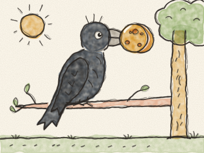
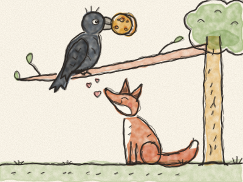

# The Fox and the Crow

One sunny morning, a black Crow found a big round piece of cheese on a farmhouse windowsill. *Swoop!* She snatched it in her beak and flew up to the top of a tall tree, very pleased with herself.

Down below, a red Fox was trotting by. He sniffed the air. *Sniff, sniff.* “Mmm! Cheese!” He looked up and saw the Crow, with the cheese in her beak. “I want that cheese,” thought the Fox. “But how can I get it? I can’t climb trees… and she won’t give it to me.”

So the Fox sat down at the foot of the tree, put on his biggest smile, and called up in his sweetest voice:

“Good morning, Madam Crow! Oh, how beautiful you are today! What shiny black feathers! What bright eyes! What an elegant beak!”

The Crow puffed out her chest. Nobody had ever said such nice things to her.

“I am sure,” said the Fox, “that a bird as beautiful as you must have the most beautiful voice in the whole forest. Oh, if only I could hear you sing, just once!”

The Crow was so proud that she forgot all about the cheese. She opened her beak as wide as she could and sang: *“CAW! CAW! CAAAW!”*

And — *plop!* — down fell the cheese, right into the Fox’s mouth.

“Thank you, Madam Crow,” said the Fox, licking his lips. “Your voice is lovely. But remember: people who say very sweet things sometimes just want your cheese!”

And off he trotted, while the Crow sat on her branch, with no cheese at all, feeling rather silly.

> Be careful of people who say too many nice things: they may want something from you.
