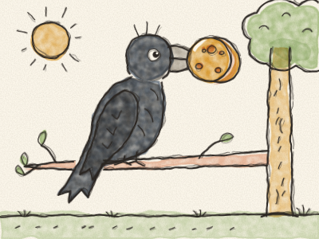
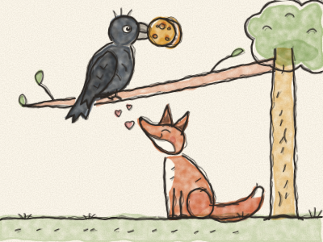

# Le Corbeau et le Renard

Un beau matin, un Corbeau tout noir trouva un gros fromage rond sur le rebord d’une fenêtre de ferme. *Hop !* Il l’attrapa dans son bec et s’envola tout en haut d’un grand arbre, très content de lui.

En bas, un Renard roux passait par là. Il renifla l’air. *Snif, snif.* « Mmm ! Du fromage ! » Il leva les yeux et vit le Corbeau, avec le fromage dans le bec. « Je veux ce fromage, pensa le Renard. Mais comment faire ? Je ne sais pas grimper aux arbres… et il ne me le donnera jamais. »

Alors le Renard s’assit au pied de l’arbre, fit son plus grand sourire et lança de sa voix la plus douce :

« Hé ! Bonjour, Monsieur du Corbeau ! Que vous êtes joli ! Que vous me semblez beau ! Quelles plumes noires et brillantes ! Quels yeux pétillants ! Quel bec élégant ! »

Le Corbeau gonfla sa poitrine. Personne ne lui avait jamais dit des choses aussi gentilles.

« Je suis sûr, reprit le Renard, qu’un oiseau aussi beau que vous a la plus belle voix de toute la forêt. Oh, si seulement je pouvais vous entendre chanter, rien qu’une fois ! »

Le Corbeau était si fier qu’il en oublia complètement son fromage. Il ouvrit un large bec et chanta : *« CROA ! CROA ! CROAAA ! »*

Et — *plouf !* — le fromage tomba, tout droit dans la gueule du Renard.

« Merci, Monsieur du Corbeau, dit le Renard en se léchant les babines. Votre voix est charmante. Mais retenez bien ceci : ceux qui disent des choses très douces veulent parfois juste votre fromage ! »

Et il s’en alla en trottinant, tandis que le Corbeau, sur sa branche, sans plus de fromage du tout, se sentait un peu bête.

> Apprenez que tout flatteur vit aux dépens de celui qui l’écoute.
