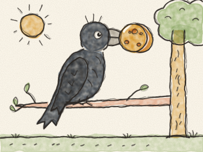
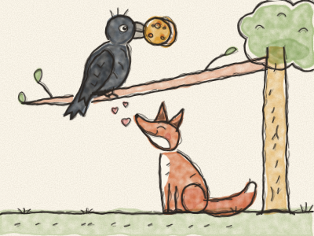

# A Raposa e o Corvo

Numa manhã de sol, um Corvo todo preto encontrou um grande queijo redondo no parapeito da janela de uma quinta. *Zás!* Agarrou-o com o bico e voou até ao cimo de uma árvore muito alta, todo contente consigo mesmo.

Lá em baixo, ia a passar uma Raposa ruiva. Farejou o ar. *Snif, snif.* — Hum! Queijo! — Olhou para cima e viu o Corvo, com o queijo no bico. «Quero aquele queijo», pensou a Raposa. «Mas como é que o apanho? Não sei subir às árvores… e ele nunca mo vai dar.»

Então a Raposa sentou-se ao pé da árvore, fez o seu sorriso mais bonito e chamou com a sua voz mais doce:

— Bom dia, Senhor Corvo! Ai, que lindo que está hoje! Que penas pretas tão brilhantes! Que olhos tão vivos! Que bico tão elegante!

O Corvo encheu o peito de orgulho. Nunca ninguém lhe tinha dito coisas tão simpáticas.

— Tenho a certeza — continuou a Raposa — de que uma ave tão bonita como o senhor tem a voz mais bonita de toda a floresta. Ai, se eu o pudesse ouvir cantar, nem que fosse só uma vez!

O Corvo ficou tão vaidoso que se esqueceu completamente do queijo. Abriu o bico o mais que pôde e cantou: *— CRÁ! CRÁ! CRÁÁÁ!*

E — *plof!* — lá caiu o queijo, direitinho para a boca da Raposa.

— Obrigada, Senhor Corvo — disse a Raposa, a lamber os beiços. — A sua voz é encantadora. Mas lembre-se: quem diz coisas muito doces às vezes só quer o seu queijo!

E lá se foi a trote, enquanto o Corvo ficava no seu ramo, sem queijo nenhum, a sentir-se um bocadinho tonto.

> Cuidado com quem diz demasiadas coisas bonitas: talvez queira alguma coisa de ti.
