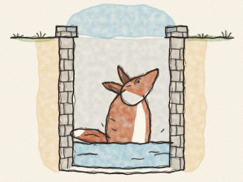
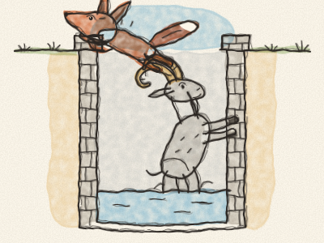

# The Fox and the Goat

One hot summer day, a red Fox was trotting along, sniffing here and sniffing there, when — *oops!* — he fell right into a deep well. *SPLASH!*

The water only came up to his tummy, so he was safe. But the walls were tall and smooth. He jumped. He scrabbled. He slid back down. *Splash!* He was stuck.

After a while, a Goat with long curly horns came by. He was very thirsty. He looked down into the well. “Hello, Fox! Is the water nice down there?”

The Fox had an idea. “Nice?” he said. “It’s the best water in the whole world! Cool and sweet! Jump in and have a drink!”

The Goat did not stop to think. *Hop!* He jumped right in. *SPLASH!* He drank and drank. *Slurp, slurp, slurp.* Then he looked up. “Oh dear. How do we get out?”

“Easy!” said the Fox. “Stand up against the wall. I’ll climb on your back, then pull you out.” *Scramble, scramble* — up the Goat’s back, up his horns, and out!

But the Fox did not pull. He just peeped over the edge. “Silly Goat! Next time, look before you leap!” And off he ran. *(What a cheeky fox!)*

The poor Goat bleated, *Meeeh!*, until the farmer heard him and lowered a bucket to help him out.

> Look before you leap, and think before you trust.
