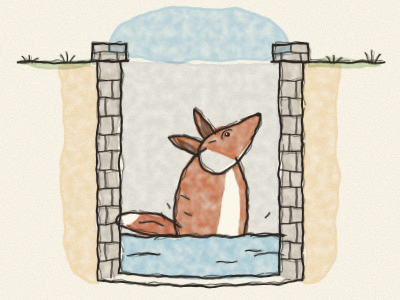
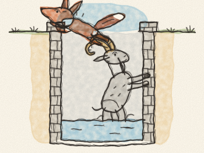

# Le Renard et le Bouc

Par un chaud jour d’été, un Renard roux trottinait en reniflant par-ci, en reniflant par-là, quand — *oups !* — il tomba tout droit dans un puits profond. *PLOUF !*

L’eau ne lui arrivait qu’au ventre, il ne risquait rien. Mais les murs étaient hauts et tout lisses. Il sauta. Il gratta. Il glissa. *Plouf !* Il était coincé.

Un peu plus tard, un Bouc aux longues cornes recourbées passa par là. Il avait très soif. Il se pencha au-dessus du puits. « Bonjour, Renard ! Elle est bonne, l’eau, là-dedans ? »

Le Renard eut une idée. « Bonne ? » dit-il. « C’est la meilleure eau du monde ! Fraîche et douce ! Saute donc, et viens boire ! »

Le Bouc ne prit pas le temps de réfléchir. *Hop !* Il sauta dans le puits. *PLOUF !* Il but et but encore. *Slurp, slurp, slurp.* Puis il leva la tête. « Oh là là. Comment est-ce qu’on sort ? »

« Facile ! » dit le Renard. « Mets-toi debout contre le mur. Je monte sur ton dos, puis je te tire dehors. » *Grimpe, grimpe* — sur le dos du Bouc, sur ses cornes, et dehors !

Mais le Renard ne tira pas. Il passa juste le museau par-dessus le bord. « Gros nigaud ! La prochaine fois, regarde avant de sauter ! » Et il s’enfuit. *(Quel coquin, ce renard !)*

Le pauvre Bouc bêla, *Bêêê !*, jusqu’à ce que le fermier l’entende et lui descende un seau pour l’aider à sortir.

> En toute chose, il faut considérer la fin.
