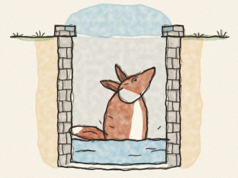
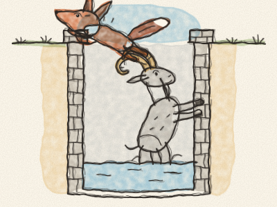

# A Raposa e o Bode

Num dia quente de verão, uma Raposa ruiva ia a trotar, a farejar aqui e a farejar ali, quando — *ups!* — caiu direitinha dentro de um poço muito fundo. *CHAPE!*

A água só lhe chegava à barriga, por isso estava a salvo. Mas as paredes eram altas e muito lisas. Saltou. Arranhou. Escorregou. *Chape!* Estava presa.

Pouco depois, passou por ali um Bode de cornos compridos e enrolados. Tinha muita sede. Espreitou para dentro do poço. — Olá, Raposa! A água aí em baixo é boa?

A Raposa teve uma ideia. — Boa? — disse ela. — É a melhor água do mundo inteiro! Fresca e doce! Salta cá para dentro e bebe!

O Bode não parou para pensar. *Hop!* Saltou lá para dentro. *CHAPE!* Bebeu e bebeu. *Glu, glu, glu.* Depois olhou para cima. — Ai, ai. Como é que saímos daqui?

— É fácil! — disse a Raposa. — Põe-te de pé encostado à parede. Eu subo para as tuas costas e depois puxo-te cá para fora. *Trepa, trepa* — pelas costas do Bode, pelos cornos acima, e cá fora!

Mas a Raposa não puxou nada. Só espreitou por cima da borda. — Bode pateta! Para a próxima, olha bem antes de saltar! — E fugiu a correr. *(Que raposa tão marota!)*

O pobre Bode baliu, *Méééé!*, até que o lavrador o ouviu e lhe desceu um balde para o ajudar a sair.

> Antes de saltar, olha bem; e antes de confiar, pensa também.
