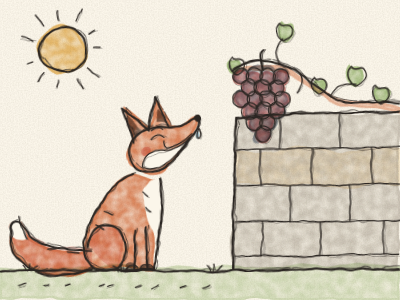
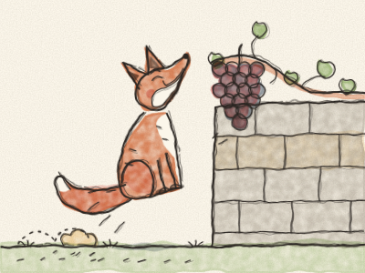

# The Fox and the Grapes

One hot summer day, a red Fox was trotting along a country lane. The sun was shining, the road was dusty, and the Fox was very, very thirsty.

Then he saw it. High up on an old stone wall grew a vine, and from the vine hung a bunch of grapes. Big, round, purple grapes, so juicy they shone in the sun.

“Mmm!” said the Fox, licking his lips. “Just what I need on a hot day!”

He stood up on his back legs and stretched as tall as he could. *Stretch… stretch…* But the grapes were too high.

So he took a few steps back, ran, and jumped. *Hop!* Not high enough. He ran faster and jumped higher. *HOP!* His nose almost touched them. He tried again and again. *Hop! Hop! HOP!* *(Let Constance count the hops.)*

At last the Fox sat down in the dust, all hot and puffing. He looked up at the grapes. The grapes hung there, round and purple, and did not move at all.

The Fox stuck his nose in the air. “Pooh!” he said. “I didn’t want those grapes anyway. Anyone can see they are green and sour. Yuck!”

And off he trotted, with his tail held very high, pretending he didn’t care one bit.

But the grapes were not sour at all. They were sweet.

> When we can’t have something, it is easy to say we never wanted it. It is braver to say: “I tried, and I couldn’t.”
