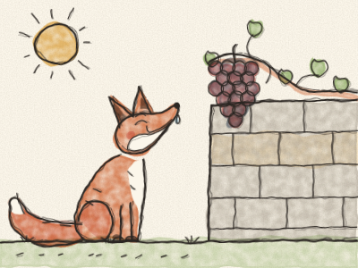
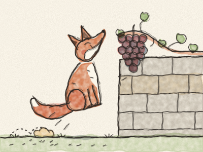

# Le Renard et les Raisins

Par une chaude journée d’été, un Renard roux trottinait le long d’un chemin de campagne. Le soleil brillait, la route était poussiéreuse, et le Renard avait très, très soif.

C’est alors qu’il la vit. Tout en haut d’un vieux mur de pierre poussait une vigne, et à la vigne pendait une grappe de raisins. De gros raisins ronds et violets, si juteux qu’ils brillaient au soleil.

« Miam ! » dit le Renard en se léchant les babines. « Exactement ce qu’il me faut par cette chaleur ! »

Il se dressa sur ses pattes de derrière et s’étira aussi haut qu’il put. *Hiii… hiii…* Mais les raisins étaient trop haut.

Alors il recula de quelques pas, prit son élan et sauta. *Hop !* Pas assez haut. Il courut plus vite et sauta plus haut. *HOP !* Son nez les frôla presque. Il essaya encore et encore. *Hop ! Hop ! HOP !* *(Comptez les sauts avec Constance.)*

Enfin, le Renard s’assit dans la poussière, tout essoufflé. Il leva les yeux vers les raisins. Les raisins pendaient là, ronds et violets, et ne bougeaient pas du tout.

Le Renard leva le nez bien haut. « Peuh ! » dit-il. « De toute façon, je n’en voulais pas, de ces raisins. Ils sont trop verts, et bons pour des goujats ! Beurk ! »

Et il s’en alla en trottinant, la queue bien haute, en faisant semblant de s’en moquer complètement.

Mais les raisins n’étaient pas verts du tout. Ils étaient tout sucrés.

> Quand on ne peut pas avoir quelque chose, il est facile de dire qu’on n’en voulait pas. C’est plus courageux de dire : « J’ai essayé, et je n’ai pas pu. »
