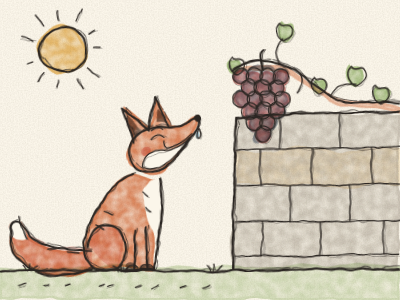
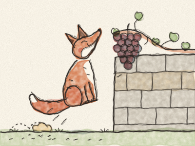

# A Raposa e as Uvas

Num dia quente de verão, uma Raposa ruiva ia a trotar por um caminho do campo. O sol brilhava, a estrada estava cheia de pó e a Raposa tinha muita, muita sede.

Foi então que o viu. Lá no alto de um velho muro de pedra crescia uma videira, e da videira pendia um cacho de uvas. Uvas grandes, redondas e roxas, tão sumarentas que brilhavam ao sol.

— Hum! — disse a Raposa, a lamber os beiços. — Mesmo o que me faz falta com este calor!

Pôs-se em pé nas patas de trás e esticou-se o mais que pôde. *Estica… estica…* Mas as uvas estavam demasiado altas.

Então recuou uns passos, ganhou balanço e saltou. *Hop!* Não chegou. Correu mais depressa e saltou mais alto. *HOP!* O nariz quase lhes tocou. Tentou outra vez, e outra, e outra. *Hop! Hop! HOP!* *(Contem os saltos com a Constance.)*

Por fim, a Raposa sentou-se no pó, cheia de calor e a arfar. Olhou para as uvas. As uvas continuavam lá penduradas, redondas e roxas, sem se mexerem nem um bocadinho.

A Raposa empinou o nariz. — Pff! — disse ela. — Eu nem queria aquelas uvas. Toda a gente vê que estão verdes e azedas. Que nojo!

E foi-se embora a trotar, de cauda bem levantada, a fingir que não se importava nada.

Mas as uvas não estavam nada azedas. Eram docinhas.

> Quando não conseguimos ter uma coisa, é fácil dizer que nem a queríamos. É mais corajoso dizer: «Eu tentei, e não consegui.»
