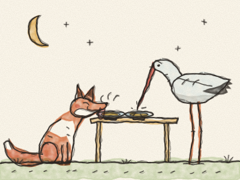
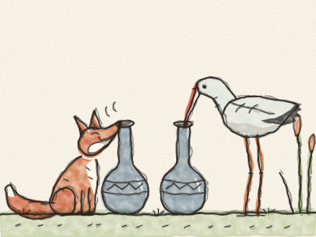

# The Fox and the Stork

Once upon a time, a Fox and a Stork lived beside the same pond. Fox had a bushy red tail and a big cheeky grin. Stork had long thin legs and a long, long, pointy beak.

One day Fox said, “Stork, my friend, come to dinner tonight! I’m making my famous soup.” “Oh, thank you!” said Stork. “I love soup.”

That evening, Fox served the soup on two flat plates. Flat as a pancake! Fox lapped up his soup: *slurp, slurp, slurp!* But Stork could only go *tap, tap, tap* with the tip of her long beak. Not one drop went in.

“Don’t you like my soup?” asked Fox, with his big cheeky grin. “Never mind, I’ll finish it for you!” *Slurp!* And poor Stork went home hungry.

The next day, Stork said, “Fox, my friend, now you must come to dinner at my house!” “Yummy!” said Fox, and he licked his lips.

Stork served the dinner in two tall jars with long thin necks. She dipped her long beak right down inside: *gulp, gulp, gulp!* Delicious! But Fox could not get his nose in. He licked the outside of the jar. He sniffed at the top. *Sniff, sniff.* Nothing!

“Don’t you like my dinner?” asked Stork. Fox’s ears went pink. “Now I understand,” he said. “I was not a very good friend to you.”

And the next time Fox made soup, he served it on a plate for himself and in a tall jar for Stork. And they both ate until their tummies were round and full.

> Treat your friends the way you would like them to treat you.
