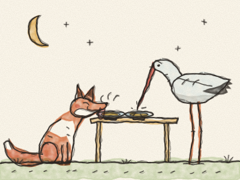
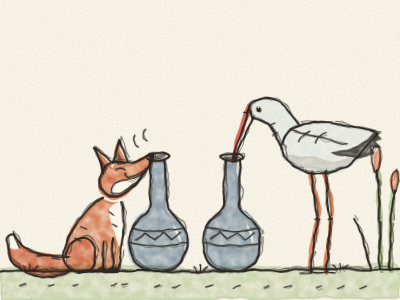

# Le Renard et la Cigogne

Il était une fois un Renard et une Cigogne qui habitaient au bord du même étang. Le Renard avait une grande queue rousse et un sourire malicieux. La Cigogne avait de longues pattes toutes fines et un long, long bec pointu.

Un jour, le Renard dit : « Cigogne, mon amie, viens dîner chez moi ce soir ! Je prépare ma fameuse soupe. » « Oh, merci ! » dit la Cigogne. « J’adore la soupe. »

Le soir venu, le Renard servit la soupe dans deux assiettes plates. Plates comme des crêpes ! Le Renard lapa sa soupe : *slurp, slurp, slurp !* Mais la Cigogne ne pouvait faire que *toc, toc, toc* du bout de son long bec. Pas une goutte n’entra.

« Tu n’aimes pas ma soupe ? » demanda le Renard avec son sourire malicieux. « Tant pis, je vais la finir pour toi ! » *Slurp !* Et la pauvre Cigogne rentra chez elle le ventre vide.

Le lendemain, la Cigogne dit : « Renard, mon ami, maintenant c’est toi qui viens dîner chez moi ! » « Miam ! » dit le Renard en se léchant les babines.

La Cigogne servit le dîner dans deux grands vases au long cou étroit. Elle plongea son long bec tout au fond : *glou, glou, glou !* Délicieux ! Mais le Renard n’arrivait pas à y mettre le museau. Il lécha le dehors du vase. Il renifla le haut. *Snif, snif.* Rien du tout !

« Tu n’aimes pas mon dîner ? » demanda la Cigogne. Les oreilles du Renard devinrent toutes roses. « Maintenant, je comprends », dit-il. « Je n’ai pas été un très bon ami pour toi. »

Et la fois suivante, quand le Renard fit de la soupe, il la servit dans une assiette pour lui et dans un grand vase pour la Cigogne. Et ils mangèrent tous les deux jusqu’à avoir le ventre bien rond.

> Fais aux autres ce que tu aimerais qu’on te fasse.
