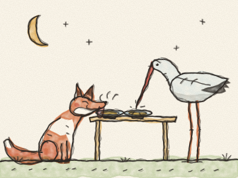
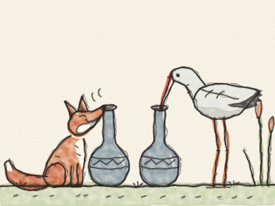

# A Raposa e a Cegonha

Era uma vez uma Raposa e uma Cegonha que viviam à beira do mesmo lago. A Raposa tinha uma cauda ruiva muito farfalhuda e um sorriso maroto. A Cegonha tinha umas pernas compridas e fininhas e um bico comprido, comprido e pontiagudo.

Um dia, a Raposa disse: — Cegonha, minha amiga, vem jantar a minha casa esta noite! Vou fazer a minha famosa sopa. — Oh, obrigada! — disse a Cegonha. — Adoro sopa.

Nessa noite, a Raposa serviu a sopa em dois pratos rasos. Rasos como panquecas! A Raposa lambeu a sopa toda: *slurp, slurp, slurp!* Mas a Cegonha só conseguia fazer *toc, toc, toc* com a ponta do seu bico comprido. Nem uma gota lhe entrou no bico.

— Não gostas da minha sopa? — perguntou a Raposa, com o seu sorriso maroto. — Não faz mal, eu acabo-a por ti! — *Slurp!* E a pobre Cegonha voltou para casa com fome.

No dia seguinte, a Cegonha disse: — Raposa, minha amiga, agora és tu que vens jantar a minha casa! — Que bom! — disse a Raposa, a lamber os beiços.

A Cegonha serviu o jantar em dois jarros altos de gargalo comprido e estreito. Meteu o bico comprido lá bem no fundo: *glu, glu, glu!* Delicioso! Mas a Raposa não conseguia meter lá o focinho. Lambeu o jarro por fora. Cheirou a boca do jarro. *Snif, snif.* Nada!

— Não gostas do meu jantar? — perguntou a Cegonha. As orelhas da Raposa ficaram cor-de-rosa. — Agora percebo — disse ela. — Não fui uma boa amiga para ti.

E da vez seguinte que a Raposa fez sopa, serviu-a num prato para ela e num jarro alto para a Cegonha. E as duas comeram até ficarem com a barriga bem redondinha.

> Trata os teus amigos como gostarias que eles te tratassem a ti.
