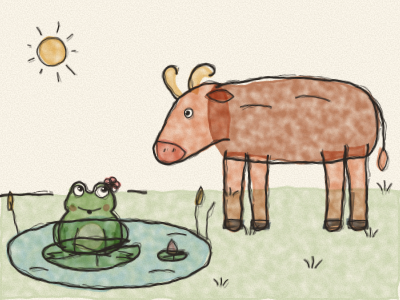
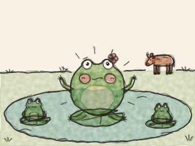

# The Frog and the Ox

Once upon a time, by a quiet pond, there lived a little green frog. She had a round tummy, two big eyes, and a very loud voice. *Ribbit, ribbit!*

One day, a big brown ox came into the meadow to eat the grass. He was enormous. He had four strong legs, two curly horns and a great big body. *Munch, munch, munch.*

The little frog looked up at him, and up, and up. “Oh!” she said. “How big he is! I want to be big like that too!”

So she took a deep breath, and she puffed herself up. *Hmmmmf!*

“Sisters!” she called. “Look at me! Am I as big as the ox now?”

“No,” said her sisters. “Not at all.”

So she puffed herself up even more. *HMMMMMF!* “And now? Am I as big as the ox now?”

“Not even close,” said her sisters.

*(Puff out your cheeks with Constance, as big as you can!)*

So the little frog puffed, and puffed, and PUFFED, until she was as round as a balloon, and her eyes were popping, and her little legs were waving in the air.

*PFFFFFFFT!*

All the air whooshed out of her, and she zoomed round and round the pond like a balloon, and landed with a *SPLASH!* right back in the water.

The little frog climbed onto her lily pad, small and green and a bit dizzy. “Ribbit,” she said. “I think I like being a frog after all.”

> Don’t try to be somebody else: you are just right as you are.
