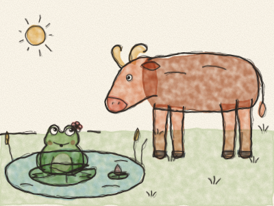
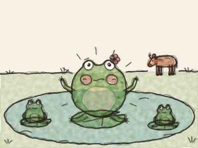

# La Grenouille qui veut se faire aussi grosse que le Bœuf

Il était une fois, au bord d’une mare tranquille, une petite grenouille verte. Elle avait un ventre tout rond, deux gros yeux et une voix très forte. *Croâ, croâ !*

Un jour, un grand bœuf brun arriva dans le pré pour manger l’herbe. Il était énorme. Il avait quatre pattes solides, deux cornes recourbées et un très, très gros corps. *Miam, miam, miam.*

La petite grenouille leva les yeux vers lui, encore, et encore. « Oh ! dit-elle. Comme il est grand ! Moi aussi, je veux être grosse comme ça ! »

Alors elle prit une grande inspiration, et elle se gonfla. *Hmmmmf !*

« Mes sœurs ! appela-t-elle. Regardez-moi ! Est-ce que je suis aussi grosse que le bœuf, maintenant ? »

« Non, dirent ses sœurs. Pas du tout. »

Alors elle se gonfla encore plus. *HMMMMMF !* « Et maintenant ? M’y voici donc ? »

« Point du tout, dirent ses sœurs. Tu n’en approches point. »

*(Gonflez vos joues avec Constance, aussi fort que vous pouvez !)*

Alors la petite grenouille se gonfla, et se gonfla, et se GONFLA, jusqu’à devenir ronde comme un ballon, les yeux tout ronds, les petites pattes qui gigotaient en l’air.

*PFFFFFFFT !*

Tout l’air sortit d’un coup, et elle fila autour de la mare comme un ballon qui se dégonfle, avant de retomber, *PLOUF !*, dans l’eau.

La petite grenouille remonta sur son nénuphar, petite, verte et un peu étourdie. « Croâ, dit-elle. Finalement, j’aime bien être une grenouille. »

> Ne cherche pas à être un autre : tu es très bien comme tu es.
