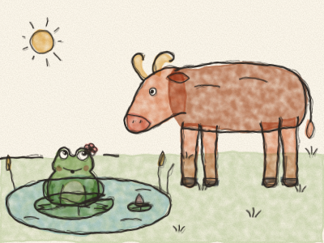
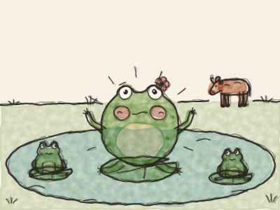

# A Rã e o Boi

Era uma vez, à beira de um charco sossegado, uma pequena rã verde. Tinha uma barriga redondinha, dois olhos grandes e uma voz muito forte. *Croac, croac!*

Um dia, um grande boi castanho veio ao prado comer erva. Era enorme. Tinha quatro patas fortes, dois chifres curvos e um corpo muito, muito grande. *Nham, nham, nham.*

A pequena rã olhou para ele, para cima, e mais para cima. — Oh! — disse ela. — Que grande que ele é! Eu também quero ser grande assim!

Então respirou fundo, e inchou-se toda. *Hmmmmf!*

— Manas! — chamou ela. — Olhem para mim! Já sou tão grande como o boi?

— Não — disseram as irmãs. — Nada disso.

Então ela inchou-se ainda mais. *HMMMMMF!* — E agora? Já sou tão grande como o boi?

— Nem pensar — disseram as irmãs.

*(Encha as bochechas com a Constance, o mais que conseguirem!)*

E a pequena rã inchou, e inchou, e INCHOU, até ficar redonda como um balão, com os olhos esbugalhados e as perninhas a abanar no ar.

*PFFFFFFFT!*

O ar saiu todo de uma vez, e ela andou às voltas à roda do charco como um balão a esvaziar, e caiu, *CHAPE!*, de volta na água.

A pequena rã subiu para o seu nenúfar, pequenina, verde e um bocadinho tonta. — Croac — disse ela. — Afinal, gosto mesmo de ser uma rã.

> Não tentes ser outra pessoa: és perfeita tal como és.
