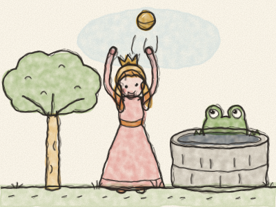
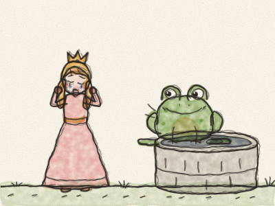
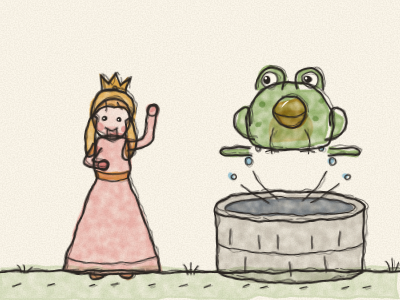
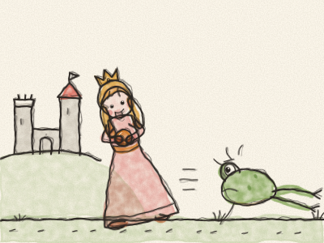
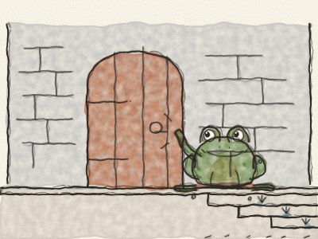
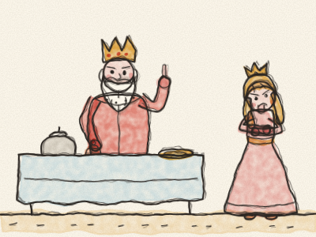
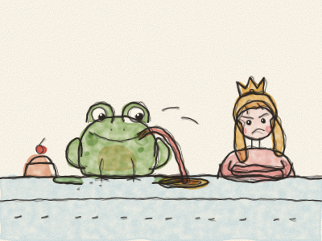
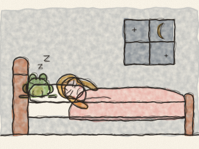
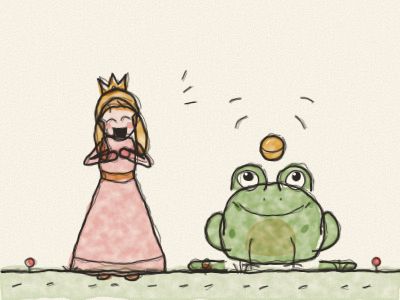
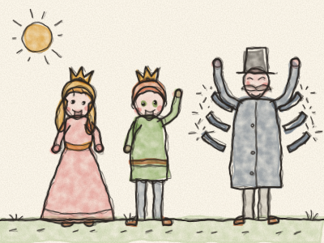

# The Frog Prince

Once upon a time, in a castle with tall towers, there lived a king and his youngest daughter, a little princess. The princess had a favourite toy. It was a golden ball, round and shiny like the sun. *(Make a round ball with your hands.)*

Every afternoon, she took her golden ball into the garden, to the cool shade of an old lime tree. Under the tree there was a deep, dark well. And there she played. She threw the ball up high, *whoosh*, and she caught it again, *clap!* Up and down, up and down, all afternoon long.

But one day she threw it a little too high. She held out her hands… and missed! The ball bounced on the stones, *bonk, bonk*, rolled to the edge of the well and fell in. *Plop!*

The princess looked down into the well. It was so deep that she could not see the bottom. “My ball! My beautiful golden ball!” she cried. And she began to sob. *Boo-hoo-hoo!*

Then she heard a little croaky voice. “Ribbit! Princess, why are you crying? You would make a stone cry too!”

She looked around. There, sitting on the edge of the well, was a frog. A fat, green, wet frog, with big goggly eyes and a very wide mouth.

“Oh, it’s only you, you old splasher,” said the princess. “I’m crying because my golden ball has fallen into the well.”

“Don’t cry,” said the frog. “I can help you. But what will you give me if I bring your ball back?”

“Anything you like, dear frog!” said the princess. “My dresses, my pearls, even my golden crown!”

“I don’t want your dresses,” said the frog. “I don’t want your pearls, and I don’t want your crown. But if you will be my friend, and let me sit beside you at the table, and eat from your little golden plate, and sleep on your pillow… then I will dive down and fetch your ball.”

The princess thought: *(in a sneaky whisper)* “What a silly frog! He’ll never leave his well.” So out loud she said: “Yes, yes, I promise! Everything you want!”

*Splash!* Down dived the frog. And a moment later, up he came, with the golden ball in his mouth.

“My ball!” cried the princess. She picked it up and hugged it. And then, without even a thank you, she ran off towards the castle, as fast as her legs could carry her.

“Wait! Wait for me!” called the frog. “I can’t run as fast as you!” *Hop, hop, hop.* He tried his very best. But his legs were short, and the castle was far away.

The princess did not stop. She did not look back. She ran in through the big castle door and forgot all about the poor frog. And the frog sat alone on the grass, beside the well, and sighed a great big froggy sigh. *Ribbit.*

The next evening, the king and the princess sat down to dinner in the great hall. There was soup, and bread, and little cakes with cherries on top. The princess ate from her little golden plate.

Suddenly they heard a funny sound on the marble stairs. *Plip, plop, plip, plop.* Something was coming up the stairs. Something wet. Then there was a knock at the door. *Knock, knock, knock!* And a little voice called:

*“Youngest princess, open the door!*
*Don’t you remember what you promised before?”*

The princess opened the door, just a crack. There sat the frog, dripping on the doormat. *Bang!* She shut the door as fast as she could and ran back to the table, her heart going *thump, thump.*

“What’s the matter, my dear?” asked the king. “Is there a giant at the door?”

“No, Father,” said the princess. “It’s a frog. A horrible, slimy frog.” And she told him all about the golden ball, and the well, and her promise.

The king put down his spoon. He looked at her very seriously. “A promise is a promise,” he said. “The frog helped you when you needed help. When you make a promise, you must keep it. Now go and let him in.”

So the princess went to the door, very, very slowly, and opened it. *Hop, hop, hop.* In came the frog, all the way to her chair. “Lift me up,” he said. “I want to sit beside you.”

The princess did not want to. But the king gave her a look. So she picked up the frog, with just two fingers, and put him on the table. *Plop!*

“Now push your little golden plate closer,” said the frog, “so that we can eat together.”

She pushed it a teeny tiny bit closer. And the frog ate happily. *Slurp, gulp, munch!* He ate the soup. He ate the bread. He ate a little cake with a cherry on top. But the princess hardly ate a thing. *(Do the princess’s grumpy face.)*

At last the frog patted his round green tummy. “Delicious! Thank you. Now I am tired. Please carry me up to your room, and we will go to sleep.”

Oh dear. The princess began to cry again. She did not want a cold, wet frog in her lovely clean bed. But the king said, once more: “A promise is a promise.”

So she carried him upstairs and put him in a corner, on the floor. “Ribbit,” said the frog. “I’m cold. And you promised. Your pillow, please.” So the princess put him on the very edge of her pillow, turned her back, and grumbled: “Goodnight, frog.” *Hmph!*

In the morning, the frog hopped away down the stairs. But the next evening, *plip, plop*, there he was again. And again they ate from the little golden plate. And again he slept on her pillow.

But a funny thing happened. The more time the princess spent with the frog, the more she liked him. He told her funny stories about the fish in the pond. He caught flies with his long tongue, *zip!* And he could balance the golden ball on his nose. *(Can you balance something on your nose?)* The princess laughed and laughed.

On the third night, she did not grumble. She made him a little blanket from her softest handkerchief, and tucked him in, right in the middle of the pillow. “Goodnight, dear frog,” she whispered. “I’m sorry I ran away from you. You are a good friend.” And she gave him a little kiss on his green head. *Mwah!*

In the morning, the frog was gone. By her bed stood a boy with a little golden crown and kind green eyes. “I was the frog!” he laughed. “A grumpy witch put a spell on me. You kept your promise, and you were kind to me, so the spell is broken!”

Just then, up rolled a carriage with the prince’s faithful servant, Heinrich. When his prince became a frog, Heinrich had been so sad that he wore three iron bands round his chest, to stop his heart from breaking. Now his heart filled up with joy. *Ping! Ping! Ping!* went the three bands. *(Pop them with your fingers!)*

And from that day on, the prince and the princess were the very best of friends.

> A promise is a promise: keep it, even when it is hard.
