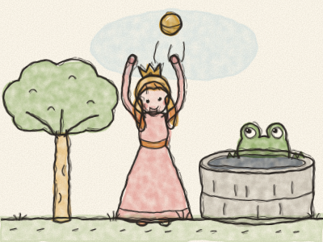
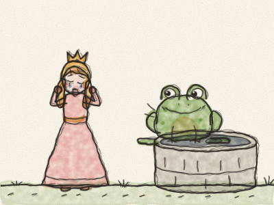
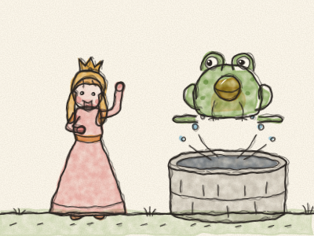
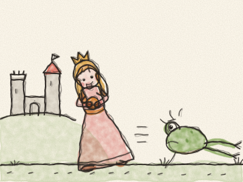
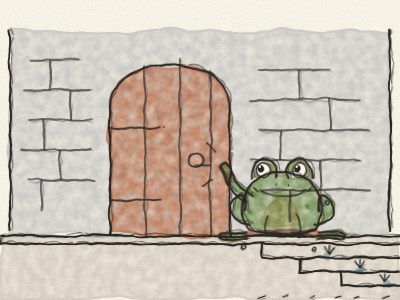
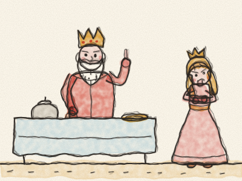
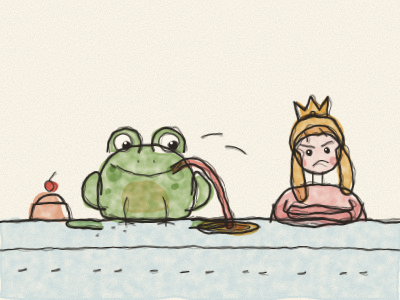
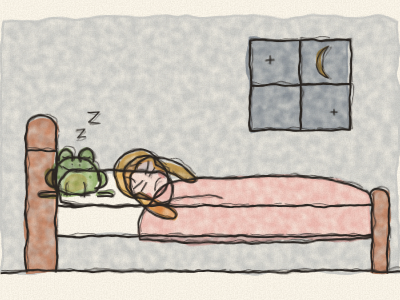
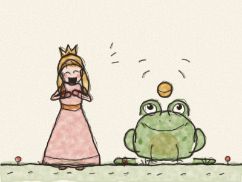
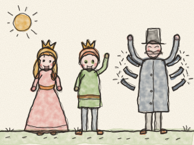

# Le Prince Grenouille

Il était une fois, dans un château aux hautes tours, un roi et sa plus jeune fille, une petite princesse. La princesse avait un jouet préféré. C’était une balle d’or, ronde et brillante comme le soleil. *(Fais une balle bien ronde avec tes mains.)*

Chaque après-midi, elle emportait sa balle d’or dans le jardin, à l’ombre fraîche d’un vieux tilleul. Sous l’arbre, il y avait un puits profond et sombre. Et c’est là qu’elle jouait. Elle lançait la balle très haut, *whoush*, et elle la rattrapait, *clap !* En haut, en bas, en haut, en bas, tout l’après-midi.

Mais un jour, elle la lança un petit peu trop haut. Elle tendit les mains… et la rata ! La balle rebondit sur les pierres, *bonk, bonk*, roula jusqu’au bord du puits et tomba dedans. *Plouf !*

La princesse regarda au fond du puits. Il était si profond qu’elle ne voyait pas le fond. « Ma balle ! Ma belle balle d’or ! » s’écria-t-elle. Et elle se mit à sangloter. *Bouhouhou !*

Alors elle entendit une petite voix enrouée. « Croâ ! Princesse, pourquoi pleures-tu ? Tu ferais pleurer une pierre ! »

Elle regarda autour d’elle. Là, assise sur le bord du puits, il y avait une grenouille. Une grosse grenouille verte et mouillée, avec de gros yeux ronds et une très grande bouche.

« Oh, ce n’est que toi, vieille barboteuse, dit la princesse. Je pleure parce que ma balle d’or est tombée dans le puits. »

« Ne pleure pas, dit la grenouille. Je peux t’aider. Mais que me donneras-tu si je te rapporte ta balle ? »

« Tout ce que tu voudras, chère grenouille ! dit la princesse. Mes robes, mes perles, et même ma couronne d’or ! »

« Je ne veux pas de tes robes, dit la grenouille. Je ne veux pas de tes perles, et je ne veux pas de ta couronne. Mais si tu veux bien être mon amie, me laisser m’asseoir à côté de toi à table, manger dans ta petite assiette d’or et dormir sur ton oreiller… alors je plongerai chercher ta balle. »

La princesse pensa : *(en chuchotant, l’air rusé)* « Quelle grenouille idiote ! Elle ne quittera jamais son puits. » Alors, tout haut, elle dit : « Oui, oui, je promets ! Tout ce que tu veux ! »

*Plouf !* La grenouille plongea. Et un instant plus tard, elle remonta, avec la balle d’or dans la bouche.

« Ma balle ! » s’écria la princesse. Elle la ramassa et la serra contre elle. Et puis, sans même dire merci, elle partit en courant vers le château, aussi vite que ses jambes pouvaient la porter.

« Attends ! Attends-moi ! cria la grenouille. Je ne peux pas courir aussi vite que toi ! » *Hop, hop, hop.* Elle fit de son mieux. Mais ses pattes étaient courtes, et le château était loin.

La princesse ne s’arrêta pas. Elle ne se retourna pas. Elle entra par la grande porte du château et oublia complètement la pauvre grenouille. Et la grenouille resta toute seule dans l’herbe, à côté du puits, et poussa un gros soupir de grenouille. *Croâ.*

Le lendemain soir, le roi et la princesse se mirent à table dans la grande salle. Il y avait de la soupe, du pain et des petits gâteaux avec une cerise dessus. La princesse mangeait dans sa petite assiette d’or.

Soudain, ils entendirent un drôle de bruit dans l’escalier de marbre. *Plic, ploc, plic, ploc.* Quelque chose montait l’escalier. Quelque chose de mouillé. Puis on frappa à la porte. *Toc, toc, toc !* Et une petite voix appela :

*« Petite princesse, ouvre-moi !*
*Ta promesse, souviens-toi ! »*

La princesse entrouvrit la porte, juste un petit peu. La grenouille était là, toute dégoulinante, sur le paillasson. *Bang !* La princesse referma la porte aussi vite qu’elle put et revint en courant à la table, le cœur battant, *boum, boum.*

« Qu’y a-t-il, ma chérie ? demanda le roi. Il y a un géant à la porte ? »

« Non, Père, dit la princesse. C’est une grenouille. Une horrible grenouille gluante. » Et elle lui raconta toute l’histoire de la balle d’or, du puits et de sa promesse.

Le roi posa sa cuillère. Il la regarda d’un air très sérieux. « Une promesse est une promesse, dit-il. La grenouille t’a aidée quand tu avais besoin d’aide. Quand on fait une promesse, il faut la tenir. Maintenant, va lui ouvrir. »

Alors la princesse alla à la porte, très, très lentement, et l’ouvrit. *Hop, hop, hop.* La grenouille entra et sauta jusqu’à sa chaise. « Soulève-moi, dit-elle. Je veux m’asseoir à côté de toi. »

La princesse n’en avait pas envie. Mais le roi lui lança un regard. Alors elle prit la grenouille du bout de deux doigts et la posa sur la table. *Ploc !*

« Maintenant, approche ta petite assiette d’or, dit la grenouille, pour que nous mangions ensemble. »

Elle l’approcha d’un tout petit peu. Et la grenouille mangea de bon cœur. *Slurp, glop, miam !* Elle mangea la soupe. Elle mangea le pain. Elle mangea un petit gâteau avec une cerise dessus. Mais la princesse ne mangea presque rien. *(Fais la grimace de la princesse.)*

Enfin, la grenouille tapota son gros ventre vert. « Délicieux ! Merci. Maintenant, je suis fatiguée. Porte-moi dans ta chambre, s’il te plaît, et nous irons dormir. »

Oh là là. La princesse se remit à pleurer. Elle ne voulait pas d’une grenouille froide et mouillée dans son joli lit tout propre. Mais le roi répéta : « Une promesse est une promesse. »

Alors elle la porta en haut et la posa dans un coin, par terre. « Croâ, dit la grenouille. J’ai froid. Et tu as promis. Ton oreiller, s’il te plaît. » Alors la princesse la posa tout au bord de son oreiller, lui tourna le dos et grogna : « Bonne nuit, grenouille. » *Hmpf !*

Le matin, la grenouille descendit l’escalier en sautillant et s’en alla. Mais le soir suivant, *plic, ploc*, la revoilà. Et de nouveau, elles mangèrent dans la petite assiette d’or. Et de nouveau, la grenouille dormit sur son oreiller.

Mais une chose étonnante arriva. Plus la princesse passait de temps avec la grenouille, plus elle l’aimait bien. La grenouille lui racontait des histoires drôles sur les poissons de la mare. Elle attrapait les mouches avec sa longue langue, *zip !* Et elle savait faire tenir la balle d’or en équilibre sur son nez. *(Sais-tu faire tenir quelque chose sur ton nez ?)* La princesse riait aux éclats.

La troisième nuit, elle ne grogna pas. Elle lui fit une petite couverture avec son mouchoir le plus doux, et la borda bien au milieu de l’oreiller. « Bonne nuit, chère grenouille, chuchota-t-elle. Pardon de m’être sauvée. Tu es une vraie amie. » Et elle lui fit un petit bisou sur sa tête verte. *Smack !*

Au matin, la grenouille avait disparu. Près du lit se tenait un garçon avec une petite couronne d’or et de gentils yeux verts. « C’était moi, la grenouille ! dit-il en riant. Une méchante sorcière m’avait jeté un sort. Tu as tenu ta promesse, et tu as été gentille avec moi : le sort est rompu ! »

Juste à ce moment, un carrosse arriva avec le fidèle serviteur du prince, Henri. Quand son prince avait été changé en grenouille, Henri avait été si triste qu’il avait mis trois cercles de fer autour de sa poitrine, pour que son cœur ne se brise pas. Maintenant, son cœur se remplissait de joie. *Ping ! Ping ! Ping !* firent les trois cercles. *(Fais-les sauter avec tes doigts !)*

Et depuis ce jour, le prince et la princesse furent les meilleurs amis du monde.

> Une promesse est une promesse : on la tient, même quand c’est difficile.
