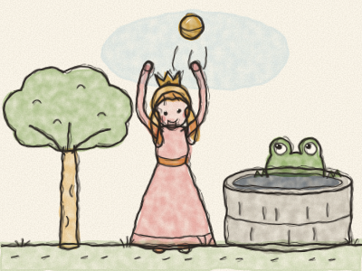
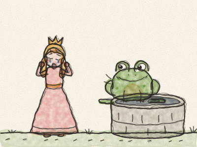
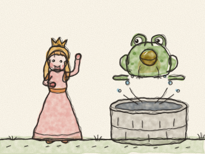
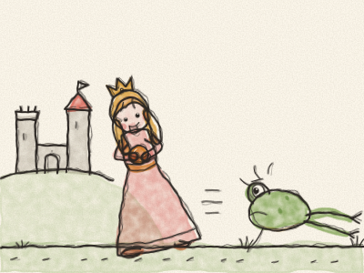
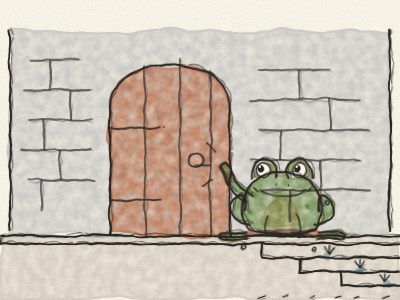
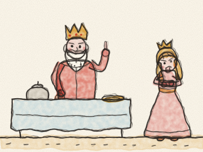
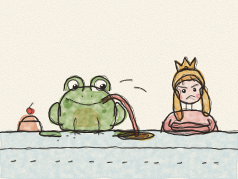
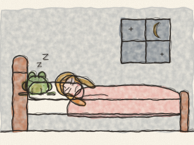
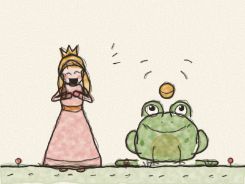
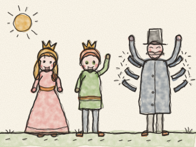

# O Príncipe Sapo

Era uma vez, num castelo de torres altas, um rei e a sua filha mais nova, uma pequena princesa. A princesa tinha um brinquedo preferido. Era uma bola de ouro, redonda e brilhante como o sol. *(Faz uma bola bem redonda com as mãos.)*

Todas as tardes, levava a sua bola de ouro para o jardim, para a sombra fresquinha de uma velha tília. Debaixo da árvore havia um poço fundo e escuro. E era ali que ela brincava. Atirava a bola bem alto, *zuum*, e apanhava-a outra vez, *clap!* Para cima e para baixo, para cima e para baixo, a tarde inteira.

Mas um dia atirou-a um bocadinho alto demais. Estendeu as mãos… e falhou! A bola saltou nas pedras, *bonc, bonc*, rolou até à beira do poço e caiu lá dentro. *Plof!*

A princesa espreitou para dentro do poço. Era tão fundo que não se via o fundo. — A minha bola! A minha linda bola de ouro! — gritou ela. E desatou a soluçar. *Buá, buá, buá!*

Então ouviu uma vozinha rouca. — Croc! Princesa, porque choras? Até farias chorar uma pedra!

Ela olhou à sua volta. Ali, sentado na beira do poço, estava um sapo. Um sapo gordo, verde e molhado, com uns olhos grandes e esbugalhados e uma boca enorme.

— Ah, és só tu, velho chapinhador — disse a princesa. — Estou a chorar porque a minha bola de ouro caiu ao poço.

— Não chores — disse o sapo. — Eu posso ajudar-te. Mas o que me dás se eu te trouxer a bola de volta?

— Tudo o que quiseres, querido sapo! — disse a princesa. — Os meus vestidos, as minhas pérolas, até a minha coroa de ouro!

— Não quero os teus vestidos — disse o sapo. — Não quero as tuas pérolas, e não quero a tua coroa. Mas se fores minha amiga, e me deixares sentar ao teu lado à mesa, e comer do teu pratinho de ouro, e dormir na tua almofada… então eu mergulho e vou buscar a tua bola.

A princesa pensou: *(a sussurrar, com ar matreiro)* «Que sapo tão tonto! Ele nunca vai sair do poço.» Por isso, em voz alta, disse: — Sim, sim, prometo! Tudo o que quiseres!

*Chape!* O sapo mergulhou. E um instante depois, voltou lá de baixo, com a bola de ouro na boca.

— A minha bola! — gritou a princesa. Apanhou-a e abraçou-a. E depois, sem sequer dizer obrigada, desatou a correr para o castelo, tão depressa quanto as pernas a deixavam.

— Espera! Espera por mim! — chamou o sapo. — Eu não consigo correr tão depressa como tu! — *Salta, salta, salta.* Ele fez o melhor que podia. Mas as pernas dele eram curtas, e o castelo ficava longe.

A princesa não parou. Não olhou para trás. Entrou pela grande porta do castelo e esqueceu-se completamente do pobre sapo. E o sapo ficou sozinho na relva, ao lado do poço, e deu um grande suspiro de sapo. *Croc.*

Na noite seguinte, o rei e a princesa sentaram-se para jantar no grande salão. Havia sopa, e pão, e bolinhos com uma cereja em cima. A princesa comia do seu pratinho de ouro.

De repente, ouviram um barulho esquisito na escada de mármore. *Plic, ploc, plic, ploc.* Alguma coisa vinha a subir a escada. Alguma coisa molhada. Depois bateram à porta. *Toc, toc, toc!* E uma vozinha chamou:

*«Princesinha, abre-me já!*
*Lembra-te do que prometeste lá!»*

A princesa abriu a porta, só uma frestinha. Ali estava o sapo, a pingar em cima do capacho. *Pum!* Ela fechou a porta o mais depressa que pôde e voltou a correr para a mesa, com o coração a bater, *tum, tum.*

— O que se passa, minha querida? — perguntou o rei. — Está algum gigante à porta?

— Não, pai — disse a princesa. — É um sapo. Um sapo horrível e viscoso. — E contou-lhe tudo sobre a bola de ouro, o poço e a sua promessa.

O rei pousou a colher. Olhou para ela muito sério. — Uma promessa é uma promessa — disse ele. — O sapo ajudou-te quando precisaste de ajuda. Quando se faz uma promessa, tem de se cumprir. Agora vai abrir-lhe a porta.

Então a princesa foi até à porta, muito, muito devagar, e abriu-a. *Salta, salta, salta.* Entrou o sapo, até à cadeira dela. — Levanta-me — disse ele. — Quero sentar-me ao teu lado.

A princesa não queria nada. Mas o rei olhou para ela daquela maneira. Por isso, ela pegou no sapo só com dois dedos e pousou-o em cima da mesa. *Ploc!*

— Agora chega o teu pratinho de ouro mais para perto — disse o sapo — para comermos juntos.

Ela chegou-o um bocadinho pequenino mais para perto. E o sapo comeu todo contente. *Slurp, glup, nham!* Comeu a sopa. Comeu o pão. Comeu um bolinho com uma cereja em cima. Mas a princesa quase não comeu nada. *(Faz a careta da princesa.)*

Por fim, o sapo deu umas palmadinhas na barriga redonda e verde. — Delicioso! Obrigado. Agora estou cansado. Leva-me ao teu quarto, por favor, e vamos dormir.

Ai, ai. A princesa voltou a chorar. Não queria um sapo frio e molhado na sua linda cama lavadinha. Mas o rei disse, mais uma vez: — Uma promessa é uma promessa.

Então ela levou-o lá para cima e pô-lo a um canto, no chão. — Croc — disse o sapo. — Tenho frio. E tu prometeste. A tua almofada, por favor. — Então a princesa pô-lo mesmo na pontinha da almofada, virou-lhe as costas e resmungou: — Boa noite, sapo. — *Hmpf!*

De manhã, o sapo desceu a escada aos saltinhos e foi-se embora. Mas na noite seguinte, *plic, ploc*, lá estava ele outra vez. E outra vez comeram do pratinho de ouro. E outra vez ele dormiu na almofada dela.

Mas aconteceu uma coisa engraçada. Quanto mais tempo a princesa passava com o sapo, mais gostava dele. Ele contava-lhe histórias engraçadas sobre os peixes do lago. Apanhava moscas com a sua língua comprida, *zip!* E sabia equilibrar a bola de ouro no nariz. *(Consegues equilibrar alguma coisa no nariz?)* A princesa ria-se às gargalhadas.

Na terceira noite, ela não resmungou. Fez-lhe um cobertorzinho com o seu lenço mais macio e aconchegou-o bem no meio da almofada. — Boa noite, querido sapo — sussurrou ela. — Desculpa ter fugido de ti. És um bom amigo. — E deu-lhe um beijinho na cabeça verde. *Chuac!*

De manhã, o sapo tinha desaparecido. Ao lado da cama estava um rapaz com uma coroinha de ouro e uns olhos verdes muito meigos. — Eu era o sapo! — disse ele, a rir. — Uma bruxa resmungona lançou-me um feitiço. Tu cumpriste a tua promessa e foste boa para mim, por isso o feitiço quebrou-se!

Nesse instante, chegou uma carruagem com o fiel criado do príncipe, Henrique. Quando o seu príncipe foi transformado em sapo, Henrique ficou tão triste que pôs três aros de ferro à volta do peito, para o coração não se partir. Agora o coração dele encheu-se de alegria. *Ping! Ping! Ping!* fizeram os três aros. *(Fá-los saltar com os dedos!)*

E desde esse dia, o príncipe e a princesa ficaram os melhores amigos do mundo.

> Uma promessa é uma promessa: cumpre-a, mesmo quando é difícil.
