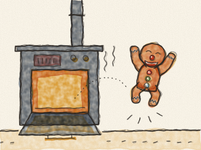
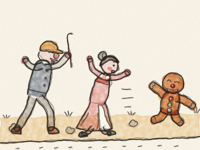
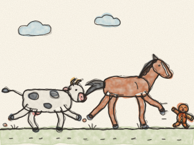
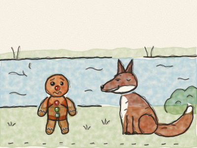
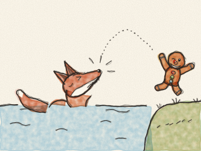

# The Gingerbread Man

Once upon a time, a little old woman and a little old man lived in a little cottage by the road. One morning, the little old woman decided to bake a gingerbread man. She gave him two currants for eyes, a cherry for a nose, a smile made of icing and three shiny sweets for buttons. Then she put him in the oven. *Mmm.* What a lovely smell!

“He must be ready now,” she said. She opened the oven door, and — *hop!* — out jumped the Gingerbread Man! He ran across the kitchen, out of the door and down the road.

“Stop! Stop!” cried the little old woman. “Come back!” cried the little old man. And they ran after him, as fast as they could.

But the Gingerbread Man only laughed and sang:

*“Run, run, as fast as you can!*
*You can’t catch me, I’m the Gingerbread Man!”*

And they couldn’t catch him.

He ran and ran until he met a Cow in a field. “*Moo!* Stop, little man,” said the Cow. “You look very good to eat!” But the Gingerbread Man ran faster, and sang:

*“I’ve run from a little old woman and a little old man,*
*and I can run from you too, I can!*
*Run, run, as fast as you can!*
*You can’t catch me, I’m the Gingerbread Man!”*

The Cow ran after him. *Clomp, clomp!* But she couldn’t catch him.

He ran and ran until he met a Horse. “*Neigh!* Stop, little man,” said the Horse. “You look very good to eat!” But the Gingerbread Man ran faster, and sang his song again. *(Sing it with him!)* The Horse galloped after him. *Clippety-clop!* But he couldn’t catch him either.

The Gingerbread Man felt very proud. “Nobody can catch me!” he said. “I am the fastest in the whole wide world!”

Then he came to a wide river, and he stopped. *Oh dear.* He could not swim. If he got wet, he would go all soft and soggy. And behind him he could hear the old woman, the old man, the Cow and the Horse, all coming closer and closer.

Just then, a Fox came out from behind a bush. He had a bushy red tail and a very big smile.

“Hello, little man,” said the Fox sweetly. “Do you need to cross the river? Jump on my tail, and I will carry you.”

So the Gingerbread Man jumped onto the Fox’s tail, and the Fox began to swim. *Swish, swish.* After a while the Fox said, “The water is getting deeper. Climb onto my back.” So he did. A little later the Fox said, “Deeper still! Climb onto my nose.”

The Gingerbread Man looked at the Fox’s nose. He looked at the Fox’s big, sharp teeth, and at his long pink tongue, licking his lips. *(What do you think the Fox wants?)* And the Gingerbread Man thought very hard.

“No, thank you, Mr Fox!” he said. And with one big leap — *hop!* — he jumped right over the water onto the far bank. *Snap!* went the Fox’s teeth, on nothing at all.

The Gingerbread Man walked home slowly, the long way round, over the bridge. The little old woman and the little old man were sitting on their doorstep, quite out of breath.

“I’m sorry I ran away,” said the Gingerbread Man. “Running fast is fun, but home is better.” So they gave him a cosy place on the kitchen windowsill, where he could watch the whole world go by, and wave to the Cow and the Horse every morning.

> Being fast is good, but thinking carefully is better.
