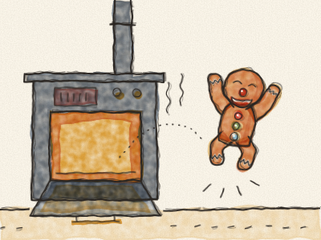
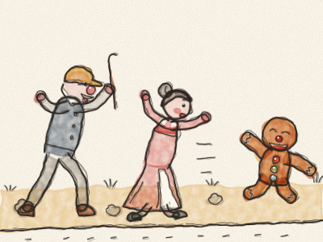
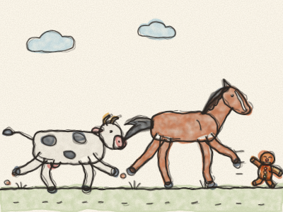
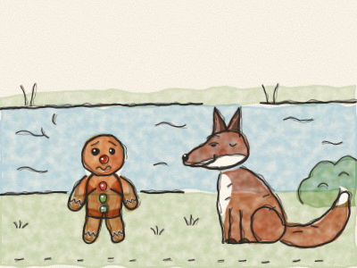
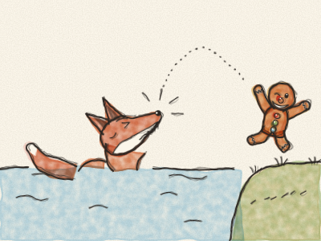

# Le Bonhomme de pain d’épice

Il était une fois une petite vieille et un petit vieux qui vivaient dans une petite maison au bord de la route. Un matin, la petite vieille décida de faire un bonhomme de pain d’épice. Elle lui donna deux raisins secs pour les yeux, une cerise pour le nez, un sourire en sucre glace et trois bonbons brillants pour les boutons. Puis elle le mit au four. *Mmm.* Quelle bonne odeur !

« Il doit être cuit, maintenant », dit-elle. Elle ouvrit la porte du four, et — *hop !* — le Bonhomme de pain d’épice sauta dehors ! Il traversa la cuisine en courant, sortit par la porte et fila sur la route.

« Arrête ! Arrête ! » cria la petite vieille. « Reviens ! » cria le petit vieux. Et ils coururent derrière lui, aussi vite qu’ils pouvaient.

Mais le Bonhomme de pain d’épice se contenta de rire et chanta :

*« Cours, cours, aussi vite que tu peux !*
*Tu ne m’attraperas pas, je suis le Bonhomme de pain d’épice ! »*

Et ils ne purent pas l’attraper.

Il courut, courut, jusqu’à ce qu’il rencontre une Vache dans un pré. « *Meuh !* Arrête-toi, petit bonhomme », dit la Vache. « Tu as l’air très bon à manger ! » Mais le Bonhomme de pain d’épice courut plus vite et chanta :

*« J’ai échappé à la petite vieille et au petit vieux,*
*et je t’échapperai aussi, comme eux !*
*Cours, cours, aussi vite que tu peux !*
*Tu ne m’attraperas pas, je suis le Bonhomme de pain d’épice ! »*

La Vache courut derrière lui. *Clomp, clomp !* Mais elle ne put pas l’attraper.

Il courut, courut, jusqu’à ce qu’il rencontre un Cheval. « *Hiii !* Arrête-toi, petit bonhomme », dit le Cheval. « Tu as l’air très bon à manger ! » Mais le Bonhomme de pain d’épice courut plus vite, et chanta encore sa chanson. *(Chantez-la avec lui !)* Le Cheval galopa derrière lui. *Cataclop, cataclop !* Mais lui non plus ne put pas l’attraper.

Le Bonhomme de pain d’épice était très fier. « Personne ne peut m’attraper ! » dit-il. « Je suis le plus rapide du monde entier ! »

Puis il arriva au bord d’une large rivière, et il s’arrêta. *Oh là là.* Il ne savait pas nager. S’il se mouillait, il deviendrait tout mou et tout ramolli. Et derrière lui, il entendait la petite vieille, le petit vieux, la Vache et le Cheval qui se rapprochaient, de plus en plus près.

Juste à ce moment-là, un Renard sortit de derrière un buisson. Il avait une queue rousse et touffue, et un très grand sourire.

« Bonjour, petit bonhomme », dit le Renard d’une voix toute douce. « Tu veux traverser la rivière ? Saute sur ma queue, je vais te porter. »

Alors le Bonhomme de pain d’épice sauta sur la queue du Renard, et le Renard se mit à nager. *Swish, swish.* Au bout d’un moment, le Renard dit : « L’eau devient plus profonde. Monte sur mon dos. » Et il monta. Un peu plus tard, le Renard dit : « Encore plus profond ! Monte sur mon nez. »

Le Bonhomme de pain d’épice regarda le nez du Renard. Il regarda ses grandes dents pointues, et sa longue langue rose qui se léchait les babines. *(À votre avis, que veut le Renard ?)* Et le Bonhomme de pain d’épice réfléchit très fort.

« Non merci, Monsieur le Renard ! » dit-il. Et d’un grand bond — *hop !* — il sauta par-dessus l’eau, jusque sur l’autre rive. *Clac !* firent les dents du Renard, dans le vide.

Le Bonhomme de pain d’épice rentra chez lui tranquillement, en faisant le grand tour par le pont. La petite vieille et le petit vieux étaient assis sur le pas de leur porte, tout essoufflés.

« Pardon de m’être sauvé », dit le Bonhomme de pain d’épice. « Courir vite, c’est amusant, mais rien ne vaut la maison. » Alors ils lui donnèrent une place bien douillette sur le rebord de la fenêtre de la cuisine, d’où il pouvait regarder le monde entier passer, et dire bonjour chaque matin à la Vache et au Cheval.

> Courir vite, c’est bien, mais bien réfléchir, c’est mieux.
