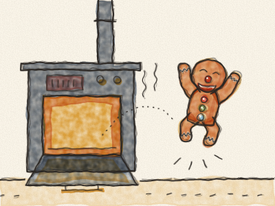
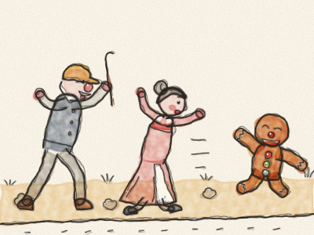
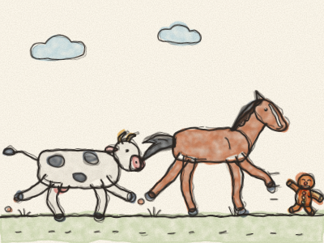
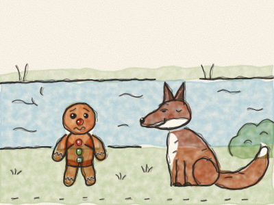
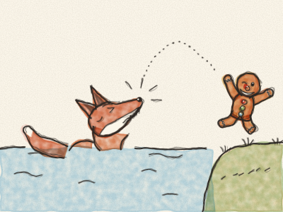

# O Homem de Gengibre

Era uma vez uma velhinha e um velhinho que viviam numa casinha à beira da estrada. Certa manhã, a velhinha decidiu fazer um homenzinho de bolo de gengibre. Deu-lhe duas passas para os olhos, uma cereja para o nariz, um sorriso de açúcar e três rebuçados brilhantes para os botões. Depois meteu-o no forno. *Hum.* Que cheirinho tão bom!

— Já deve estar pronto — disse ela. Abriu a porta do forno e — *hop!* — o Homem de Gengibre saltou cá para fora! Atravessou a cozinha a correr, saiu pela porta e foi pela estrada abaixo.

— Para! Para! — gritou a velhinha. — Volta! — gritou o velhinho. E correram atrás dele, o mais depressa que podiam.

Mas o Homem de Gengibre só se ria e cantava:

*«Corre, corre, corre sem parar!*
*Sou o Homem de Gengibre, não me vais apanhar!»*

E não o conseguiram apanhar.

Correu, correu, até que encontrou uma Vaca num prado. — *Muuu!* Para, homenzinho — disse a Vaca. — Pareces mesmo bom para comer! — Mas o Homem de Gengibre correu ainda mais depressa e cantou:

*«Fugi de uma velhinha e de um velhinho também,*
*e de ti também fujo, e muito bem!*
*Corre, corre, corre sem parar!*
*Sou o Homem de Gengibre, não me vais apanhar!»*

A Vaca correu atrás dele. *Plomp, plomp!* Mas não o conseguiu apanhar.

Correu, correu, até que encontrou um Cavalo. — *Hiii!* Para, homenzinho — disse o Cavalo. — Pareces mesmo bom para comer! — Mas o Homem de Gengibre correu ainda mais depressa e cantou outra vez a sua canção. *(Cantem com ele!)* O Cavalo galopou atrás dele. *Catrapum, catrapum!* Mas também não o conseguiu apanhar.

O Homem de Gengibre estava muito vaidoso. — Ninguém me apanha! — disse ele. — Sou o mais rápido do mundo inteiro!

Depois chegou a um rio muito largo, e parou. *Ai, ai.* Ele não sabia nadar. Se se molhasse, ficava todo mole e desfeito. E atrás dele ouvia a velhinha, o velhinho, a Vaca e o Cavalo, cada vez mais perto, mais perto.

Nesse momento, saiu de trás de um arbusto uma Raposa. Tinha uma cauda ruiva e farfalhuda e um sorriso enorme.

— Olá, homenzinho — disse a Raposa, com voz doce. — Queres atravessar o rio? Salta para a minha cauda, que eu levo-te.

Então o Homem de Gengibre saltou para a cauda da Raposa, e a Raposa começou a nadar. *Chuá, chuá.* Passado um bocado, a Raposa disse: — A água está mais funda. Sobe para as minhas costas. — E ele subiu. Um pouco depois, a Raposa disse: — Ainda mais funda! Sobe para o meu nariz.

O Homem de Gengibre olhou para o nariz da Raposa. Olhou para os dentes grandes e afiados, e para a língua comprida e cor-de-rosa que lambia os beiços. *(O que acham que a Raposa quer?)* E o Homem de Gengibre pensou muito, muito bem.

— Não, obrigado, Senhora Raposa! — disse ele. E com um grande salto — *hop!* — saltou por cima da água até à outra margem. *Zás!* fizeram os dentes da Raposa, a morder o ar.

O Homem de Gengibre voltou para casa devagarinho, pelo caminho mais comprido, pela ponte. A velhinha e o velhinho estavam sentados à porta, todos esbaforidos.

— Desculpem ter fugido — disse o Homem de Gengibre. — Correr depressa é divertido, mas não há nada como a nossa casa. — Então deram-lhe um lugar muito aconchegado no parapeito da janela da cozinha, de onde ele podia ver o mundo inteiro a passar e acenar todas as manhãs à Vaca e ao Cavalo.

> Ser rápido é bom, mas pensar bem é ainda melhor.
