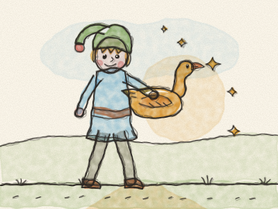
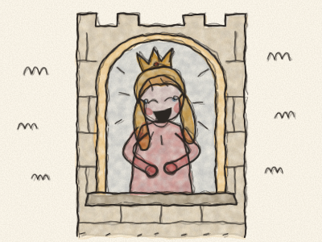

# The Golden Goose

Once upon a time, there were three brothers. The youngest was called Hans, and everybody laughed at him, because he was small and a little bit dreamy.

One day, the eldest brother went into the forest to chop wood. His mother gave him a big sweet cake and a bottle of juice. In the forest, he met a little grey old man.

“Good morning,” said the little old man. “I’m so hungry. Will you share your cake with me?”

“Certainly not!” said the eldest brother. “It’s all for me.” He began to chop, and — *ouch!* — he hit his own toe with the axe handle. He hopped home, grumbling.

The next day, the second brother went. He met the little grey old man too. “Will you share your cake with me?” “Certainly not!” *Chop, chop… ouch!* He bumped his knee and limped home, grumbling.

“Now I’ll go,” said Hans. His mother gave him only a dry crust of bread and some water. In the forest, there was the little grey old man.

“Will you share your lunch with me?”

“Of course,” said Hans. “It’s not much, but let’s share it.” They sat down on a log, and when Hans opened his bag — *oh!* — the dry crust had become a big sweet cake, and the water had become juice!

When they had eaten every crumb, the little old man said, “You have a kind heart. Chop down that old tree, and you will find something among its roots.” Hans chopped, *chop, chop, chop*, and the tree fell. Among the roots sat a goose with feathers of shining gold.

Hans tucked the goose under his arm and went off to see the world. That night he stopped at an inn. The innkeeper had three daughters, and when they saw the golden goose, they each wanted a golden feather.

While Hans was asleep, the eldest daughter crept up and touched the goose. Her hand stuck fast! The second daughter tried to pull her sister away, and — stuck! The third touched the second, and — stuck too!

In the morning, Hans picked up his goose and walked off, and the three sisters had to run behind him, all in a row. *Hop, hop, hop!*

A parson saw them. “Girls! Running after a young man? Shame on you!” He grabbed the youngest by the sleeve, and — stuck! Then the sexton tried to pull the parson free — stuck! Then two farmers with spades — stuck, stuck!

Now there were seven people running behind Hans and his goose, in a long wobbly line. *Hop, hop, hop! Oops! Hop, hop!*

In that country lived a King whose daughter was very, very sad. She never, ever laughed. The King had said: “Whoever makes my daughter laugh may marry her.”

Hans marched straight past the palace with his golden goose and his long line of stuck people. They were tripping and bumping and hopping and puffing. The parson’s hat fell over his eyes. The farmers’ spades went *clang, clang*.

The Princess looked out of her window. Her mouth twitched. Her nose wiggled. And then she laughed, and laughed, and laughed! *Ha ha ha! Hee hee hee!*

The moment she laughed — *pop!* — everybody came unstuck and fell in a heap on the grass.

The Princess ran down to meet Hans. “You made me laugh,” she said, “and I think you are very kind.” They became the best of friends, and later they were married, with a golden goose at the wedding.

And everyone who had laughed at Hans had to agree: he was not silly at all.

> A kind heart that shares is worth more than gold.
