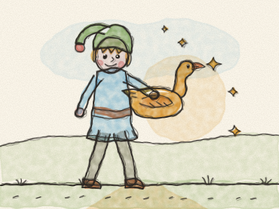
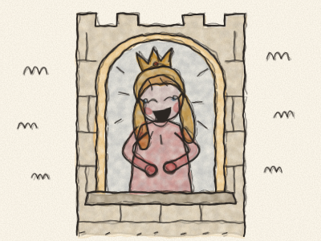

# L’Oie d’or

Il était une fois trois frères. Le plus jeune s’appelait Hans, et tout le monde se moquait de lui, parce qu’il était petit et un peu rêveur.

Un jour, l’aîné partit couper du bois dans la forêt. Sa maman lui donna un gros gâteau bien sucré et une bouteille de jus de fruits. Dans la forêt, il rencontra un petit vieux tout gris.

« Bonjour, » dit le petit vieux. « J’ai tellement faim. Veux-tu partager ton gâteau avec moi ? »

« Certainement pas ! » dit l’aîné. « Il est tout pour moi. » Il se mit à couper du bois, et — *aïe !* — il se cogna l’orteil avec le manche de la hache. Il rentra à cloche-pied, en ronchonnant.

Le lendemain, ce fut le tour du deuxième frère. Il rencontra lui aussi le petit vieux tout gris. « Veux-tu partager ton gâteau avec moi ? » « Certainement pas ! » *Tchac, tchac… aïe !* Il se cogna le genou et rentra en boitant, en ronchonnant.

« Maintenant, c’est moi qui y vais, » dit Hans. Sa maman ne lui donna qu’une croûte de pain sec et un peu d’eau. Dans la forêt, le petit vieux tout gris était là.

« Veux-tu partager ton repas avec moi ? »

« Bien sûr, » dit Hans. « Ce n’est pas grand-chose, mais partageons-le. » Ils s’assirent sur un tronc, et quand Hans ouvrit son sac — *oh !* — la croûte sèche était devenue un gros gâteau sucré, et l’eau était devenue du jus de fruits !

Quand ils eurent mangé jusqu’à la dernière miette, le petit vieux dit : « Tu as bon cœur. Coupe ce vieil arbre, et tu trouveras quelque chose entre ses racines. » Hans coupa, *tchac, tchac, tchac*, et l’arbre tomba. Entre les racines, il y avait une oie aux plumes d’or brillantes.

Hans prit l’oie sous son bras et partit voir du pays. Le soir, il s’arrêta dans une auberge. L’aubergiste avait trois filles, et quand elles virent l’oie d’or, chacune voulut une plume d’or.

Pendant que Hans dormait, l’aînée s’approcha sur la pointe des pieds et toucha l’oie. Sa main resta collée ! La deuxième voulut tirer sa sœur, et — collée ! La troisième toucha la deuxième, et — collée, elle aussi !

Le matin, Hans prit son oie et s’en alla, et les trois sœurs durent courir derrière lui, toutes en file. *Hop, hop, hop !*

Un curé les vit. « Mesdemoiselles ! Courir après un jeune homme ? Quelle honte ! » Il attrapa la plus jeune par la manche, et — collé ! Puis le sacristain voulut tirer le curé — collé ! Puis deux paysans avec leurs pelles — collés, collés !

Maintenant, il y avait sept personnes qui couraient derrière Hans et son oie, en une longue file toute tordue. *Hop, hop, hop ! Oups ! Hop, hop !*

Dans ce pays vivait un Roi dont la fille était très, très triste. Elle ne riait jamais, jamais. Le Roi avait dit : « Celui qui fera rire ma fille pourra l’épouser. »

Hans passa tout droit devant le palais, avec son oie d’or et sa longue file de gens collés. Ils trébuchaient, se cognaient, sautillaient et soufflaient. Le chapeau du curé lui tomba sur les yeux. Les pelles des paysans faisaient *clang, clang*.

La Princesse regarda par sa fenêtre. Sa bouche frémit. Son nez remua. Et puis elle rit, et rit, et rit ! *Ha ha ha ! Hi hi hi !*

Au moment même où elle rit — *pop !* — tout le monde se décolla et tomba en tas dans l’herbe.

La Princesse descendit en courant à la rencontre de Hans. « Tu m’as fait rire, » dit-elle, « et je crois que tu es très gentil. » Ils devinrent les meilleurs amis du monde, et plus tard ils se marièrent, avec une oie d’or au mariage.

Et tous ceux qui s’étaient moqués de Hans durent bien l’admettre : il n’était pas sot du tout.

> Un bon cœur qui partage vaut plus que tout l’or du monde.
