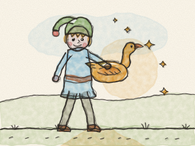
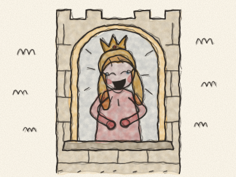

# A Gansa de Ouro

Era uma vez três irmãos. O mais novo chamava-se Hans, e toda a gente se ria dele, porque era pequeno e um bocadinho sonhador.

Um dia, o irmão mais velho foi à floresta cortar lenha. A mãe deu-lhe um grande bolo docinho e uma garrafa de sumo. Na floresta, encontrou um velhinho pequeno, todo cinzento.

— Bom dia — disse o velhinho. — Tenho tanta fome. Partilhas o teu bolo comigo?

— Nem pensar! — disse o irmão mais velho. — É tudo para mim. — Começou a cortar lenha e — *ai!* — bateu com o cabo do machado no próprio pé. Voltou para casa ao pé-coxinho, a resmungar.

No dia seguinte, foi o segundo irmão. Também encontrou o velhinho cinzento. — Partilhas o teu bolo comigo? — Nem pensar! — *Tchac, tchac… ai!* Bateu com o joelho e voltou para casa a coxear, a resmungar.

— Agora vou eu — disse o Hans. A mãe deu-lhe só uma côdea de pão seco e um pouco de água. Na floresta, lá estava o velhinho cinzento.

— Partilhas o teu almoço comigo?

— Claro que sim — disse o Hans. — Não é muito, mas vamos partilhar. — Sentaram-se num tronco e, quando o Hans abriu o saco — *oh!* — a côdea seca tinha-se transformado num grande bolo docinho, e a água em sumo!

Quando comeram até à última migalha, o velhinho disse: — Tens bom coração. Corta aquela árvore velha e vais encontrar uma coisa no meio das raízes. — O Hans cortou, *tchac, tchac, tchac*, e a árvore caiu. No meio das raízes estava uma gansa com penas de ouro brilhantes.

O Hans pôs a gansa debaixo do braço e partiu para conhecer o mundo. À noite, parou numa estalagem. O estalajadeiro tinha três filhas e, quando viram a gansa de ouro, cada uma quis uma pena de ouro.

Enquanto o Hans dormia, a mais velha aproximou-se em bicos de pés e tocou na gansa. A mão ficou-lhe colada! A segunda quis puxar a irmã e — colada! A terceira tocou na segunda e — colada também!

De manhã, o Hans pegou na gansa e foi-se embora, e as três irmãs tiveram de correr atrás dele, todas em fila. *Hop, hop, hop!*

Um padre viu-as. — Meninas! A correr atrás de um rapaz? Que vergonha! — Agarrou a mais nova pela manga e — colado! Depois o sacristão quis puxar o padre — colado! Depois dois lavradores com as pás — colados, colados!

Agora havia sete pessoas a correr atrás do Hans e da gansa, numa longa fila toda torta. *Hop, hop, hop! Ups! Hop, hop!*

Naquele país vivia um Rei cuja filha andava muito, muito triste. Nunca, mas nunca, se ria. O Rei tinha dito: — Quem fizer a minha filha rir poderá casar com ela.

O Hans passou mesmo em frente ao palácio, com a gansa de ouro e a sua longa fila de pessoas coladas. Tropeçavam, chocavam uns com os outros, saltitavam e bufavam. O chapéu do padre caiu-lhe para cima dos olhos. As pás dos lavradores faziam *clang, clang*.

A Princesa olhou pela janela. A boca tremeu-lhe. O nariz mexeu-se. E depois riu-se, e riu-se, e riu-se! *Ah ah ah! Ih ih ih!*

No preciso momento em que ela se riu — *pop!* — toda a gente se descolou e caiu num monte em cima da relva.

A Princesa desceu a correr ao encontro do Hans. — Fizeste-me rir — disse ela — e acho que és muito bondoso. — Ficaram os melhores amigos do mundo e, mais tarde, casaram-se, com uma gansa de ouro na festa.

E todos os que se tinham rido do Hans tiveram de admitir: ele não era nada tolo.

> Um bom coração que partilha vale mais do que todo o ouro do mundo.
