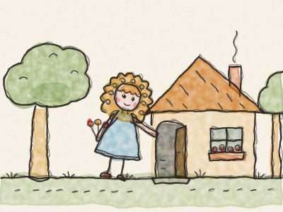
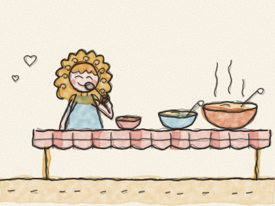
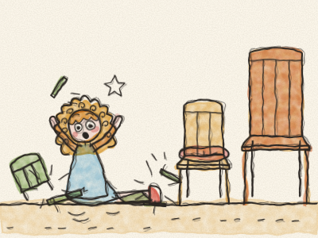
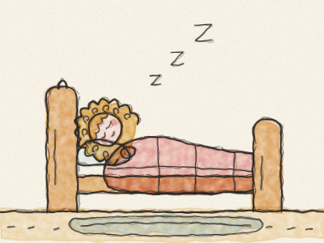
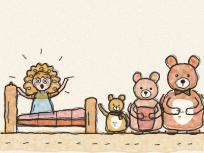

# Goldilocks and the Three Bears

Once upon a time, in a little cottage in the woods, there lived three bears. There was a great big Daddy Bear, a middle-sized Mummy Bear, and a tiny little Baby Bear.

One morning, Mummy Bear made porridge for breakfast. But it was much too hot to eat. “Let’s go for a walk in the woods while it cools down,” said Daddy Bear. So off they went, and they left the door open.

Not far away lived a little girl with golden curls. Everybody called her Goldilocks. That morning, she was picking flowers in the woods when she saw the little cottage. “Hello?” she called. Nobody answered. So Goldilocks walked right in. *(She didn’t knock. Should she have knocked?)*

On the table were three bowls of porridge. Goldilocks was hungry, so she tasted the porridge in the great big bowl. “Ouch! This porridge is too hot!”

She tasted the porridge in the middle-sized bowl. “Brrr! This porridge is too cold!”

Then she tasted the porridge in the tiny little bowl. “Mmm! This porridge is just right!” And she ate it all up. *Slurp, slurp, slurp.*

Then Goldilocks wanted to sit down. She climbed onto the great big chair. “This chair is too hard!”

She sat in the middle-sized chair. “This chair is too soft!” She sank right down into the cushions.

Then she sat in the tiny little chair. “This chair is just right!” But she wriggled, and she wiggled, and — *CRACK!* — the tiny little chair broke into pieces, and Goldilocks landed on the floor. *Bump!*

Now Goldilocks felt very tired. She went upstairs, where there were three beds. She lay on the great big bed. “This bed is too high!” She lay on the middle-sized bed. “This bed is too low!”

Then she lay on the tiny little bed. “This bed is just right,” she yawned. And she fell fast asleep. *Zzzz…*

Soon the three bears came home. Daddy Bear looked at his bowl. “Somebody’s been eating my porridge!” he said in his great big voice.

“Somebody’s been eating my porridge!” said Mummy Bear in her middle-sized voice.

“Somebody’s been eating my porridge,” said Baby Bear in his tiny little voice, “and they’ve eaten it all up!”

“Somebody’s been sitting in my chair!” growled Daddy Bear. “Somebody’s been sitting in my chair!” said Mummy Bear. “Somebody’s been sitting in my chair,” squeaked Baby Bear, “and they’ve broken it!”

The three bears tiptoed upstairs. *Creak, creak, creak.* “Somebody’s been sleeping in my bed!” said Daddy Bear. “Somebody’s been sleeping in my bed!” said Mummy Bear.

“Somebody’s been sleeping in my bed,” said Baby Bear, “and SHE’S STILL THERE!”

Goldilocks opened her eyes and saw three bears looking at her. “Oh!” she cried, and she jumped out of bed. Her cheeks went pink. “I’m so sorry,” she said. “I came into your house without asking. I ate your porridge and I broke your chair.”

The bears looked at each other. “Well,” said Mummy Bear kindly, “thank you for saying sorry.”

So Goldilocks helped Daddy Bear to mend the tiny chair, and Mummy Bear made a new pot of porridge, just right, for everyone. And from then on, whenever Goldilocks visited the cottage in the woods, she always knocked on the door first. *Knock, knock!*

> Always ask before you go into someone’s home or take their things. And if you make a mistake, say sorry.
