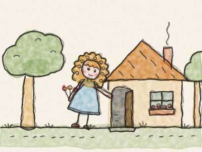
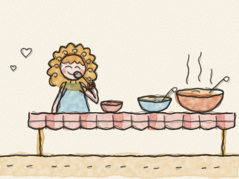
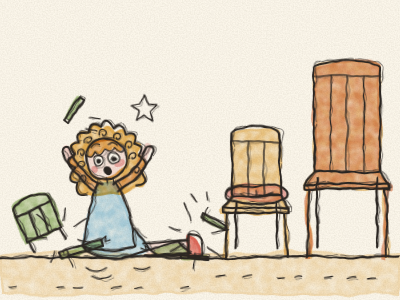
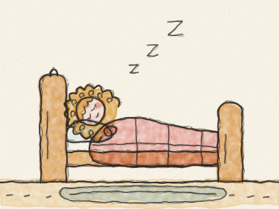
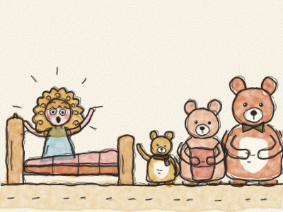

# Boucle d’or et les Trois Ours

Il était une fois, dans une petite maison au fond des bois, trois ours. Il y avait un très grand Papa Ours, une Maman Ours de taille moyenne, et un tout petit Bébé Ours.

Un matin, Maman Ours prépara de la bouillie pour le petit déjeuner. Mais elle était bien trop chaude pour être mangée. « Allons faire une promenade dans les bois en attendant qu’elle refroidisse », dit Papa Ours. Et ils partirent, en laissant la porte ouverte.

Non loin de là vivait une petite fille aux boucles dorées. Tout le monde l’appelait Boucle d’or. Ce matin-là, elle cueillait des fleurs dans les bois quand elle aperçut la petite maison. « Il y a quelqu’un ? » appela-t-elle. Personne ne répondit. Alors Boucle d’or entra tout droit. *(Elle n’a pas frappé. Aurait-elle dû frapper ?)*

Sur la table, il y avait trois bols de bouillie. Boucle d’or avait faim, alors elle goûta la bouillie du très grand bol. « Aïe ! Cette bouillie est trop chaude ! »

Elle goûta la bouillie du bol moyen. « Brrr ! Cette bouillie est trop froide ! »

Puis elle goûta la bouillie du tout petit bol. « Mmm ! Cette bouillie est parfaite ! » Et elle la mangea jusqu’au bout. *Slurp, slurp, slurp.*

Ensuite, Boucle d’or eut envie de s’asseoir. Elle grimpa sur la très grande chaise. « Cette chaise est trop dure ! »

Elle s’assit dans la chaise moyenne. « Cette chaise est trop molle ! » Elle s’enfonça tout au fond des coussins.

Puis elle s’assit sur la toute petite chaise. « Cette chaise est parfaite ! » Mais elle se tortilla, et se trémoussa, et — *CRAC !* — la toute petite chaise se cassa en morceaux, et Boucle d’or tomba par terre. *Boum !*

Maintenant, Boucle d’or se sentait très fatiguée. Elle monta à l’étage, où il y avait trois lits. Elle s’allongea sur le très grand lit. « Ce lit est trop haut ! » Elle s’allongea sur le lit moyen. « Ce lit est trop bas ! »

Puis elle s’allongea sur le tout petit lit. « Ce lit est parfait », bâilla-t-elle. Et elle s’endormit profondément. *Zzzz…*

Bientôt, les trois ours rentrèrent. Papa Ours regarda son bol. « Quelqu’un a mangé ma bouillie ! » dit-il de sa très grosse voix.

« Quelqu’un a mangé ma bouillie ! » dit Maman Ours de sa voix moyenne.

« Quelqu’un a mangé ma bouillie, dit Bébé Ours de sa toute petite voix, et il l’a toute finie ! »

« Quelqu’un s’est assis sur ma chaise ! » grogna Papa Ours. « Quelqu’un s’est assis sur ma chaise ! » dit Maman Ours. « Quelqu’un s’est assis sur ma chaise, couina Bébé Ours, et il l’a cassée ! »

Les trois ours montèrent l’escalier sur la pointe des pieds. *Cric, crac, cric.* « Quelqu’un s’est couché dans mon lit ! » dit Papa Ours. « Quelqu’un s’est couché dans mon lit ! » dit Maman Ours.

« Quelqu’un s’est couché dans mon lit, dit Bébé Ours, et ELLE EST ENCORE LÀ ! »

Boucle d’or ouvrit les yeux et vit trois ours qui la regardaient. « Oh ! » s’écria-t-elle, et elle sauta du lit. Ses joues devinrent toutes roses. « Je suis désolée, dit-elle. Je suis entrée chez vous sans demander. J’ai mangé votre bouillie et j’ai cassé votre chaise. »

Les ours se regardèrent. « Eh bien, dit gentiment Maman Ours, merci de nous demander pardon. »

Alors Boucle d’or aida Papa Ours à réparer la toute petite chaise, et Maman Ours fit une nouvelle marmite de bouillie, parfaite, pour tout le monde. Et depuis ce jour, chaque fois que Boucle d’or venait rendre visite à la maison des bois, elle frappait toujours à la porte d’abord. *Toc, toc !*

> On demande toujours avant d’entrer chez quelqu’un ou de prendre ses affaires. Et quand on fait une bêtise, on dit pardon.
