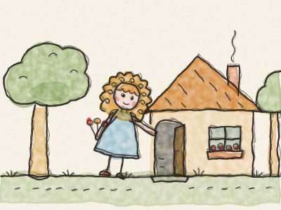
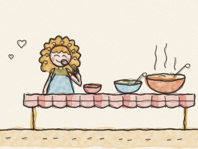
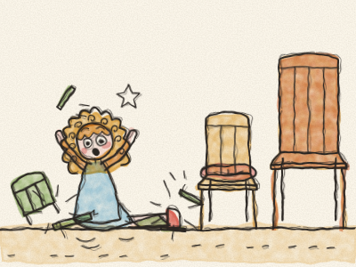
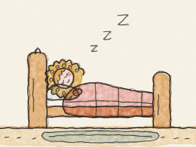
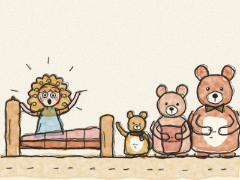

# Caracóis Dourados e os Três Ursos

Era uma vez, numa casinha no meio do bosque, três ursos. Havia um Papá Urso muito grande, uma Mamã Ursa de tamanho médio e um Bebé Urso pequenino.

Uma manhã, a Mamã Ursa fez papas de aveia para o pequeno-almoço. Mas estavam quentes demais para se comerem. — Vamos dar um passeio pelo bosque enquanto arrefecem — disse o Papá Urso. E lá foram, deixando a porta aberta.

Ali perto vivia uma menina de caracóis dourados. Toda a gente lhe chamava Caracóis Dourados. Nessa manhã, andava a apanhar flores no bosque quando viu a casinha. — Está alguém? — chamou ela. Ninguém respondeu. Então a Caracóis Dourados entrou, sem mais nem menos. *(Ela não bateu à porta. Devia ter batido?)*

Em cima da mesa havia três tigelas de papas. A Caracóis Dourados tinha fome, por isso provou as papas da tigela muito grande. — Ai! Estas papas estão quentes demais!

Provou as papas da tigela média. — Brrr! Estas papas estão frias demais!

Depois provou as papas da tigela pequenina. — Hum! Estas papas estão mesmo boas! — E comeu-as todas. *Slurp, slurp, slurp.*

A seguir, a Caracóis Dourados quis sentar-se. Subiu para a cadeira muito grande. — Esta cadeira é dura demais!

Sentou-se na cadeira média. — Esta cadeira é mole demais! — E afundou-se nas almofadas.

Depois sentou-se na cadeira pequenina. — Esta cadeira é mesmo boa! — Mas mexeu-se, e remexeu-se, e — *CRAC!* — a cadeira pequenina partiu-se em bocados, e a Caracóis Dourados caiu no chão. *Pumba!*

Agora a Caracóis Dourados sentia-se muito cansada. Subiu ao andar de cima, onde havia três camas. Deitou-se na cama muito grande. — Esta cama é alta demais! — Deitou-se na cama média. — Esta cama é baixa demais!

Depois deitou-se na cama pequenina. — Esta cama é mesmo boa — bocejou ela. E adormeceu profundamente. *Zzzz…*

Pouco depois, os três ursos voltaram para casa. O Papá Urso olhou para a sua tigela. — Alguém andou a comer as minhas papas! — disse ele com o seu vozeirão.

— Alguém andou a comer as minhas papas! — disse a Mamã Ursa com a sua voz média.

— Alguém andou a comer as minhas papas — disse o Bebé Urso com a sua vozinha — e comeu-as todas!

— Alguém se sentou na minha cadeira! — rosnou o Papá Urso. — Alguém se sentou na minha cadeira! — disse a Mamã Ursa. — Alguém se sentou na minha cadeira — guinchou o Bebé Urso — e partiu-a!

Os três ursos subiram as escadas em bicos de pés. *Rec, rec, rec.* — Alguém se deitou na minha cama! — disse o Papá Urso. — Alguém se deitou na minha cama! — disse a Mamã Ursa.

— Alguém se deitou na minha cama — disse o Bebé Urso — e AINDA ESTÁ CÁ!

A Caracóis Dourados abriu os olhos e viu três ursos a olhar para ela. — Oh! — gritou, e saltou da cama. Ficou com as bochechas cor-de-rosa. — Desculpem — disse ela. — Entrei na vossa casa sem pedir. Comi as vossas papas e parti a vossa cadeira.

Os ursos olharam uns para os outros. — Bem — disse a Mamã Ursa com carinho —, obrigada por pedires desculpa.

Então a Caracóis Dourados ajudou o Papá Urso a arranjar a cadeira pequenina, e a Mamã Ursa fez uma nova panela de papas, mesmo boas, para todos. E a partir desse dia, sempre que a Caracóis Dourados ia visitar a casinha do bosque, batia primeiro à porta. *Truz, truz!*

> Pede sempre antes de entrares em casa de alguém ou de mexeres nas suas coisas. E quando fizeres asneira, pede desculpa.
