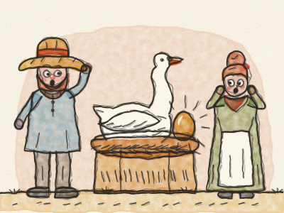

# The Goose That Laid the Golden Eggs

Once upon a time, a farmer and his wife had a fat white goose. *Honk, honk!*

One morning, the farmer went to look in her nest. And there, in the straw, was an egg. But not an ordinary egg. It was yellow, and shiny, and very, very heavy. It was made of gold!

“Wife! Wife!” he shouted. “Come and see!”

The next morning, there was another golden egg. And the next morning, another one. Every day, the goose laid one beautiful golden egg. *Honk!* And every day, the farmer and his wife grew a little richer.

But the farmer was not happy. “One egg a day is too slow,” he grumbled. “I want all the eggs, and I want them now!”

So he stomped into the barn. “Come on, goose!” he shouted. “Lay more! Lay faster!” And he shook the nest. *Shake, shake, shake!*

*(Ask Constance: do you think the goose liked that?)*

The goose did not like that one bit. *HONK!* She flapped her big white wings, flew out of the barn, over the hedge and far, far away. *Flap, flap, flap.*

And she never came back.

The next morning, the nest was empty. No goose. No golden egg. Just a little bit of straw.

“Oh dear,” said the farmer. “If only I had been patient, and gentle, and happy with one egg a day.”

> Be happy with what you have, and don’t be greedy: if you want everything at once, you may end up with nothing.
