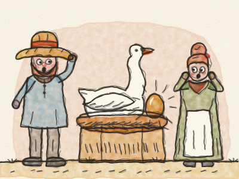

# L’Oie aux œufs d’or

Il était une fois un fermier et sa femme qui avaient une grosse oie blanche. *Couin, couin !*

Un matin, le fermier alla regarder dans son nid. Et là, dans la paille, il y avait un œuf. Mais pas un œuf ordinaire. Il était jaune, brillant, et très, très lourd. Il était en or !

« Ma femme ! Ma femme ! cria-t-il. Viens voir ! »

Le lendemain matin, il y avait un autre œuf d’or. Et le matin d’après, encore un. Chaque jour, l’oie pondait un magnifique œuf d’or. *Couin !* Et chaque jour, le fermier et sa femme devenaient un peu plus riches.

Mais le fermier n’était pas content. « Un œuf par jour, c’est trop lent, grogna-t-il. Je veux tous les œufs, et je les veux tout de suite ! »

Alors il entra dans la grange en tapant des pieds. « Allez, l’oie ! cria-t-il. Ponds-en plus ! Ponds plus vite ! » Et il secoua le nid. *Secoue, secoue, secoue !*

*(Demandez à Constance : à ton avis, l’oie a-t-elle aimé ça ?)*

L’oie n’aima pas ça du tout. *COUIN !* Elle battit de ses grandes ailes blanches, s’envola hors de la grange, par-dessus la haie, et loin, très loin. *Flap, flap, flap.*

Et elle ne revint jamais.

Le lendemain matin, le nid était vide. Plus d’oie. Plus d’œuf d’or. Juste un peu de paille.

« Oh là là, dit le fermier. Si seulement j’avais été patient, et doux, et content d’un œuf par jour. »

> L’avarice perd tout en voulant tout gagner.
