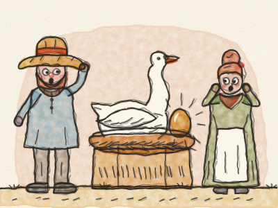

# A Gansa dos Ovos de Ouro

Era uma vez um lavrador e a mulher que tinham uma gansa branca e gorda. *Qué, qué!*

Uma manhã, o lavrador foi espreitar o ninho dela. E ali, na palha, estava um ovo. Mas não era um ovo qualquer. Era amarelo, brilhante, e muito, muito pesado. Era de ouro!

— Mulher! Mulher! — gritou ele. — Anda cá ver!

Na manhã seguinte, havia outro ovo de ouro. E na manhã a seguir, mais um. Todos os dias, a gansa punha um lindo ovo de ouro. *Qué!* E todos os dias, o lavrador e a mulher ficavam um bocadinho mais ricos.

Mas o lavrador não estava contente. — Um ovo por dia é muito devagar — resmungou ele. — Quero os ovos todos, e quero-os já!

Então entrou no celeiro a bater com os pés. — Vá lá, gansa! — gritou. — Põe mais! Põe mais depressa! — E sacudiu o ninho. *Abana, abana, abana!*

*(Pergunte à Constance: achas que a gansa gostou disso?)*

A gansa não gostou nada disso. *QUÉ!* Bateu as grandes asas brancas, saiu a voar do celeiro, por cima da sebe, para muito, muito longe. *Flap, flap, flap.*

E nunca mais voltou.

Na manhã seguinte, o ninho estava vazio. Nada de gansa. Nada de ovo de ouro. Só um bocadinho de palha.

— Ai, ai — disse o lavrador. — Se ao menos eu tivesse sido paciente, e meigo, e contente com um ovo por dia.

> Quem tudo quer, tudo perde.
